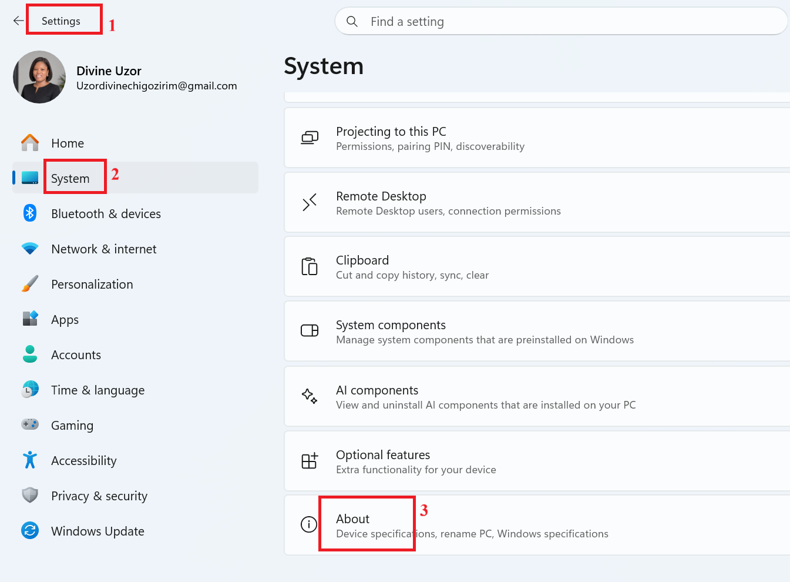
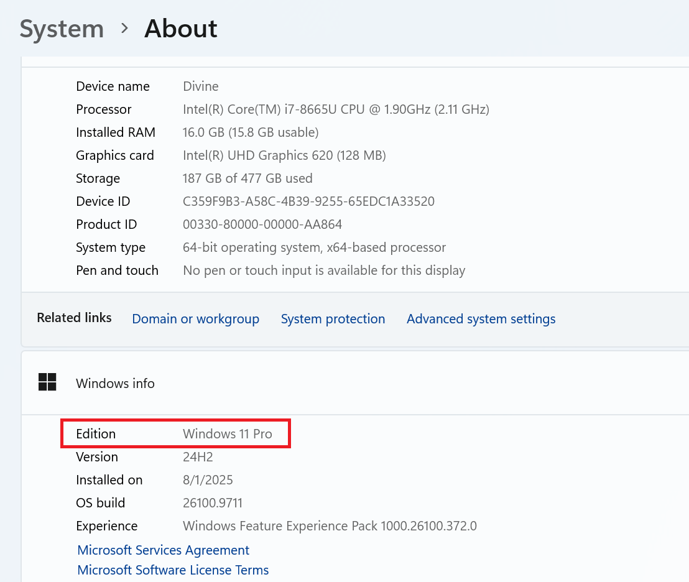
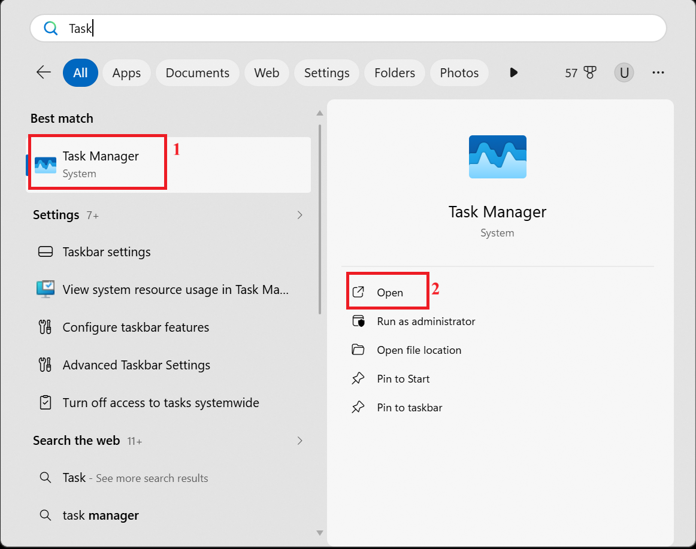
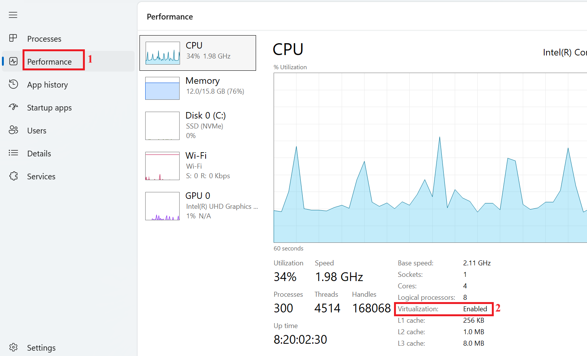
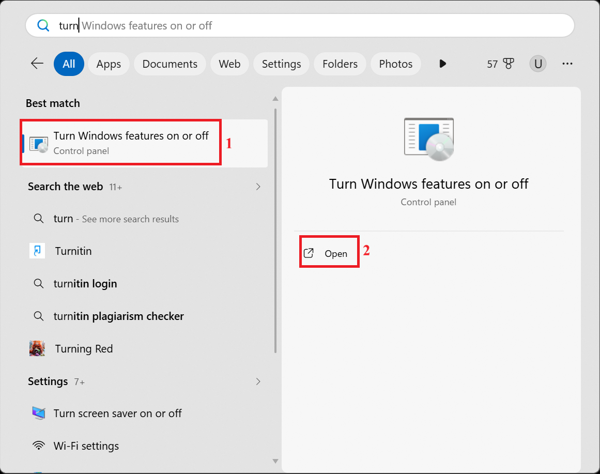
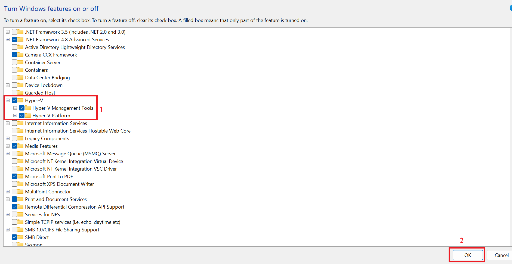
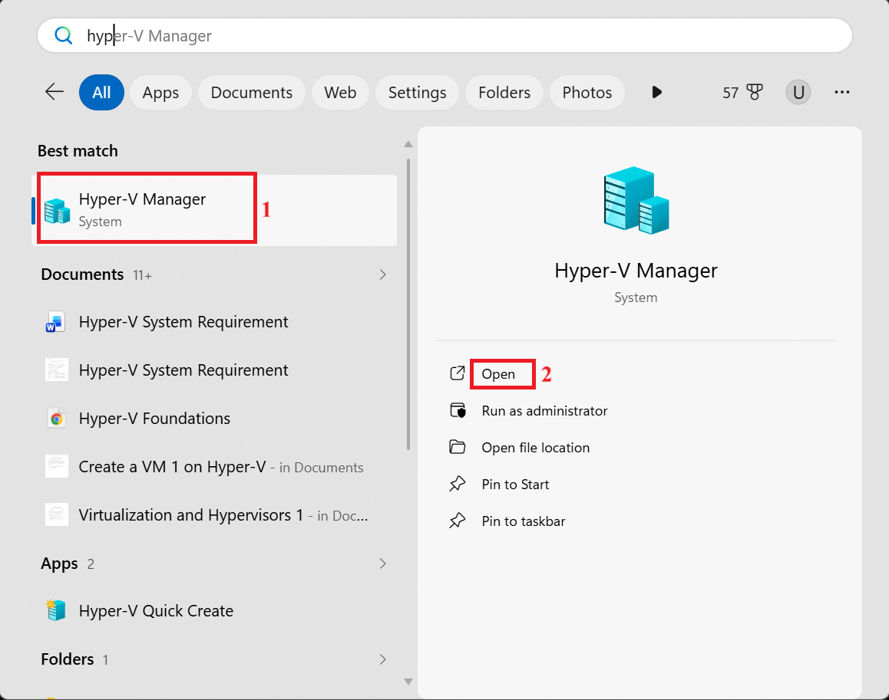
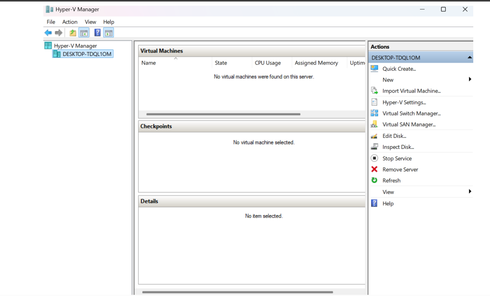

# Lab 01: System Requirements and Enabling Hyper-V

## Overview

Before creating virtual machines with Microsoft Hyper-V, verify that the computer supports the required virtualization features and that the Windows edition supports Hyper-V.

This lab covers checking the Windows edition, reviewing hardware and virtualization requirements, enabling Hyper-V, restarting the computer, and confirming that Hyper-V Manager is available.

## Objectives

By the end of this lab, you should be able to:

- Check whether your Windows edition supports Hyper-V.
- Identify the minimum hardware and virtualization requirements.
- Check whether hardware virtualization is enabled.
- Enable Hyper-V through Windows Features.
- Restart Windows to complete installation.
- Verify that Hyper-V Manager is available.

## Prerequisites

- A Windows computer running a supported edition of Windows.
- Access to Windows settings and Windows Features with permission to enable optional Windows features.
- Hardware virtualization support enabled in the computer's BIOS/UEFI.
- Administrator access may be required to enable Hyper-V and restart the computer.

## System requirements

The original lab guide lists the following requirements:

| Requirement | Description |
|---|---|
| Operating system | Windows 10/11 Pro, Enterprise, or Education. Hyper-V is not available on Windows Home by default. |
| Processor | 64-bit CPU with Second Level Address Translation (SLAT). |
| RAM | Minimum 4 GB; 8 GB or more recommended. |
| Hardware virtualization | Intel VT-x or AMD-V enabled in BIOS/UEFI. |
| Data Execution Prevention (DEP) | Hardware-enforced DEP enabled. |

These are the requirements listed in the source lab. Actual performance will depend on the host computer and the virtual machines you plan to run.

## Procedure 1: Check your Windows edition

1. Open **Settings**.
2. Select **System**.
3. Select **About**.

4. Review the Windows specifications to identify your Windows edition.

Confirm that the installed edition supports Hyper-V before continuing.

## Procedure 2: Check whether virtualization is enabled

1. Open **Task Manager**.

2. Select the **Performance** tab.
3. Find the **Virtualization** entry and check that it says **Enabled**.

If virtualization is disabled, check your computer manufacturer's instructions for enabling Intel VT-x or AMD-V in BIOS/UEFI. The exact menu and wording depend on the computer.

## Procedure 3: Open Windows Features

1. Select **Start** or press the **Windows** key.
2. Search for `Turn Windows features on or off`.
3. Open the matching result.

## Procedure 4: Enable Hyper-V

1. In the **Windows Features** window, locate **Hyper-V**.
2. Select the **Hyper-V** checkbox.
3. Allow Windows to select the required Hyper-V components.
4. Select **OK**.

Windows will begin applying the requested changes.

## Procedure 5: Complete installation and restart

1. Wait while Windows searches for the required files and installs Hyper-V.
2. When prompted, select **Restart now**.
3. Allow the computer to restart before trying to use Hyper-V.

Save any open work before restarting.

## Procedure 6: Verify Hyper-V installation

1. After the computer restarts, open **Start**.
2. Search for **Hyper-V Manager**.
3. Confirm that Hyper-V Manager appears in the search results.
4. Open Hyper-V Manager to check that it launches.

If Hyper-V Manager is available, the installation step has completed. Hyper-V is ready for you to begin preparing virtual machines, subject to the host's configuration and available resources.

## Troubleshooting notes

- **Hyper-V is not listed in Windows Features:** Confirm that the Windows edition supports Hyper-V and that the computer meets the virtualization requirements.
- **Virtualization is disabled:** Check BIOS/UEFI settings and your computer manufacturer's documentation.
- **Hyper-V Manager does not appear after restarting:** Recheck the Windows Features selection and whether installation completed successfully.

## Outcome

This lab checks the host computer's Hyper-V compatibility, enables the Hyper-V feature, and verifies that Hyper-V Manager is available.

## Next step

Continue to **Lab 02: Preparing the Environment and Creating a Windows Server 2019 Virtual Machine** to prepare the virtual machine environment.
