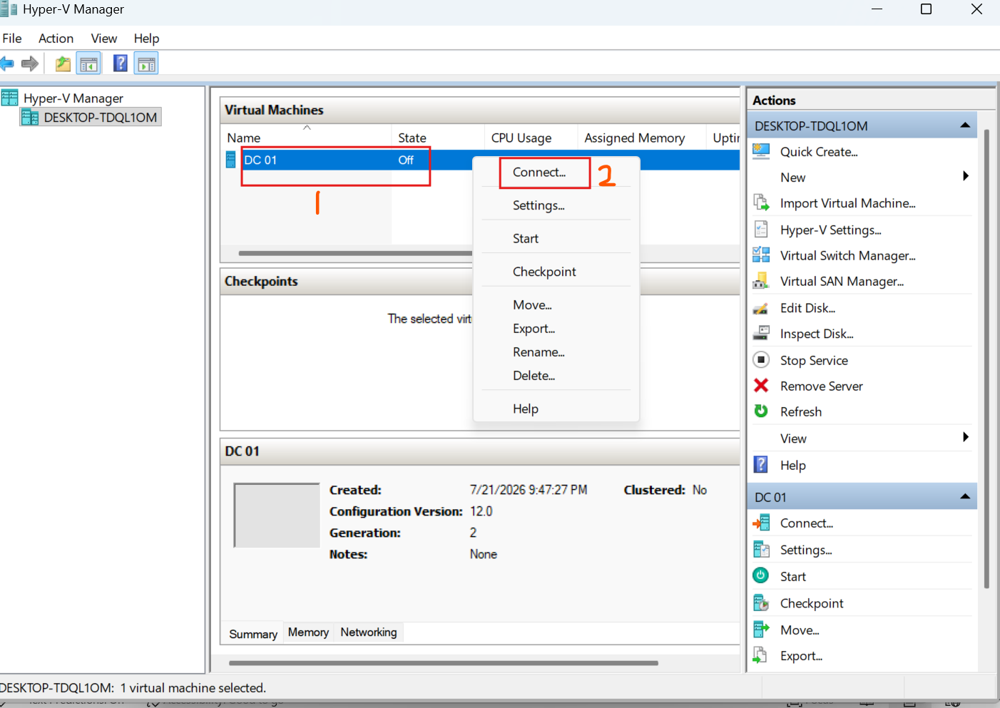
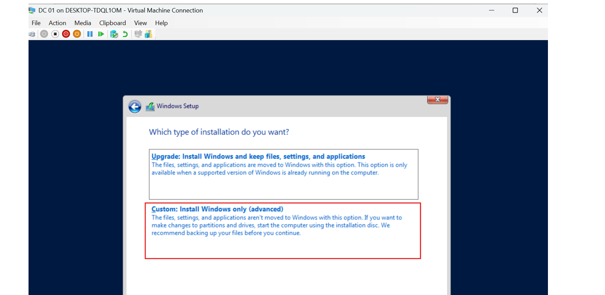
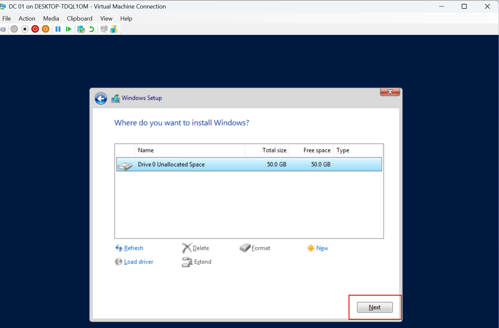
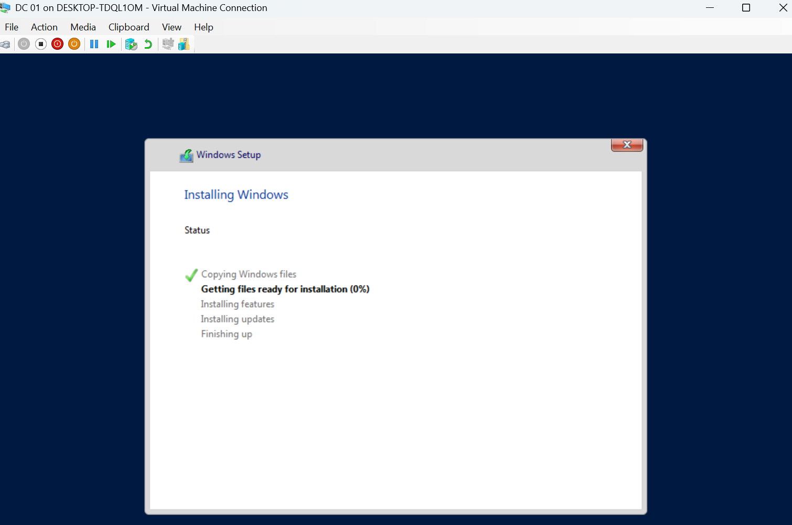
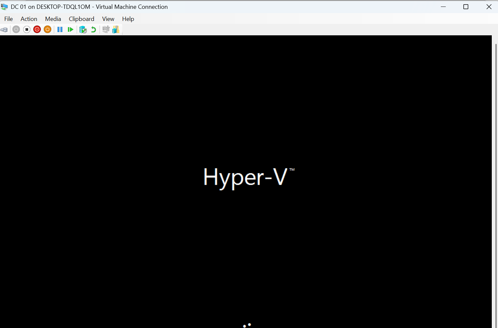
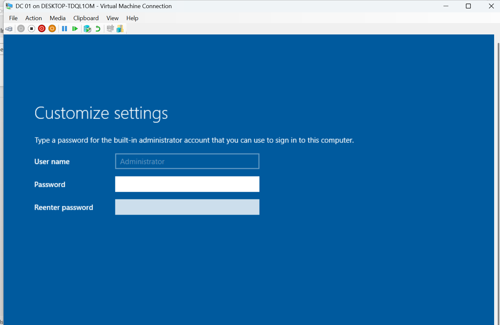
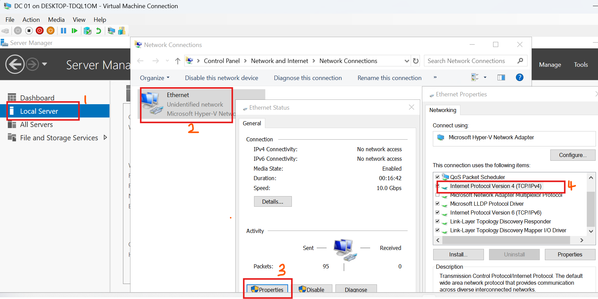
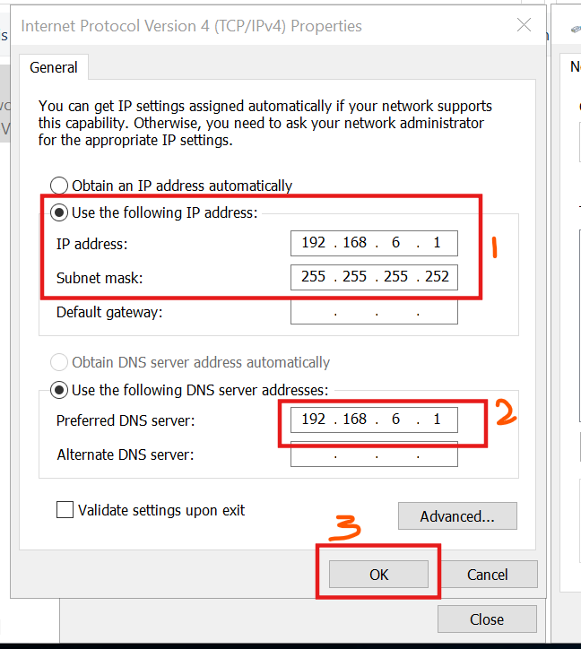
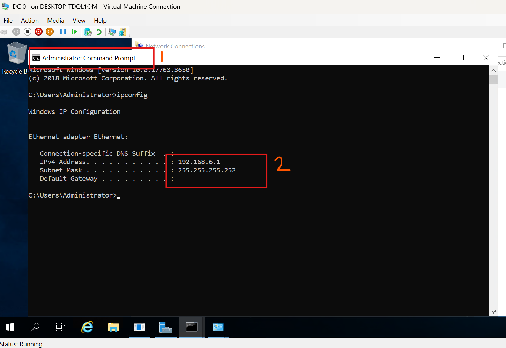
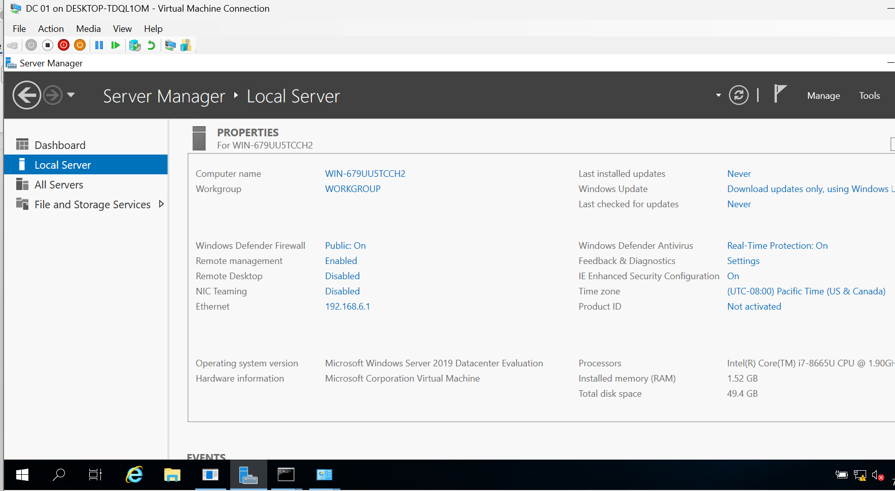

# Lab 03: Installing and Configuring Windows Server 2019

## Overview

This lab covers the installation and initial configuration of Windows Server 2019 on a Hyper-V virtual machine. It continues from [Lab 02: Building a Windows Server 2019 Lab](../Lab-02-Building-a-Windows-Server-2019-Lab/README.md), where the virtual machine was created but the operating system had not yet been installed.

The goal is to install Windows Server 2019, configure the built-in Administrator account, set a static IPv4 address, and verify the initial server configuration.

## Objectives

By completing this lab, you will:

- Start a Hyper-V virtual machine and boot from a Windows Server 2019 ISO.
- Install Windows Server 2019 Datacenter Evaluation with Desktop Experience.
- Set the built-in Administrator password.
- Configure a static IPv4 address.
- Verify the network configuration and Server Manager.

## Prerequisites

- A Windows host with Hyper-V enabled.
- The virtual machine created in Lab 02.
- A Windows Server 2019 ISO attached to the virtual machine.
- Sufficient memory and disk space for the virtual machine.

## Procedure 1: Start the Virtual Machine

1. Open **Hyper-V Manager**.
2. Select the Windows Server virtual machine.
3. Right-click the virtual machine and select **Connect**.
4. Start the virtual machine if it is powered off.
5. If the message `Press any key to boot from CD or DVD...` appears, press a key promptly to boot from the attached ISO.



## Procedure 2: Install Windows Server 2019

### Step 1: Start Windows Setup

When Windows Setup loads, select the appropriate language, time and currency format, and keyboard input method.
Select **Next**, then select **Install now**.

### Step 2: Select the Windows Server edition

Select **Windows Server 2019 Datacenter Evaluation (Desktop Experience)** when that is the edition available in your installation media.

The Desktop Experience option provides a graphical user interface for managing the server.


Accept the applicable license terms and choose **Custom: Install Windows only (advanced)** when prompted for the installation type. This is the only valid option for a brand-new virtual disk.




### Step 3: Choose the installation disk


Select the virtual disk's unallocated space, then continue with the installation. In this lab, the virtual disk was created with approximately 50 GB of capacity.




### Step 4: Allow installation to finish

Windows Setup copies files, installs features and updates, and restarts the virtual machine as needed. Allow the process to complete.




If prompted to boot from the ISO again after restarting, do not press a key unless you intend to restart the installation process.




## Procedure 3: Set the Administrator Password

After installation, Windows prompts you to set a password for the built-in **Administrator** account.

1. Enter a strong password.
2. Confirm the password.
3. Finish the setup process.
4. Sign in using the Administrator account and the password you created.

Store the password securely.



## Procedure 4: Configure the Network

### Step 1: Open the network settings

After signing in, open **Server Manager** and select **Local Server**.

Locate the Ethernet setting and open the network connection properties. The virtual machine uses the private virtual switch created in Lab 02.

A private Hyper-V switch does not provide DHCP by itself. Unless a DHCP server is available on the connected network, configure a static IPv4 address for communication with other lab machines.



### Step 2: Configure a static IPv4 address

Open the Ethernet adapter's properties, select **Internet Protocol Version 4 (TCP/IPv4)**, and open its properties.

Choose **Use the following IP address** and enter an address that matches your lab's network plan.


- **IP address:** `192.168.6.1`
- **Subnet mask:** `255.255.255.252`

**Important:** The example subnet mask is `/30`, which provides only two usable host addresses. It may not suit a lab containing multiple virtual machines. Use a subnet large enough for your planned domain controllers, client machines, and any other lab systems. Ensure every machine has a unique IP address in the correct subnet.

Do not configure a default gateway or DNS server unless your network design requires one. For a domain controller lab, DNS settings should be planned according to the Active Directory environment.



## Procedure 5: Verify the Configuration

### Step 1: Check the IP configuration

Open Command Prompt and run:

```cmd
ipconfig
```

Check that the Ethernet adapter displays the static IPv4 address and subnet mask you configured.



### Step 2: Confirm Server Manager is available

Open or return to Server Manager and confirm that the **Local Server** page loads.

At this stage, no additional server roles or features need to be installed as part of this lab. Those configurations can be completed in later labs.



## Expected Outcome

At the end of this lab:

- Windows Server 2019 is installed on the Hyper-V virtual machine.
- You can sign in using the built-in Administrator account.
- A static IPv4 address has been configured.
- The network settings can be verified with `ipconfig`.
- Server Manager opens successfully.

## Next Steps

The server is now ready for subsequent configuration labs. Future tasks can include hostname configuration, Active Directory Domain Services, DNS, domain controller setup, and joining client machines to the domain.

