# Lab 07: Everyday Windows Administration Tasks

## Managing Accounts, User Profiles, Permissions & Domain-Joined Devices

## Overview

Managing Windows environments involves more than creating user accounts and joining computers to a domain. IT administrators must also manage user profiles, control access permissions, monitor active sessions, troubleshoot workstation issues, maintain storage, and manage domain membership.

This lab demonstrates practical Windows administration tasks performed on a domain-joined Windows client within a Hyper-V environment. The exercises use the client workstation and domain controller already configured in the earlier labs, so no additional virtual machines are required.

The lab focuses on the everyday responsibilities commonly encountered in IT Support and junior Systems Administration, particularly when investigating account access, user profile behaviour, permissions, sign-in sessions, workstation maintenance, and domain connectivity.

## Lab Objectives

By completing this lab, I demonstrate how to:

- Inspect local accounts and verify local administrator group membership.
- Create and manage local Windows user accounts.
- Distinguish between local accounts and domain accounts.
- Observe how Windows creates a user profile at first sign-in.
- Verify profile isolation between different users.
- Understand how administrator privileges and file/folder permissions affect access.
- Add a standard user to the local Administrators group and remove that membership.
- Monitor active and disconnected user sessions.
- Remove and recreate a local user profile without deleting the underlying account.
- Use Disk Cleanup to remove selected temporary and system files.
- Move a workstation from a domain to a workgroup and rejoin it to the domain.
- Sign in with different domain user accounts and compare their local profile experiences.

## Lab Environment

| Component | Configuration |
|---|---|
| Virtualization platform | Microsoft Hyper-V |
| Client computer | Didi Client PC 1 |
| Client operating system | Windows 10 Pro |
| Domain controller | Existing Windows Server domain controller from earlier labs |
| Active Directory domain | `divineuzor.com` |
| Local administrator account | `Divineg` |
| Additional local accounts | `Elena Mike` and `Princess Sylvia` |
| Domain user examples | Cloud Engineer and Software Engineer |

> **Note:** The screenshots and steps in this lab reflect the Windows environment used during the exercise. Menu names and some screens may differ slightly across Windows versions.

## Key Concepts

### Local account vs. domain account

A local account is created and managed on an individual computer. It is authenticated against that computer's local account database. A domain account is managed through Active Directory and can authenticate to domain-joined computers where the user is permitted to sign in.

### Account vs. user profile

An account represents a user's identity, including its username, password, and assigned permissions. A user profile is the collection of files, settings, and configuration Windows maintains for that account on a particular computer. When the same account signs in to another computer, Windows normally creates a separate local profile there unless a profile-management solution is configured.

### Local Administrators group

The local `Administrators` group grants its members elevated administrative rights on that computer. It is a security group, not a single-user role. Membership should be limited to users and administrators who require those privileges.

---

# Hands-On Implementation

All tasks are performed on **Didi Client PC 1**, which is initially joined to the `divineuzor.com` domain.

## Task 1: Explore the Local Administrator Account Created During Windows Setup

The first task is to inspect the local account created during the Windows installation and confirm its group membership.

1. On Didi Client PC 1, open the Start menu, type `lusrmgr.msc`, and press **Enter**.

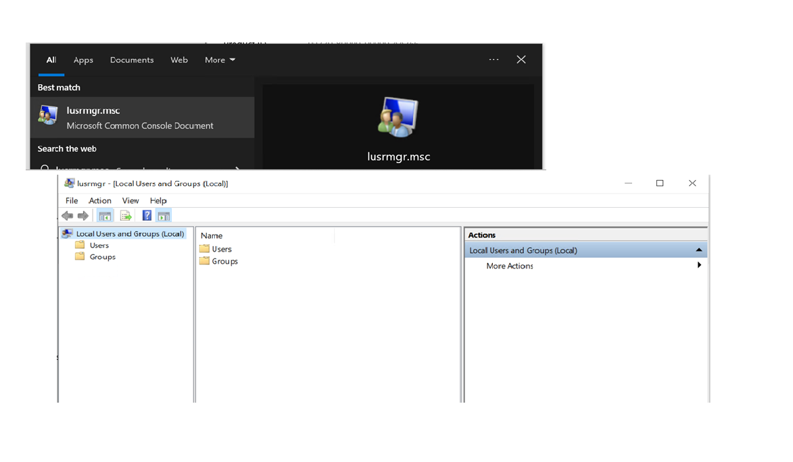

2. In the Local Users and Groups console, select **Users** in the left pane.
3. Locate the account created during Windows setup. In this lab, the account is `Divineg`.
4. Double-click `Divineg` and open the **Member Of** tab.

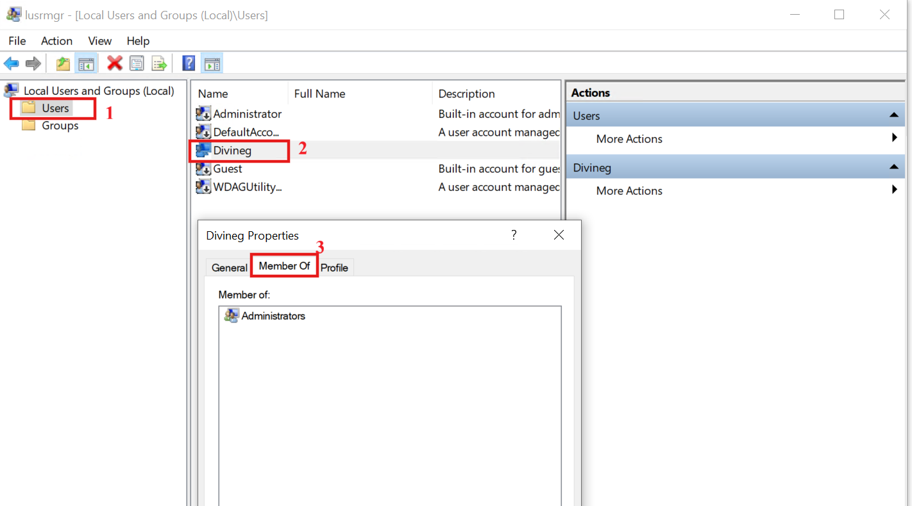

5. Confirm that **Administrators** is listed.

Membership in the local Administrators group gives `Divineg` administrative privileges on this computer, subject to Windows security controls such as User Account Control (UAC).

> **Note:** `Divineg` is the only account in the local Administrators group at this point because of how this lab environment was configured. Windows supports multiple members in the Administrators group.

> **Edition requirement:** The Local Users and Groups management console (`lusrmgr.msc`) is available in Windows Pro, Enterprise, and Education editions. It is not available in Windows Home.

## Task 2: Create Two Additional Local User Accounts

A Windows computer can have multiple local user accounts. In this task, two standard local accounts are created alongside `Divineg`.

1. In **Local Users and Groups**, right-click **Users** and select **New User**.
2. Enter `Elena Mike` as the username and full name. Set and confirm a password.

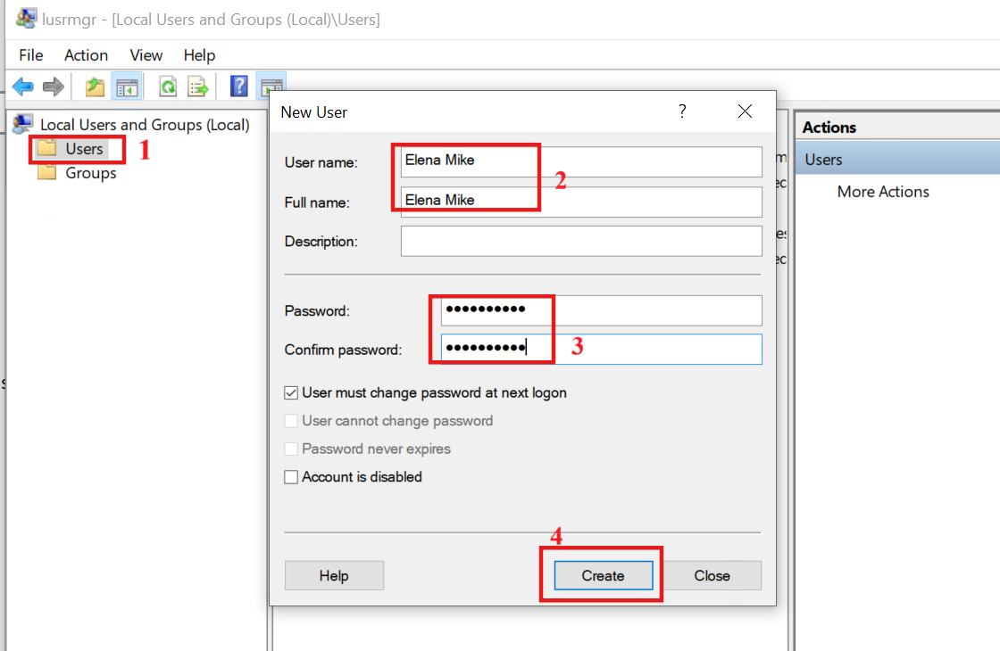

3. Select **Create**. Keep the dialog open if you want to create the next account immediately.
4. Repeat the process for `Princess Sylvia`, using a separate password.
5. Select **Close** after both accounts have been created.

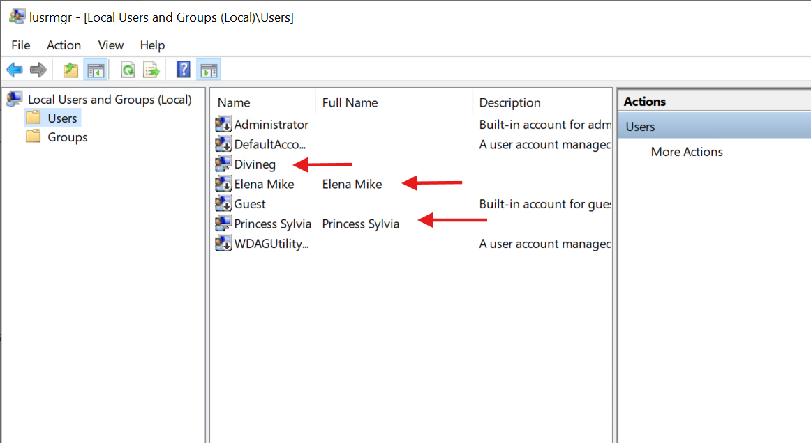

6. Confirm that both accounts appear in the Users list.

Accounts created this way are standard users by default unless they are subsequently added to an administrative group.

## Task 3: Sign In as Elena Mike and Observe Profile Creation

The first sign-in allows Windows to create a local profile for the new account on this computer.

1. Select **Start**, open the account menu, and choose **Sign out**.
2. On the sign-in screen, select **Other user**.

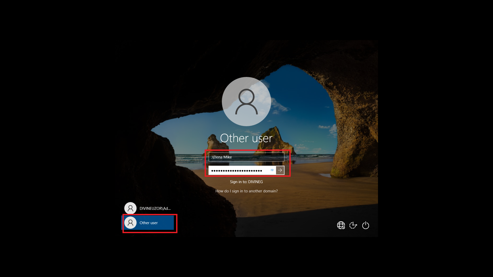

3. Enter `.\Elena Mike` as the username (without the spaces around it) and enter Elena's password. The `.` prefix tells Windows to authenticate against the local computer rather than the domain.
4. Wait while Windows displays **Getting things ready** and prepares the desktop.

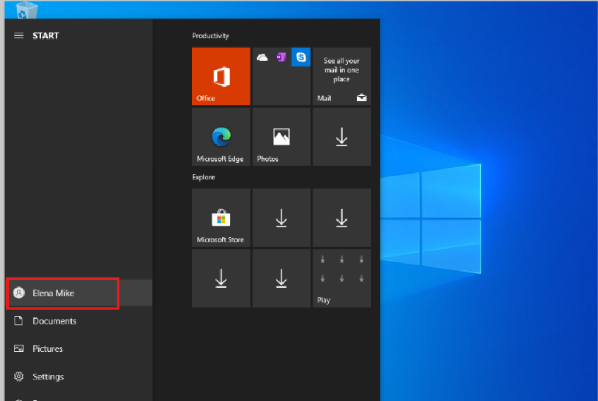

Windows creates a new profile for Elena Mike on this client computer. The profile stores user-specific files, settings, and configuration for her sessions on this device.

> **Troubleshooting note:** If Windows reports that the password is incorrect even when it appears to be typed correctly, check the keyboard layout indicator on the sign-in screen. Different keyboard layouts can place symbols such as `@` and `"` in different positions.

## Task 4: Test User Profile Isolation and Folder Access

This task demonstrates that separate user accounts have separate local profiles, and that access to another user's profile is controlled by permissions.

### 4.1 Create a folder in Elena Mike's profile

1. While signed in as Elena Mike, right-click the desktop.
2. Select **New > Folder**.
3. Name the folder `ElenaOnly`.

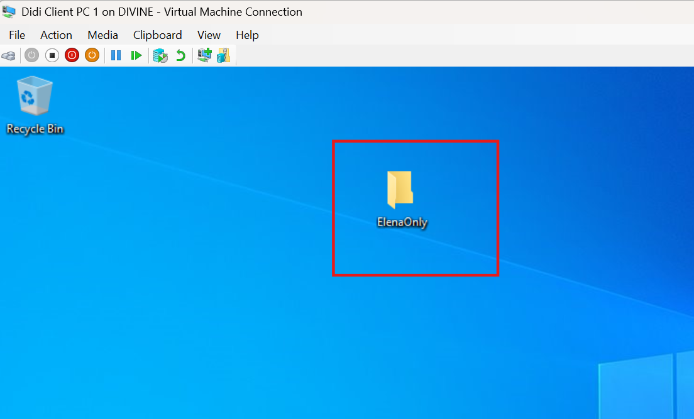

### 4.2 Sign in as Princess Sylvia

1. Sign out of Elena Mike's account.
2. Sign in as `Princess Sylvia` using the local account credentials.

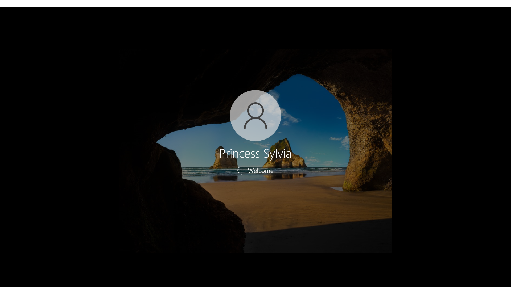

3. Observe that the `ElenaOnly` folder is not present on Princess Sylvia's desktop.

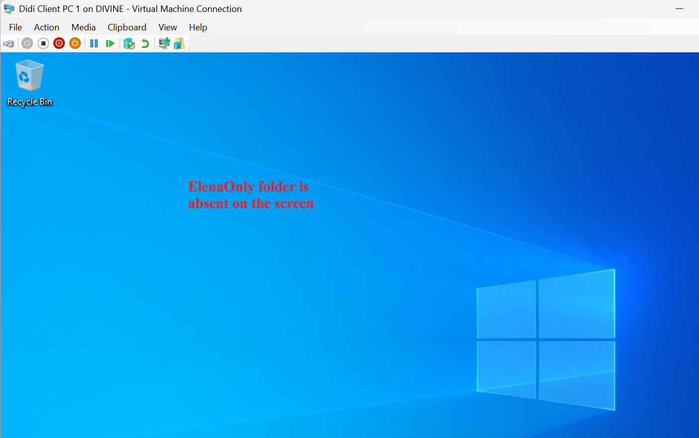

This confirms that each local account has its own profile and desktop environment on the same computer.

### 4.3 Compare access to the profile folders

1. While signed in as Princess Sylvia, open **File Explorer**.
2. Navigate to **This PC > Local Disk (C:) > Users**.
3. Observe the profile folders for the accounts on the computer.

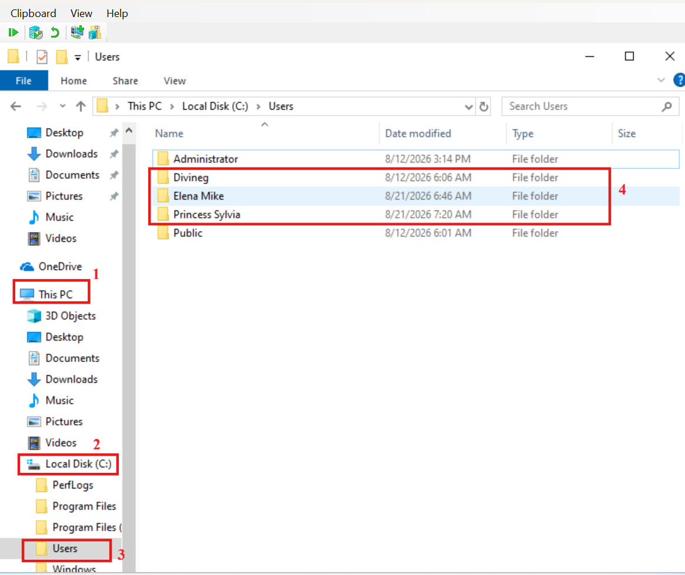

4. Sign out and sign in as `Divineg`, the local administrator.
5. Open Elena Mike's profile folder. If Windows displays a message that you do not currently have permission to access the folder, select **Continue** and respond to any required elevation prompt.

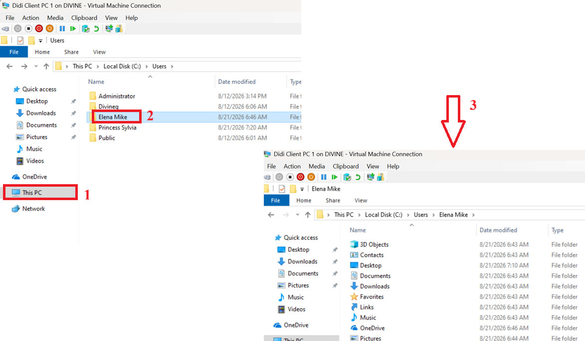

6. Sign out and sign in as Princess Sylvia again.
7. Try to open Elena Mike's profile folder. Windows displays a permission message and may request administrator credentials to continue.
8. Since Princess Sylvia is a standard user at this point and does not have administrator credentials, she cannot complete the elevated operation.

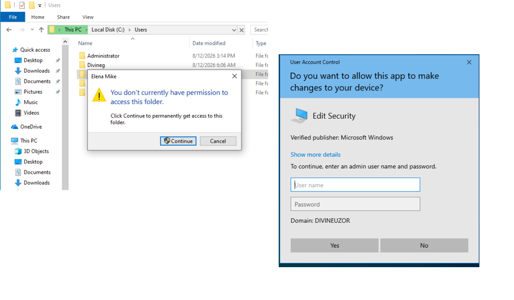

The two accounts have different access experiences because they have different privilege levels. An administrator can approve an elevated operation, while a standard user cannot approve an action that requires administrator credentials.

> **Security note:** UAC (User Account Control) helps prevent unauthorized changes by prompting for consent or administrator credentials when an operation requires elevation. Access to a folder is also governed by its NTFS permissions. UAC and file/folder permissions are related to the access experience but are not the same security mechanism.

## Task 5: Promote a Standard User to Administrator, Then Demote Her Back

This task demonstrates that the local `Administrators` group can contain multiple accounts and that group membership can be changed when administrative access is required.

### 5.1 Add Princess Sylvia to the Administrators group

1. Sign in as `Divineg`, because changing another account's group membership requires administrative rights.
2. Open Local Users and Groups by running `lusrmgr.msc`.
3. Select **Users**, then double-click **Princess Sylvia**.
4. Open the **Member Of** tab.

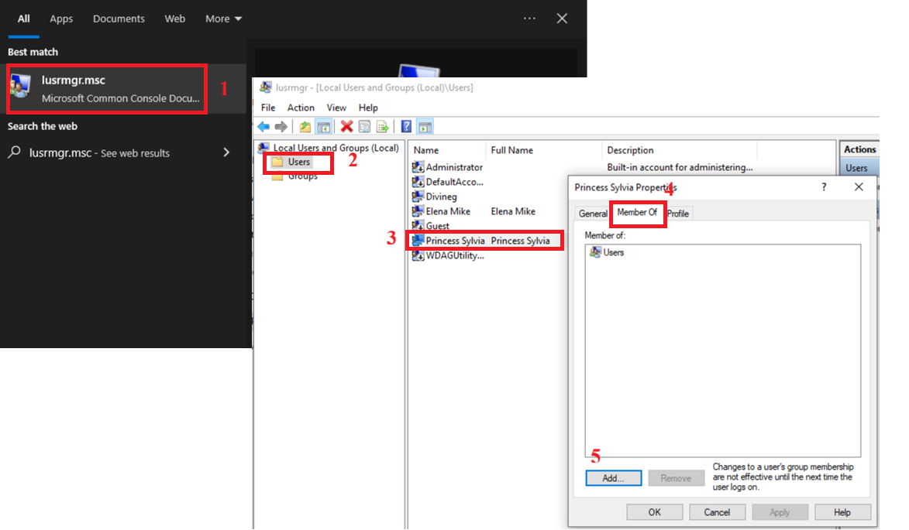

5. Select **Add**, enter `Administrators`, select **Check Names**, and confirm the entry.
6. Select **Apply** and **OK**.

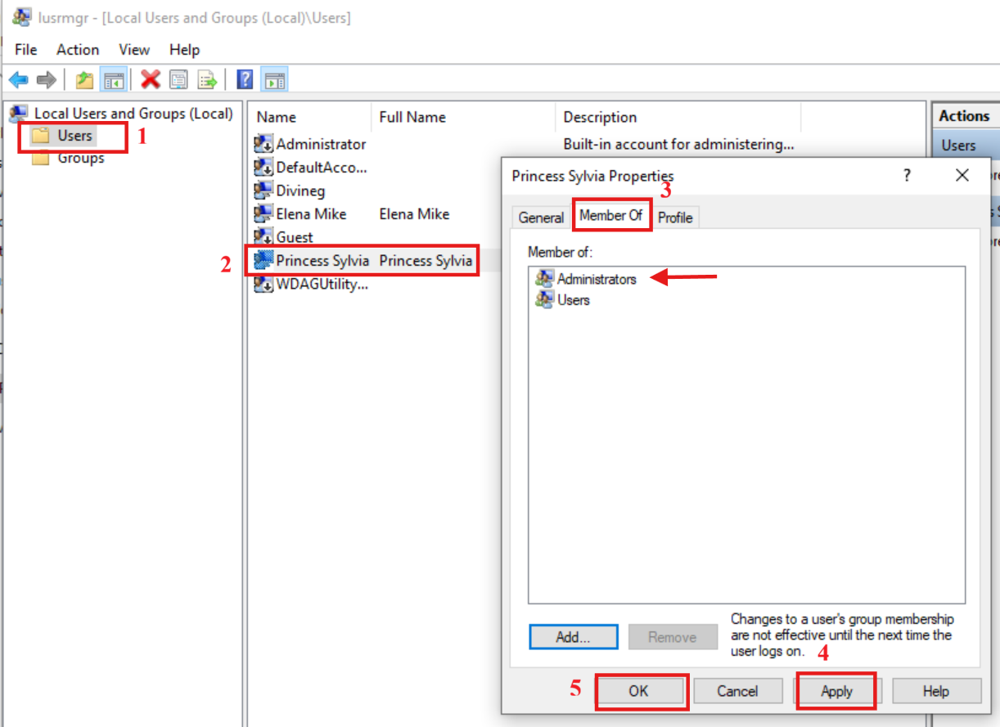

### 5.2 Test access after elevation

1. Sign out and sign in as Princess Sylvia.
2. Try opening Elena Mike's profile folder again.
3. Observe the access behaviour shown in the lab. The elevated account can approve the operation.

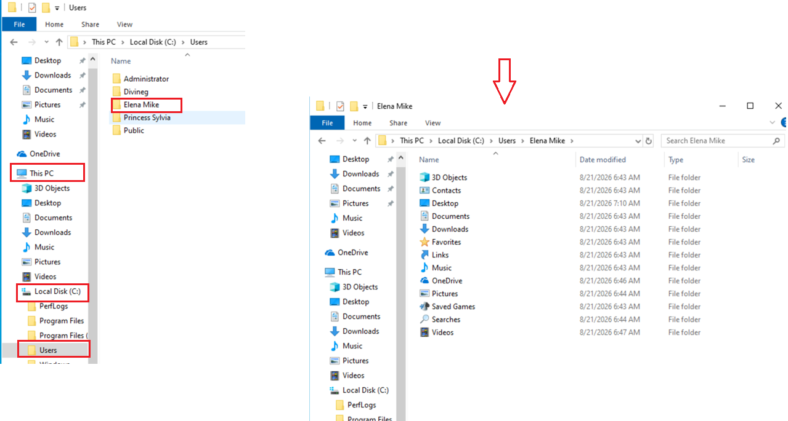

### 5.3 Remove administrator membership

1. Sign out and sign back in as `Divineg`.
2. Reopen Local Users and Groups.
3. Open Princess Sylvia's **Member Of** tab.
4. Select **Administrators**, choose **Remove**, and confirm the change.

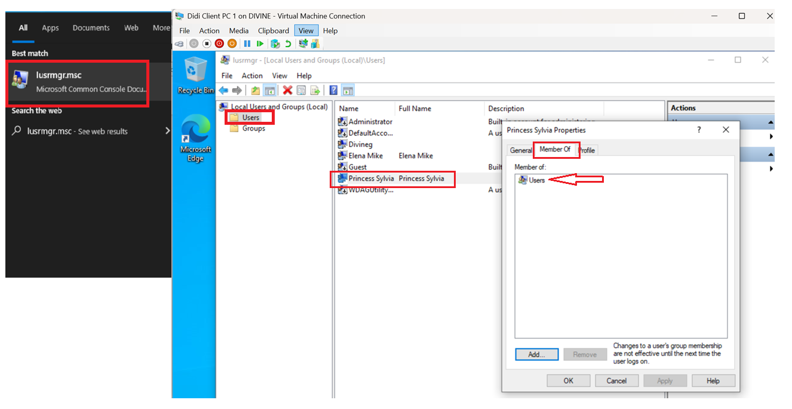

5. Sign in as Princess Sylvia and test access to Elena Mike's folder again.

In this lab, access to Elena Mike's folder remained possible after the group membership was removed. This showed that the earlier access operation had resulted in a separate permission entry for Princess Sylvia on that folder. Removing a user from the Administrators group does not automatically remove separately assigned NTFS permissions.

### 5.4 Remove the remaining explicit folder permission

1. Sign in as `Divineg`.
2. In File Explorer, right-click Elena Mike's profile folder and select **Properties**.
3. Open the **Security** tab and select **Edit**.
4. Select `Princess Sylvia` (shown in the lab as `DIVINEG\Princess Sylvia`) from the permissions list.
5. Select **Remove**, then **Apply** and **OK**.

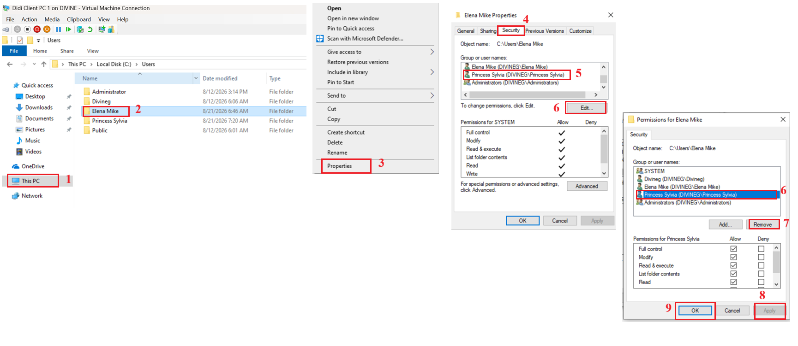

6. Sign in as Princess Sylvia and try opening Elena Mike's folder again.
7. Confirm that the permission prompt appears again and that Princess Sylvia cannot proceed without authorized administrator credentials.

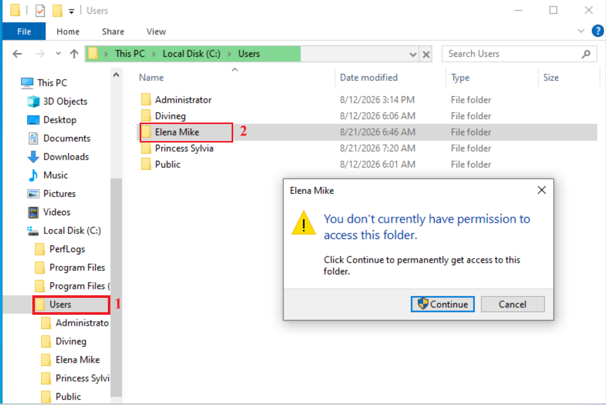

### Real-life IT scenario: Permission creep after role changes

An employee may be temporarily granted local administrator privileges to troubleshoot an issue. During that work, they may also receive direct access to a folder that they would not normally be allowed to access. When their administrator membership is later removed, that separate folder permission can remain.

This is why access reviews should examine both group membership and explicit file/folder permissions. Removing elevated group membership does not automatically clean up every permission that may have been granted separately.

> **Production practice:** Use least privilege. Grant elevated access only when required, for an appropriate duration, and review both group memberships and resource-level permissions when access is removed.

## Task 6: Monitor Signed-In Users and View Multiple Sessions

Windows Task Manager can show accounts that currently have a session on the computer, including sessions that are disconnected but have not been signed out.

1. Right-click the taskbar and select **Task Manager**, or press `Ctrl + Shift + Esc`.
2. If Task Manager opens in its simplified view, select **More details**.

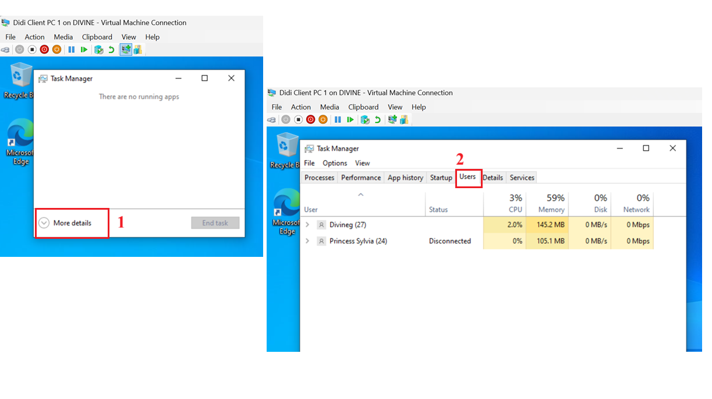
3. Open the **Users** tab.

4. Review the accounts listed. This view shows users with a session on the computer; it does not list every account that exists on the device.

5. Use **Fast User Switching** to sign in as another account without signing out the first account: select **Start > account icon > Switch user**, then sign in with another account.
6. Return to Task Manager and review the **Status** column. The session currently in use may have no status label, while another signed-in session may show **Disconnected**.

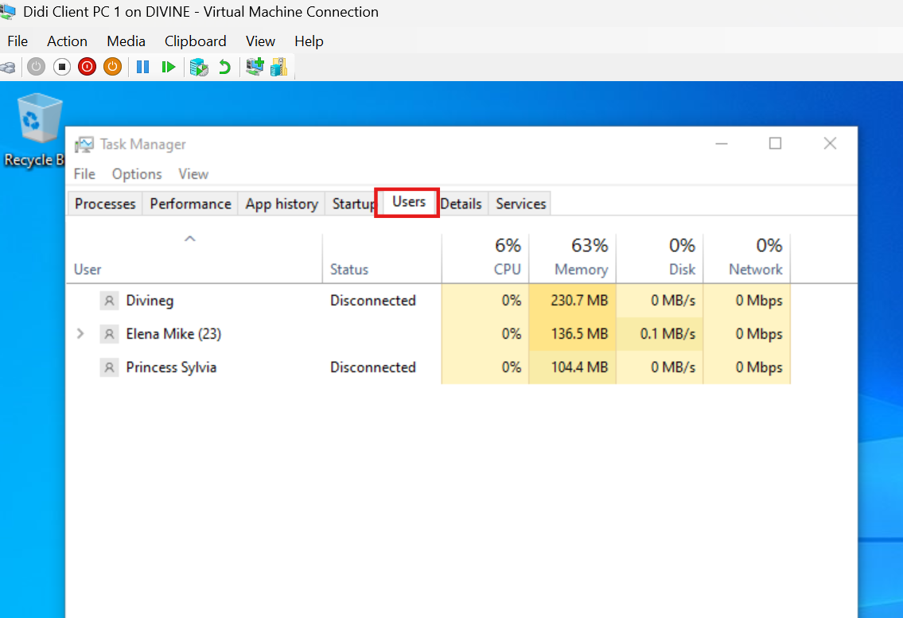

A **Disconnected** session means the user remains signed in even though that session is not currently displayed. Processes belonging to that session may continue running in the background. Fast User Switching therefore allows multiple logged-on sessions to coexist on one device.

7. To end a disconnected session, right-click the user in Task Manager and select **Sign off**. Use this carefully because unsaved work in that session may be lost.

> **Note:** The Users tab shows sessions on the computer where Task Manager is running. It does not provide a single consolidated view of every user's sessions across all devices in a network. Centralized visibility generally requires dedicated monitoring or endpoint-management tools.

## Task 7: Rebuild a User Profile Without Deleting the Account

A user reporting an empty desktop or missing settings may be experiencing a profile problem. A damaged or corrupted profile is one possible cause, although other causes should also be investigated before deciding to recreate a profile.

> **Important:** Before deleting a profile in a production environment, confirm that important user data has been backed up or recovered. Files stored only in the local profile may be lost when that profile is removed.

### 7.1 Open the User Profiles settings

1. Open File Explorer.
2. Right-click **This PC** and select **Properties**.
3. Open **Advanced system settings**.
4. Under the **Advanced** tab, locate **User Profiles** and select **Settings**.

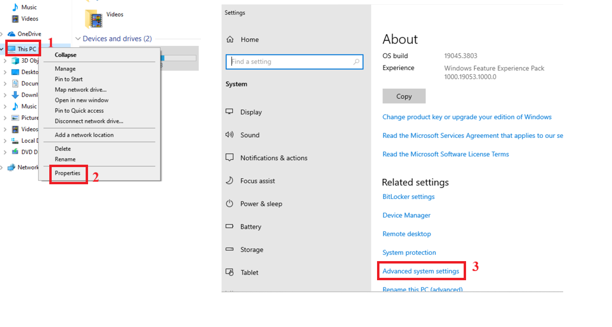

### 7.2 Review and delete the local profile

1. In the User Profiles window, identify Elena Mike's profile.
2. Confirm that the profile is the one you intend to remove and that required data has been backed up or preserved.

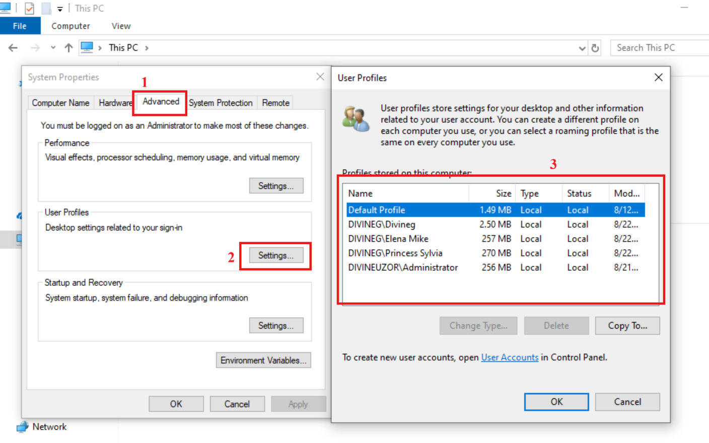

3. Select the profile and choose **Delete**.

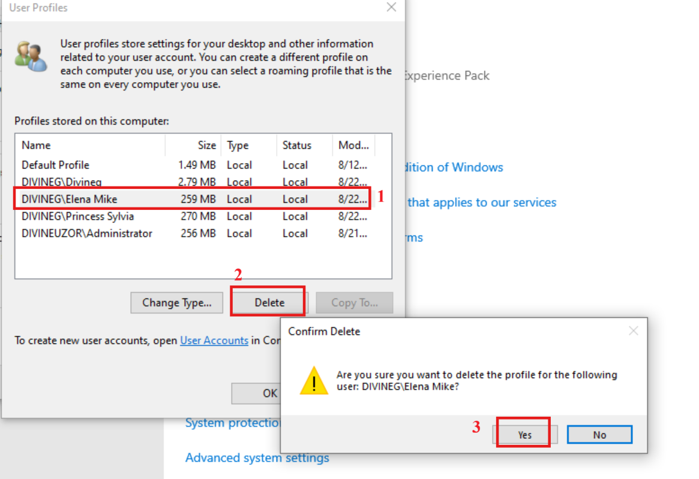
4. Confirm the deletion.

Removing a profile deletes the local copy of that user's profile data from this device. It does **not** delete the underlying local or domain account.

### 7.3 Sign in and allow Windows to create a fresh profile

1. Sign out and sign back in as Elena Mike.
2. Allow Windows to prepare the account's profile.
3. Confirm that a new desktop is created and that the `ElenaOnly` folder from the previous profile is no longer present.

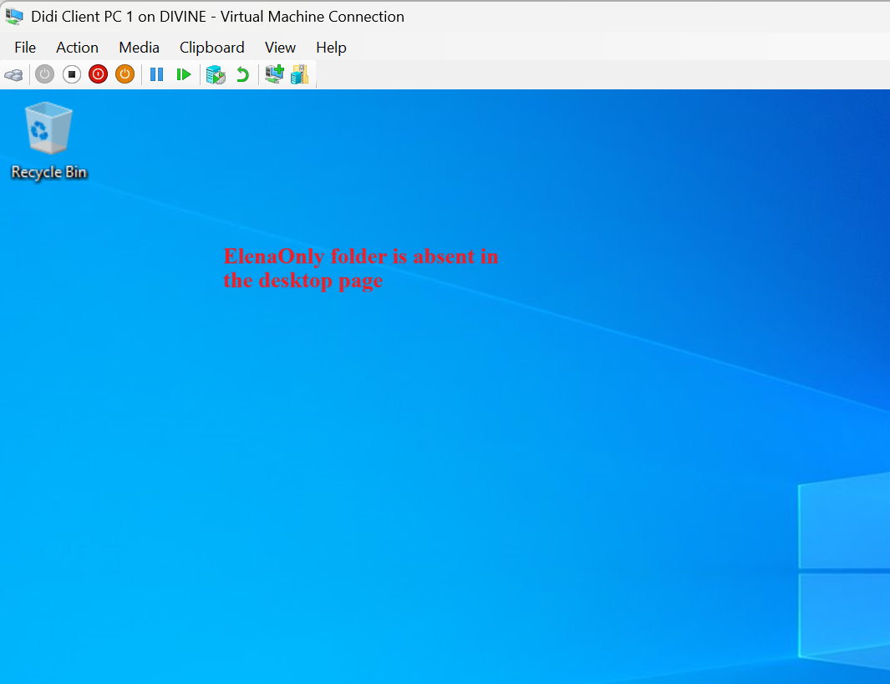

This demonstrates the difference between an account and its local profile. Elena Mike's account still exists; Windows has created a new local profile for that account on this computer.

### Real-life IT scenario: The empty desktop ticket

A user reports that they signed in and their desktop appears empty, with familiar files or shortcuts missing. Before assuming that the data has been permanently lost, a technician investigates whether Windows loaded a temporary profile or whether the local profile is damaged. If profile corruption is confirmed, required data should be recovered or backed up before the damaged profile is removed and Windows is allowed to create a fresh one.

## Task 8: Clean Up Temporary and Unnecessary Files

Disk Cleanup can help remove selected temporary and system files. Windows also provides storage-management options under **Settings > System > Storage**, including Storage Sense on supported versions.

1. Open the Start menu, type **Disk Cleanup**, and launch the utility.
   - Alternatively, open **This PC**, right-click **Local Disk (C:)**, select **Properties**, and choose **Disk Cleanup**.
2. Wait for the scan to finish.
3. Review the available file categories, such as temporary files and Recycle Bin contents.
4. Select only the categories that are appropriate to remove.
5. Optionally select **Clean up system files** to review additional categories, such as previous Windows Update files.
6. Select **OK**, then **Delete Files** to confirm.

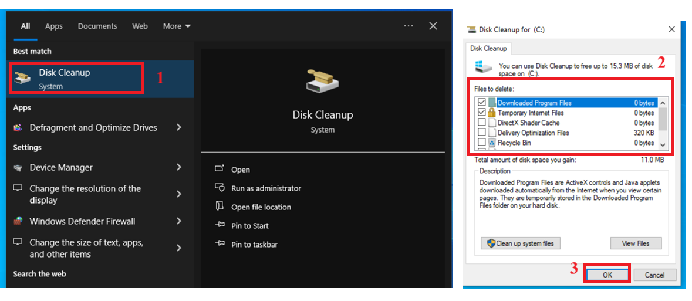

### Real-life IT scenario: A full disk ticket

A support ticket reports that a shared laptop's C: drive is nearly full. A technician can review temporary and system files using Disk Cleanup and investigate whether old user profiles are consuming space. Disk Cleanup handles supported temporary and system-file categories; stale user profiles require a separate review and should only be removed after confirming that their data is no longer needed.

## Task 9: Remove the Client PC from the Domain

This task moves the client computer from the `divineuzor.com` domain to a workgroup.

1. Sign in using an account with local administrative privileges. In this lab, `Divineg` is used.
2. Open File Explorer, right-click **This PC**, select **Properties**, and open **Advanced system settings**.
3. Under the **Computer Name** tab, select **Change**.

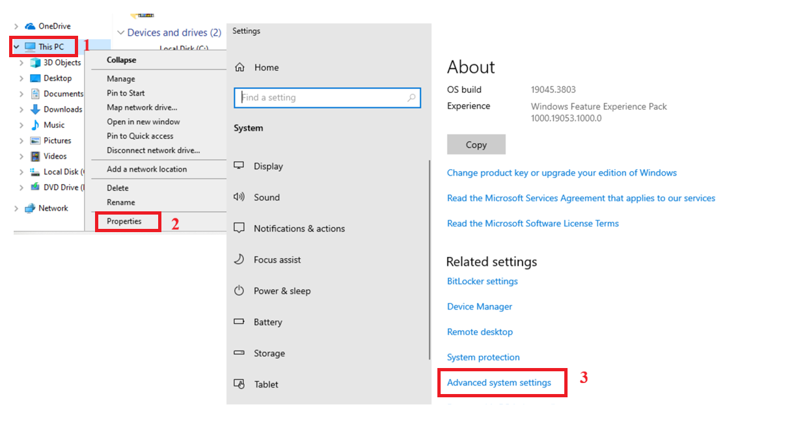

4. Select **Workgroup**, enter `WORKGROUP`, and select **OK**.

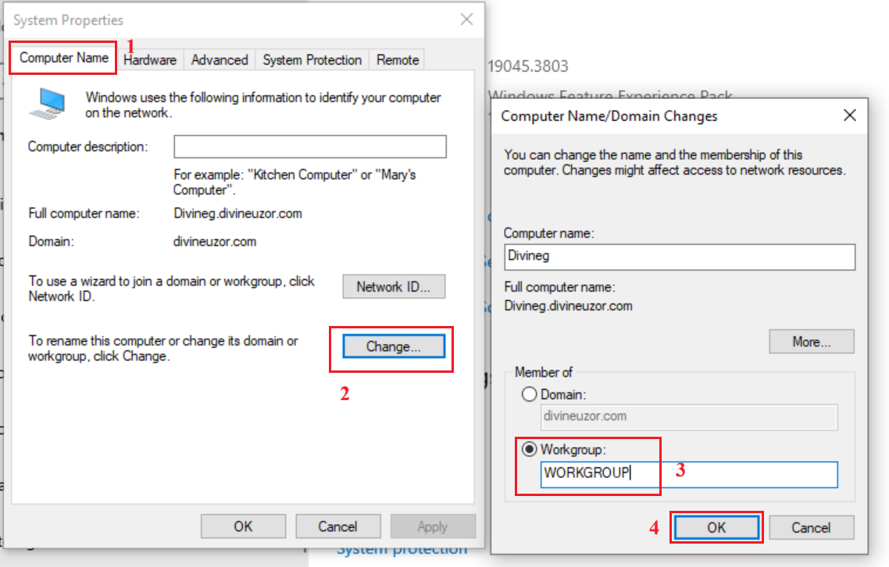

5. When prompted, provide domain credentials authorized to remove the computer from the domain.
6. Accept the confirmation messages and restart the computer when prompted.

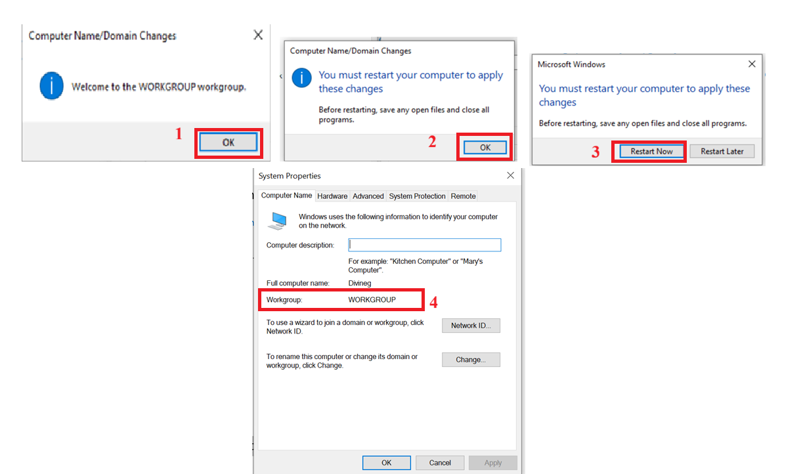

> **Note:** The operation requires local administrative privileges on the workstation and appropriate domain permissions for the domain-side operation. A domain account can also administer the local computer if it has been granted the required local administrative rights.

## Task 10: Rejoin the Client PC to the Domain

After the workstation has been moved to a workgroup and restarted, it can be joined to the domain again.

1. Sign in using the local administrator account `Divineg`.
2. Open **System Properties**, select the **Computer Name** tab, and choose **Change**.
3. Select **Domain** and enter `divineuzor.com`.
4. Provide domain credentials authorized to join computers to the domain. In this lab, the example is `DIVINEUZOR\Administrator`.

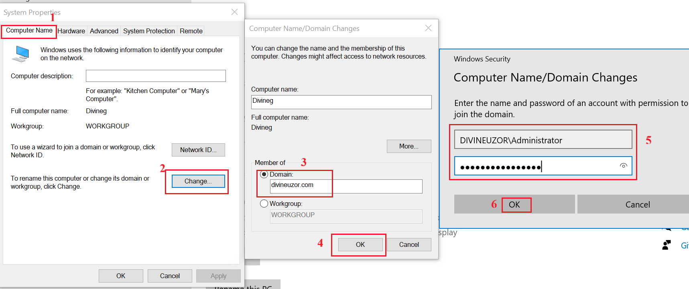

5. Accept the confirmation messages and restart the computer.

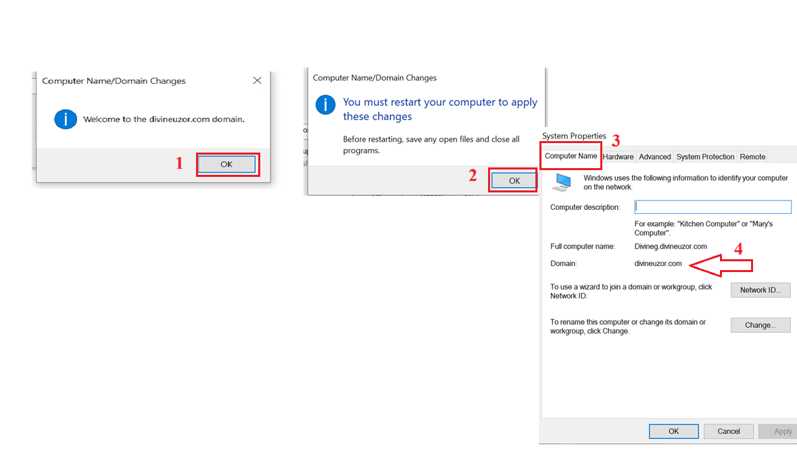

### Real-life IT scenario: The trust relationship failed

A common Windows sign-in error states: **“The trust relationship between this workstation and the primary domain failed.”** This can occur when the secure channel between the computer and Active Directory is broken, including when the computer's machine-account password is out of sync with the password stored for the computer account in Active Directory.

A common recovery approach is to repair the computer's secure channel or reset the machine-account password. If those approaches do not resolve the issue, removing the computer from the domain and rejoining it may re-establish the trust relationship. The appropriate recovery method depends on the cause and the organization's procedures.

## Task 11: Sign In as Different Domain Users and Compare Their Experiences

The final task compares local account sign-in with domain account sign-in.

1. After the restart, select **Other user** on the Windows sign-in screen.
2. Sign in using one of the domain user accounts created in the earlier Active Directory lab, such as the Cloud Engineer or Software Engineer account.

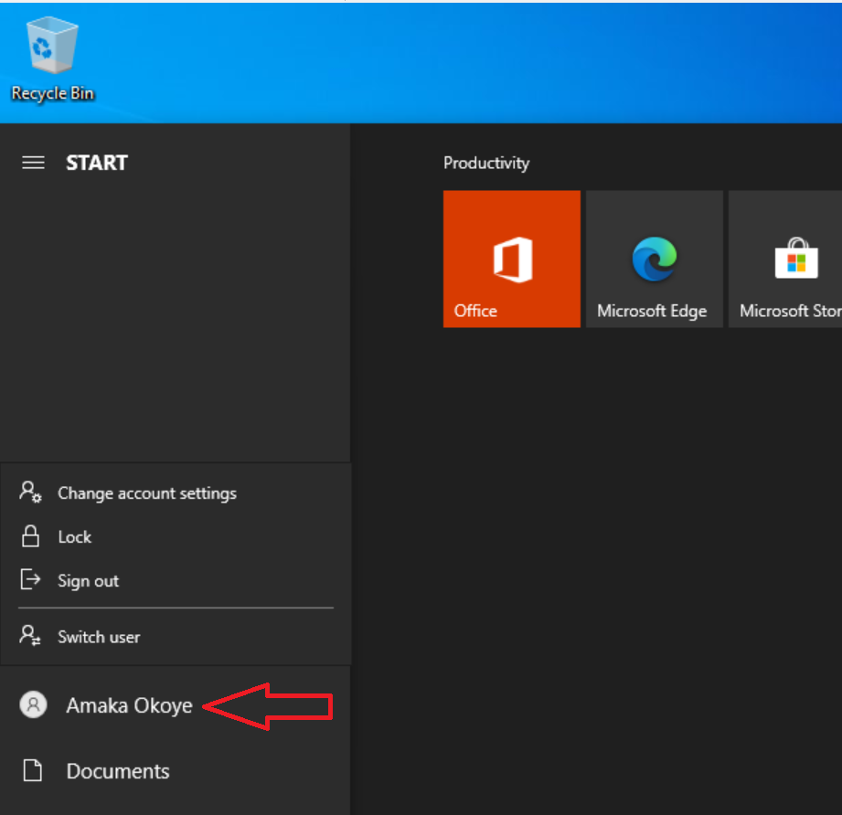

3. Observe that Windows prepares a local profile for this domain user on the client computer.
4. Sign out and repeat with another domain user, if available, to compare each account's experience and access.

The domain account is authenticated through Active Directory, while Windows still creates and maintains a local user profile for that account on this particular device. Authentication source and local profile storage are separate concepts.

---

# Why This Matters for IT Support and Systems Administration

The tasks in this lab reflect practical work carried out by IT Support technicians and junior Systems Administrators.

- **Local administrative recovery:** A local administrator account can provide a way to administer a workstation when domain-based authentication or connectivity is temporarily unavailable.
- **Faster user-support troubleshooting:** Understanding the difference between an account and a profile helps investigate missing desktops, settings, and user data without immediately assuming that an account has been deleted.
- **Access control and least privilege:** Reviewing group membership and explicit folder permissions helps identify access that remains after a user's role or privileges change.
- **Session management:** Recognizing active and disconnected sessions helps technicians understand why a user may still have processes running after switching accounts.
- **Workstation maintenance:** Reviewing temporary files and old profiles can help investigate low disk space, while protecting data that users may still need.
- **Domain administration:** Moving a workstation between a domain and workgroup, rejoining it, and understanding trust relationship failures are useful skills in Windows domain environments.
- **Hybrid identity relevance:** Many organizations continue to operate on-premises Active Directory alongside Microsoft 365 and Microsoft Entra ID. Foundational knowledge of local accounts, domain authentication, permissions, and workstation profiles remains useful in hybrid environments.

## Summary

This lab moved from Active Directory structure and domain joining into the everyday administration of a Windows client. Across eleven tasks, I created and inspected local accounts, observed profile creation and isolation, tested administrator privileges and folder permissions, monitored concurrent user sessions, recreated a local profile, performed disk cleanup, managed domain membership, and signed in with domain accounts.

All exercises were performed using the existing Hyper-V client PC and domain controller environment, reinforcing practical Windows administration without requiring additional virtual machines.

## Skills Demonstrated

- Windows 10 Pro administration
- Local Users and Groups management
- Local account creation and administration
- Local Administrators group management
- User profile management and troubleshooting
- User Account Control (UAC) fundamentals
- NTFS file and folder permissions
- Fast User Switching and session monitoring
- Disk Cleanup and workstation maintenance
- Active Directory domain membership
- Domain user authentication
- Basic domain trust troubleshooting
- Hyper-V lab administration

