# Lab 8: Deploying Windows Server 2022 as a Read-Only Domain Controller

*Adding a read-only domain controller to an existing Active Directory domain*

## Overview

Relying on a single domain controller creates a single point of failure. If it goes down, users may be unable to authenticate. One way organizations improve resilience is by adding domain controllers. This lab introduces a specific type: the **Read-Only Domain Controller (RODC)**.

An RODC maintains a read-only copy of Active Directory. Changes are made on a writable domain controller first and then replicate to the RODC. Changes are not replicated from the RODC back to the writable domain controller. This makes RODCs useful in branch offices where physical security, network reliability, or local IT staffing may be limited.

This lab uses three machines in the `divineuzor.com` domain:

| Machine | Operating system / role | IP address |
|---|---|---|
| DC 01 | Windows Server 2019; existing writable domain controller | `192.168.6.1` |
| Client PC | Windows 10; already joined to the domain | `192.168.6.2` |
| Server 02 | Windows Server 2022 Datacenter (Desktop Experience); new RODC | `192.168.6.3` |

Server 02's virtual machine has already been created and Windows Server has been installed. For the VM creation and Windows Server installation process, refer to Parts 1 and 2.

### What this lab covers

- Expanding the lab network to accommodate a third machine.
- Configuring a static IP address and DNS server on Server 02.
- Verifying connectivity between the three machines.
- Installing Active Directory Domain Services (AD DS).
- Promoting Server 02 specifically as a Read-Only Domain Controller.
- Verifying the RODC configuration and demonstrating its read-only behaviour.
- Confirming replication from the writable domain controller to the RODC.

---

## Hands-On Lab

### Task 1: Expand the Lab Network

The original network was `192.168.6.0/30`, with a subnet mask of `255.255.255.252`. This subnet provides only two usable IP addresses, already assigned to DC 01 (`192.168.6.1`) and the Client PC (`192.168.6.2`).

Adding Server 02 requires another usable address. The subnet mask is therefore changed to `255.255.255.224` (`/27`), which provides 30 usable addresses. The existing IP addresses remain unchanged; only the subnet mask is updated.

1. On DC 01, open the network adapter's IPv4 properties and note the current configuration before changing anything.

   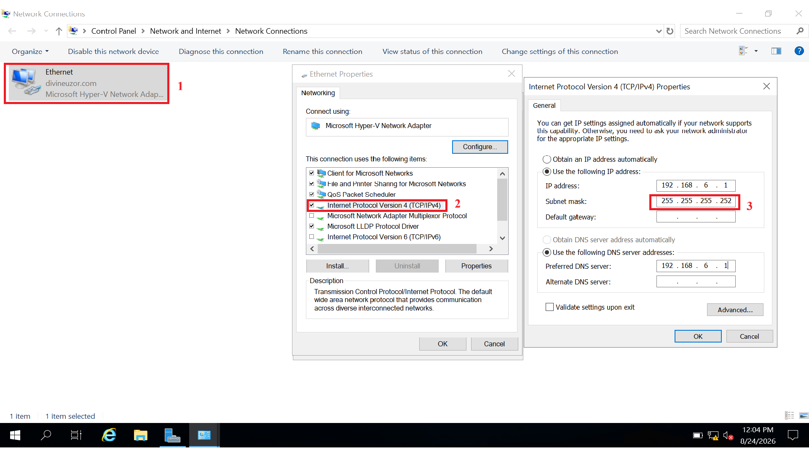

2. Change the subnet mask from `255.255.255.252` to `255.255.255.224`. Leave the IP address as `192.168.6.1`.

   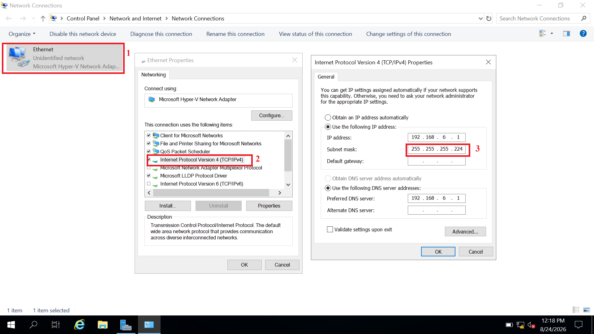

### Task 2: Update the Client PC's Subnet

1. On the Client PC, open its IPv4 properties and change only the subnet mask to `255.255.255.224`. Keep the IP address at `192.168.6.2`.

### Task 3: Assign a Static IP to Server 02

1. On Server 02, open the network adapter's IPv4 properties.
2. Set the IP address to `192.168.6.3` and the subnet mask to `255.255.255.224`.

   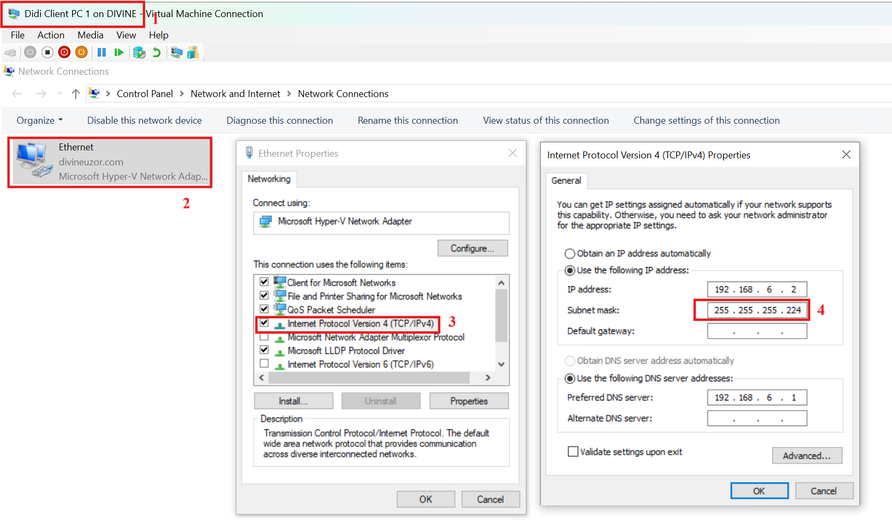

3. Set the Preferred DNS server to `192.168.6.1`, the address of DC 01.

   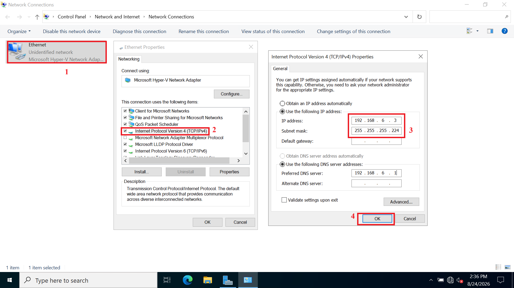

   **Note:** Server 02 is not yet a domain controller, so it does not have its own DNS service to rely on. Pointing it to DC 01 allows it to resolve `divineuzor.com` and locate the existing domain controller. This is required before promotion.

4. Open Command Prompt on Server 02 and run:

   ```powershell
   ipconfig
   ```

   Verify that the IP address and subnet mask are configured as intended.

   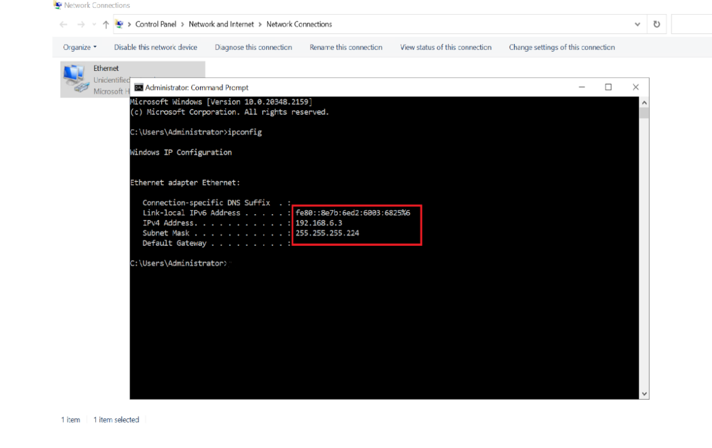

### Task 4: Verify Network Connectivity

Before configuring Active Directory, confirm that the three machines can reach one another. Checking connectivity first helps distinguish network issues from Active Directory or promotion issues later.

1. On Server 02, open Command Prompt and run the following command to confirm that it can reach DC 01:

   ```powershell
   ping 192.168.6.1
   ```

   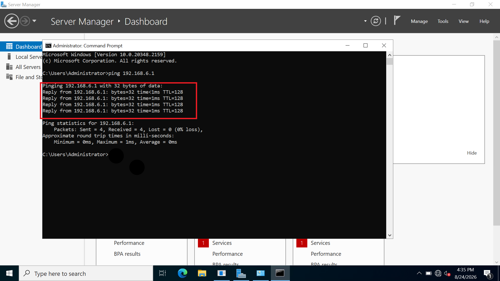

2. Still on Server 02, run the following command to confirm that it can reach the Client PC:

   ```powershell
   ping 192.168.6.2
   ```

3. On DC 01, run the following command to confirm that it can reach Server 02:

   ```powershell
   ping 192.168.6.3
   ```

### Task 5: Install Active Directory Domain Services on Server 02

1. On Server 02, open **Server Manager**, select **Manage**, and then select **Add Roles and Features**.
2. Choose **Role-based or feature-based installation** and select Server 02 as the target server.
3. Select **Active Directory Domain Services** from the roles list. When prompted, select **Add Features** to include the related management tools.
4. Continue through the wizard and select **Install**.

   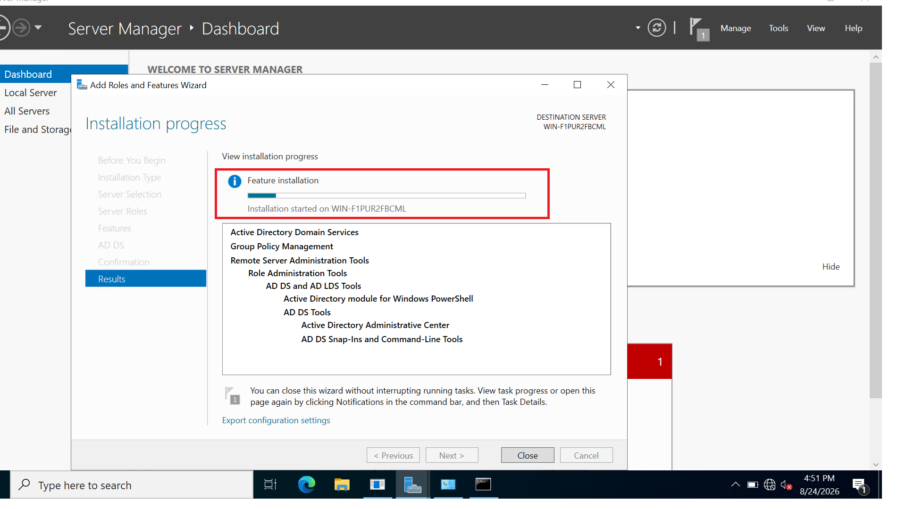

5. When installation finishes, confirm that the results page shows the option to **Promote this server to a domain controller**.

   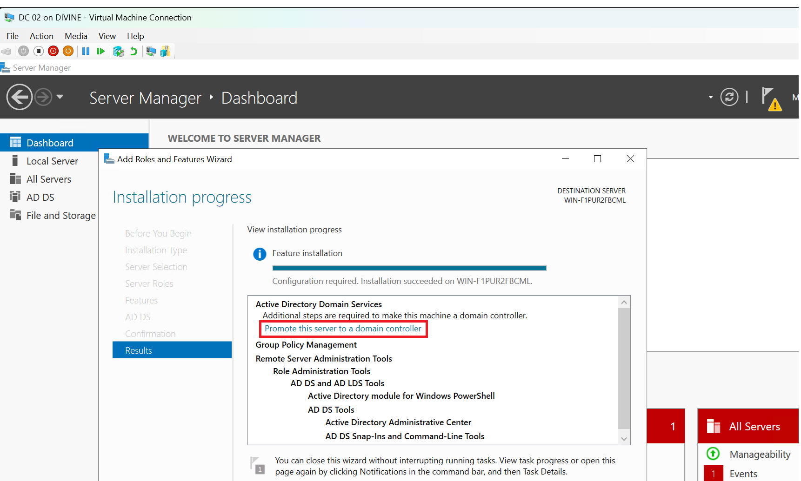

   **Note:** Installing the AD DS role prepares the server; it does not make Server 02 a domain controller by itself. Promotion is a separate step.

### Task 6: Promote Server 02 and Configure It as a Read-Only Domain Controller (RODC)

1. In Server Manager, select the notification flag and then select **Promote this server to a domain controller**. This opens the Active Directory Domain Services Configuration Wizard.
2. On **Deployment Configuration**, select **Add a domain controller to an existing domain** and enter `divineuzor.com`. Use an account with sufficient domain permissions to complete the promotion.

   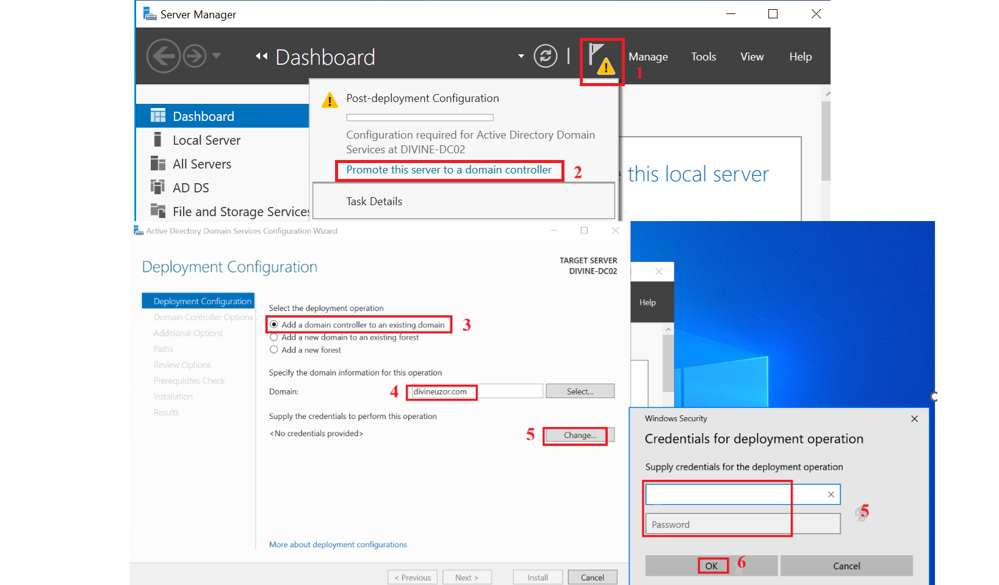

3. On **Domain Controller Options**, select the **Read-only domain controller (RODC)** checkbox. Configure the Directory Services Restore Mode (DSRM) password as prompted.

   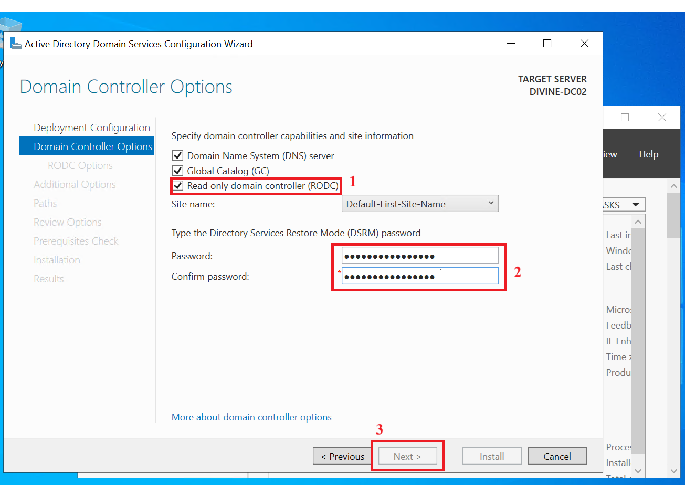

4. Continue to **RODC Options**. This page covers the Delegated Administrator Account and the Password Replication Policy, which controls whose credentials are allowed to be cached on the RODC.

### Task 7: Complete the Promotion

1. Continue through the remaining wizard pages: **DNS**, **Additional Options** (including the replication source), **Paths**, and **Review Options**.

   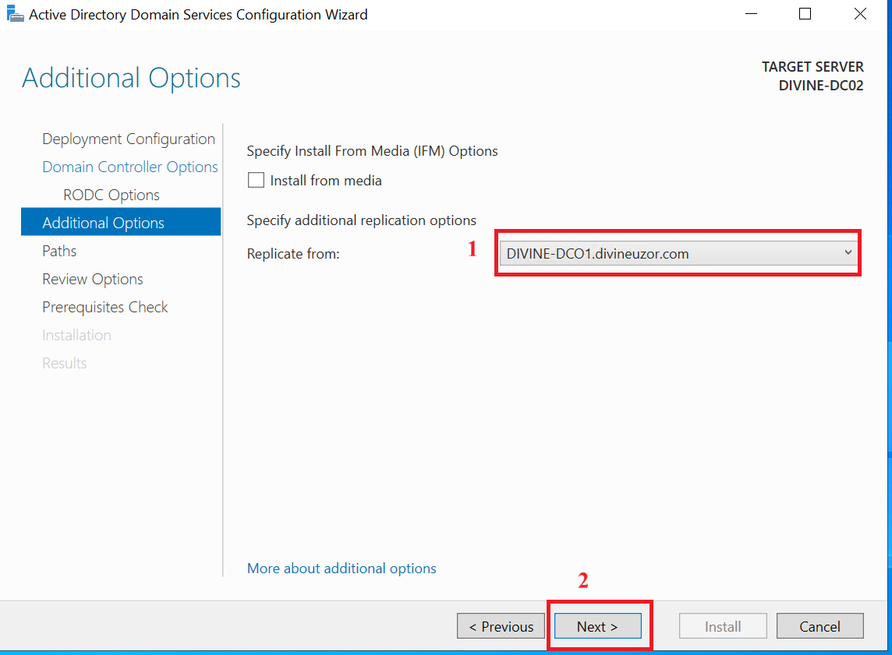

2. Allow the wizard to run its prerequisite checks. Installation should proceed only after the checks pass without blocking errors.

   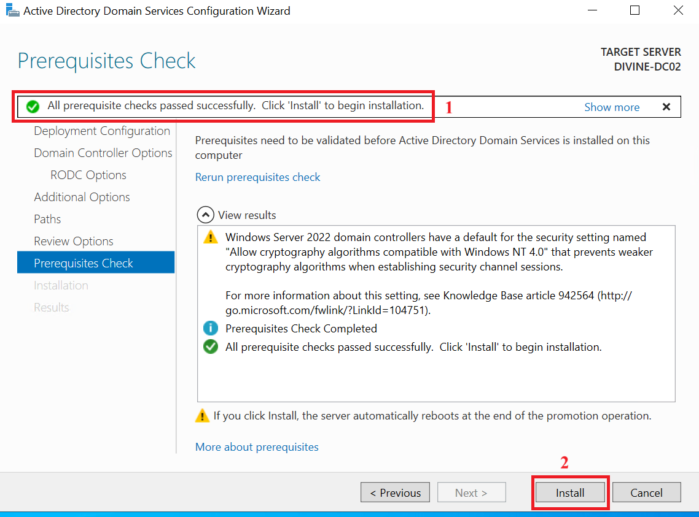

3. Select **Install**. The server completes AD DS configuration and restarts automatically.

   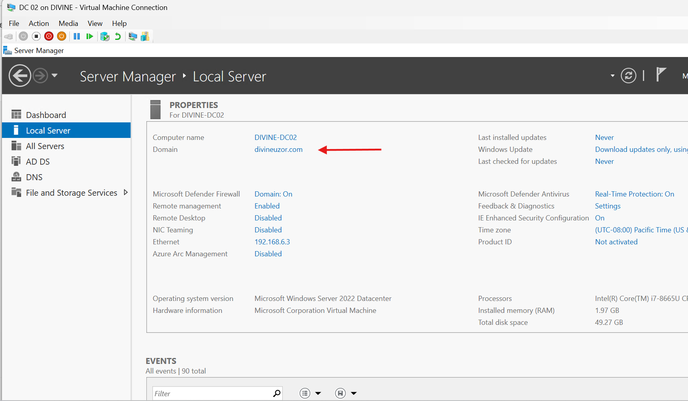

### Task 8: Verify Server 02 Is Registered as a Domain Controller

1. On DC 01, open **Active Directory Users and Computers**.
2. Expand `divineuzor.com`, then select the **Domain Controllers** container.
3. Confirm that Server 02 appears in the list alongside DC 01.

   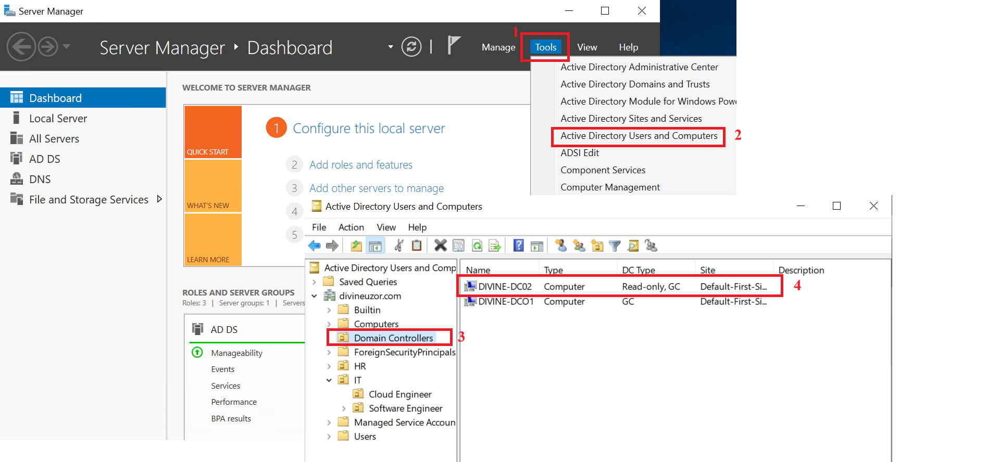

### Task 9: Confirm Server 02 Is Specifically an RODC

Being listed in the Domain Controllers container proves that Server 02 is a domain controller, but it does not establish that it is read-only. A regular writable domain controller would also appear in this container.

1. In **Active Directory Users and Computers**, right-click Server 02's computer object inside **Domain Controllers**, and select **Properties**.
2. Look for the **Password Replication Policy** tab. This tab is present on RODC objects; a normal writable domain controller's Properties window does not have it. Its presence is evidence that Server 02 is configured as an RODC.

   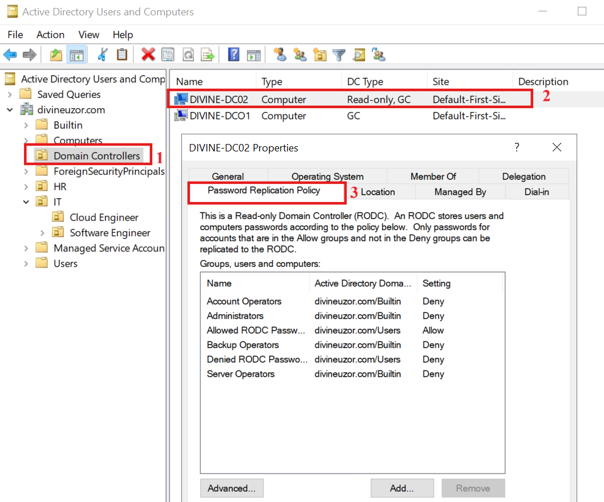

### Task 10: Demonstrate Read-Only Behaviour

The strongest demonstration is to compare the available actions when Active Directory Users and Computers is connected to the writable domain controller and when it is connected to the RODC.

1. On DC 02, open **Active Directory Users and Computers** while it is still connected to the default writable domain controller (DC 01). Right-click the **Users** container and select **New**. Observe the full submenu, including the option to create a new user.

   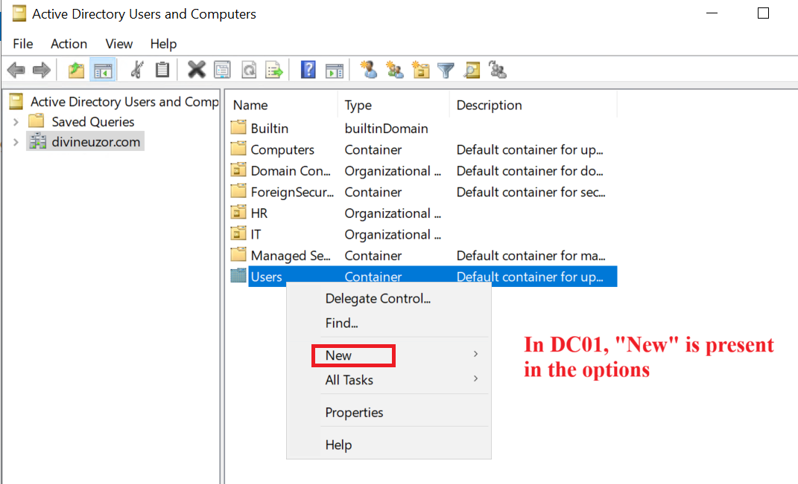

2. Switch the connection to DC 02. Right-click the domain name at the top of the tree, select **Change Domain Controller...**, choose `DIVINE-DC02.divineuzor.com`, and select **OK**.

   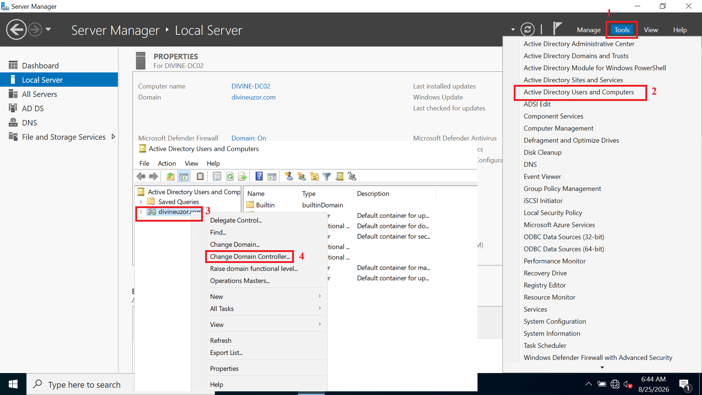

3. In the available domain controllers window, select DC 02 and select **OK**. A warning appears stating that you are connecting to a read-only domain controller and will not be able to perform write operations. Select **OK** to acknowledge the warning. This is proof 1.

   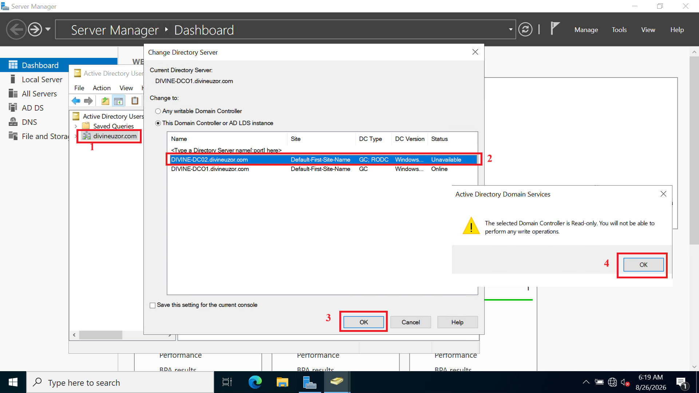

4. Right-click the **Users** container again. This time, the **New** option is absent. This is proof 2.

   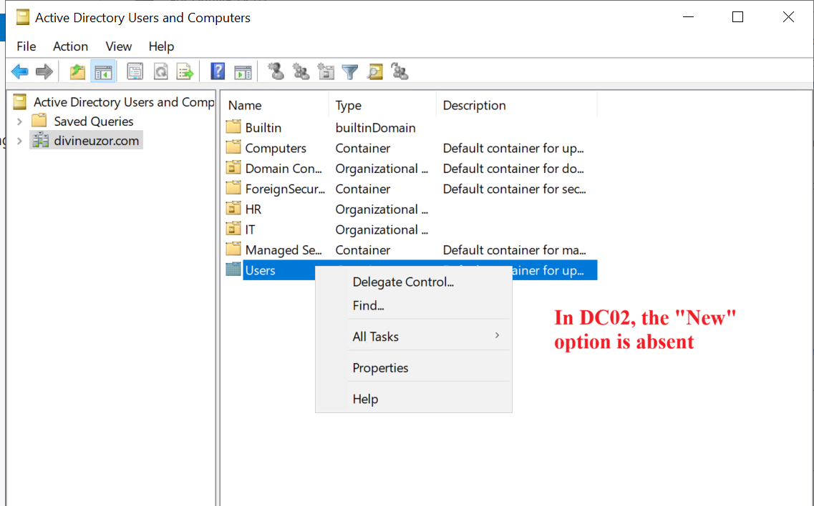

   **Note:** If you close and reopen Active Directory Users and Computers, it automatically reconnects to DC 01 by default. This is expected. The **Change Domain Controller** setting applies only to the current window and is not remembered between sessions. Repeat the change-domain-controller steps each time you want to test against DC 02 specifically.

### Task 11: Verify Replication From DC 01 to the RODC

1. On DC 01, the writable domain controller, create or modify a test object. For example, create a new test user account.

   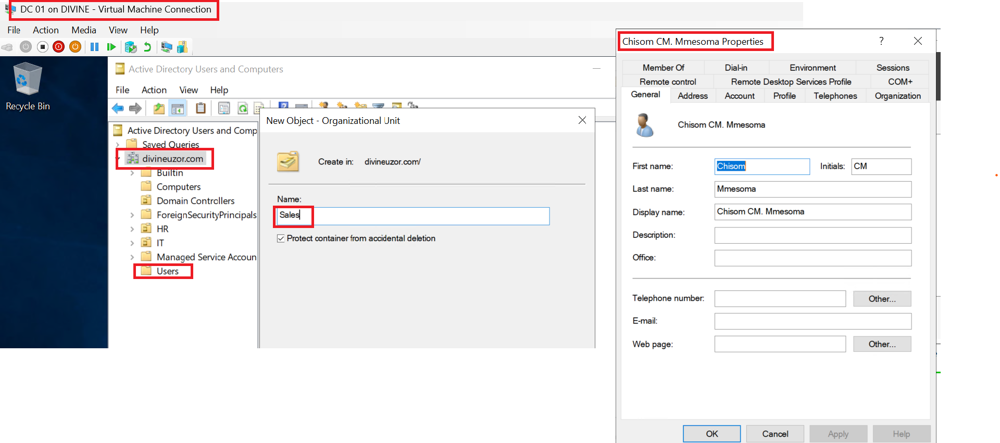

2. Allow a few seconds for replication, then check Server 02 to confirm that the same object appears there too.

   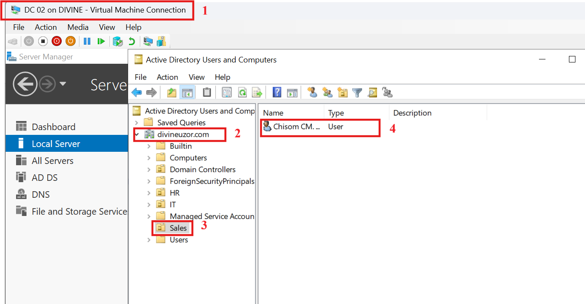

---

## Why This Matters

An RODC is designed for locations that should not hold a writable copy of Active Directory, such as a branch office with limited physical security, no dedicated IT staff, or unreliable connectivity to headquarters.

Local logons and directory lookups can remain available, while the read-only directory database limits what an attacker could change if the server were compromised. The Password Replication Policy adds another layer of control by determining whose credentials may be cached on the RODC.

Understanding why the RODC option exists, how its Password Replication Policy works, and how to verify its read-only behaviour demonstrates more than the ability to follow a promotion wizard. It shows an understanding of domain architecture and the security trade-offs involved.

## Summary

You expanded the network from a two-host `/30` subnet to a `/27` subnet to accommodate a third machine. You then configured Server 02 with a static IP address, installed AD DS, and promoted the server specifically as a Read-Only Domain Controller rather than an ordinary additional domain controller.

You verified the RODC configuration through the **Password Replication Policy** tab, a direct comparison of available write actions, and confirmation that an object created on DC 01 replicated to Server 02.


## Next Step

Continue to **Lab 09: NTFS and Share Permissions** to apply Active Directory users and groups to shared folder access, configure NTFS and share permissions, and test how Windows evaluates access.
