# Lab 9: NTFS and Share Permissions

*Creating, sharing, and testing folder permissions in a Windows Server environment*

## Overview

You will manage access to shared folders by applying both NTFS permissions and share permissions. This lab puts the two permission systems into practice by creating a shared folder, assigning permissions to Active Directory users and groups, and testing how Windows evaluates access.

The lab demonstrates two key rules:

1. **NTFS permissions:** When a user receives multiple Allow permissions on the same file or folder, the permissions combine. An explicit Deny overrides an Allow.
2. **Network share permissions:** When a folder is accessed over the network, the effective permission is the more restrictive of the user's NTFS permission and share permission. Local access on the server is governed by NTFS permissions; share permissions do not apply.

The environment uses two domain controllers, DC01 and DC02, and one domain-joined client PC in the `divineuzor.com` domain. DC01 and DC02 share the same Active Directory database. All server-side configuration in this lab is performed on DC01.

## Lab Environment and Existing Accounts

This lab reuses accounts created in earlier labs:

| User | Organizational Unit | Purpose in this lab |
|---|---|---|
| Glory Davies | IT → Software Engineer | Receives NTFS permissions from two sources |
| Amaka Okoye | IT → Cloud Engineer | Joins the IT Staff security group |
| Chisom CM Mmesoma | Sales | Tests default-deny behavior |
| Ada Obi | HR | Created in Task 1 and later used to demonstrate an explicit Deny |

Ada Obi is created in the HR OU because no user currently exists there.

## Hands-On Lab

### Task 1: Create a User in the HR OU

1. On DC01, open **Server Manager**, select **Tools**, then **Active Directory Users and Computers**. Alternatively, press `Win + R` and run `dsa.msc`.
2. Expand `divineuzor.com`, right-click the **HR** OU, select **New**, then **User**.

   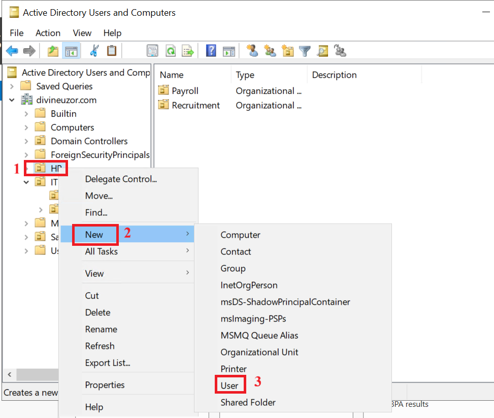

3. Enter **Ada** as the first name and **Obi** as the last name. Set the user logon name to `AdaO`, then select **Next**.

   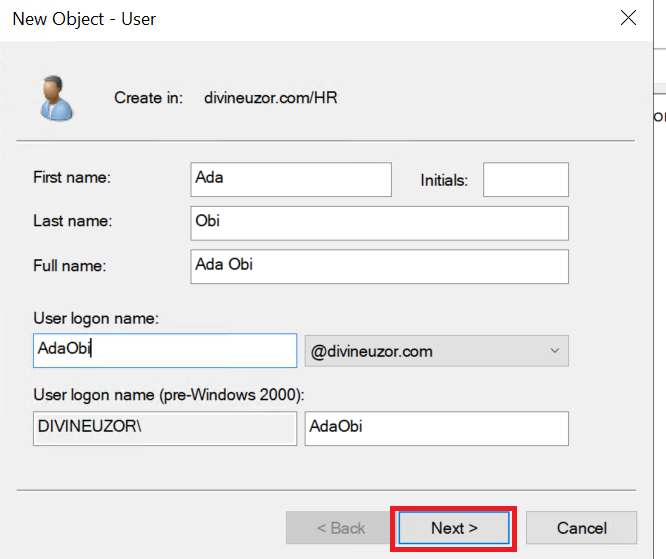

4. Enter and confirm a password. Leave **User must change password at next logon** selected, then select **Next** and **Finish**.

   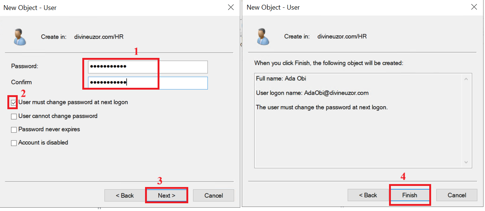

5. Select the **HR** OU in the left pane and confirm that Ada Obi appears in its user list.

   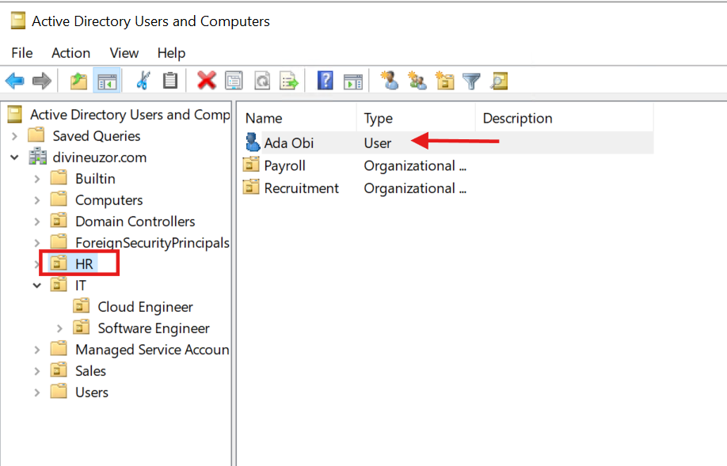

### Task 2: Create a Security Group for IT Staff

Permissions are assigned to a group rather than individually to each user. This task creates `IT Staff` and adds Glory Davies and Amaka Okoye so that folder permissions can be assigned once to the group.

1. In Active Directory Users and Computers, right-click the **IT** OU, select **New**, then **Group**.
2. Enter `IT Staff` as the group name. Leave **Group scope** set to **Global** and **Group type** set to **Security**, then select **OK**.
3. Double-click the new **IT Staff** group, open the **Members** tab, and select **Add**.
4. Enter `Glory Davies; Amaka Okoye`, select **Check Names**, then select **OK**. Select **OK** again to close the group's Properties window.

   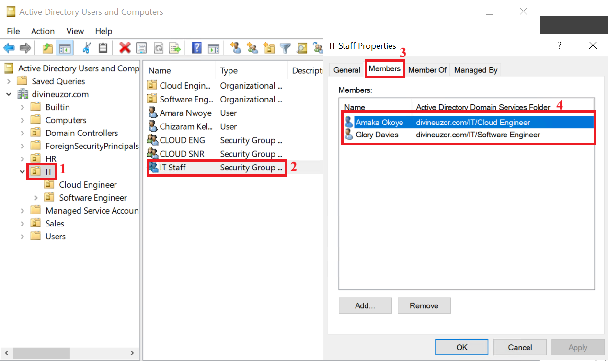

**Why use a group?** Adding users directly to folder permissions would require editing the folder each time someone joins the IT team. With group-based permissions, new team members can be added to `IT Staff` without changing the folder's permission entries.

### Task 3: Create the Shared Folder

1. On DC01, open **File Explorer** and go to the `C:` drive.
2. Right-click an empty area, select **New**, then **Folder**, and name the folder `IT Projects`.

   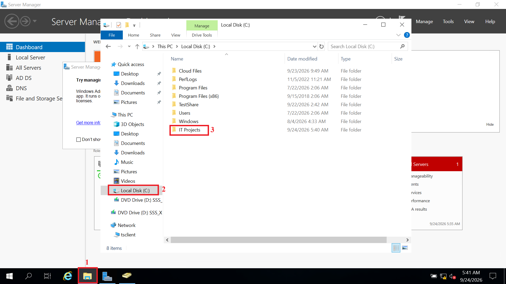

### Task 4: Assign NTFS Permissions (Rule 1)

This task gives Glory Davies NTFS permission from two sources: directly and through the `IT Staff` group.

1. Right-click **IT Projects**, select **Properties**, then open the **Security** tab.
2. Select **Edit**, then **Add**.

   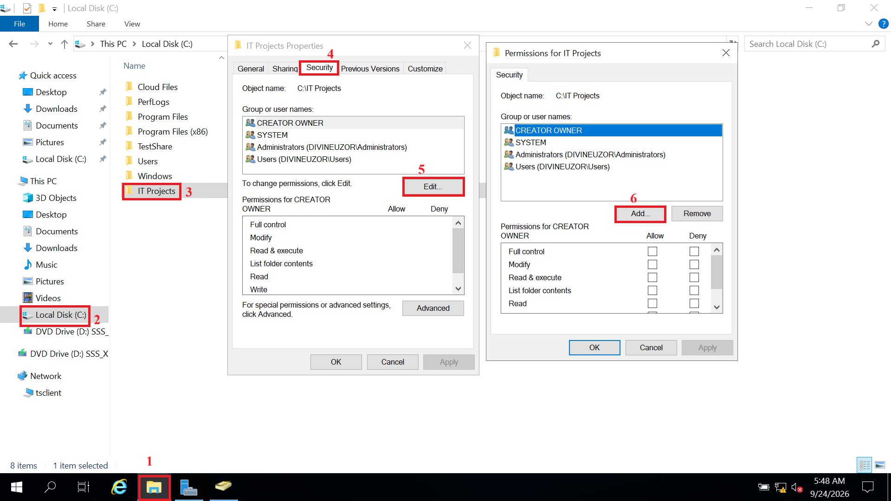

3. Enter `IT Staff`, select **Check Names**, then **OK**.
4. With **IT Staff** selected, select the **Allow** box next to **Modify**, then select **Apply**.

   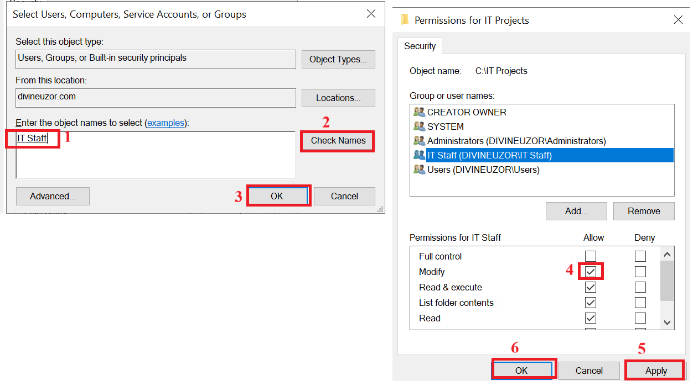

5. Select **Add** again. Enter `Glory Davies`, select **Check Names**, then **OK**.
6. With **Glory Davies** selected, select only **Allow** next to **Read**. Do not select **Modify** for her individual entry. Select **Apply**, then **OK**.

   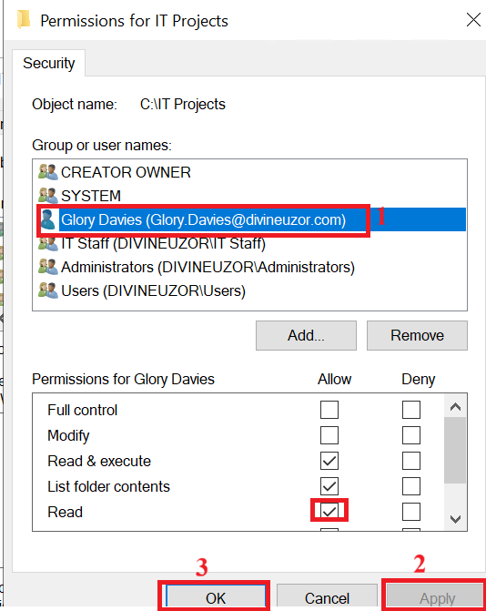

**What this establishes:** Glory Davies has Read assigned directly and Modify assigned through `IT Staff`. Under the lab's first rule, her effective NTFS permission should be Modify, the higher of the two Allow permissions. Task 5 checks this using Effective Access.

### Task 5: Verify Rule 1 With the Effective Access Tab

1. On the folder's **Security** tab, select **Advanced**.
2. Open the **Effective Access** tab and select **Select a user**.

   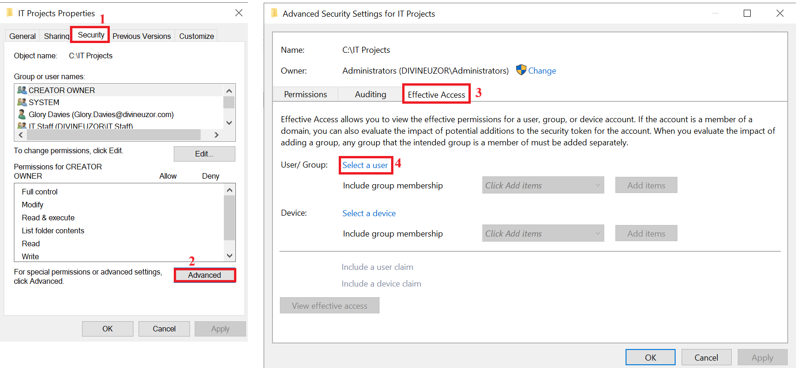

3. Enter `Glory Davies`, select **Check Names**, then **OK**.

   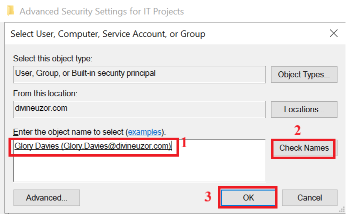

4. Select **View effective access**.

   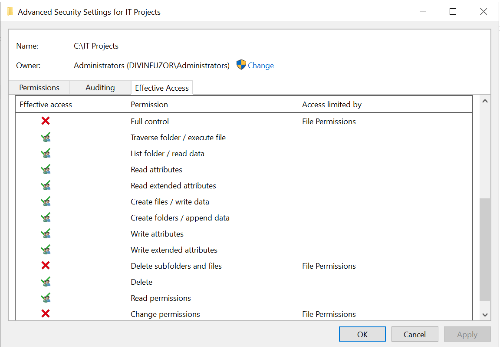

Effective Access displays individual special permissions rather than a single label such as Modify. The result should show the permissions associated with Modify while Full Control and permission-management actions, such as changing permissions and taking ownership, remain unavailable. This verifies how the two Allow sources combine for NTFS access.

### Task 6: Share the Folder (Rule 2)

The folder is shared over the network with a permission deliberately more restrictive than the NTFS permission. This allows the next task to demonstrate how the more restrictive permission controls network access.

1. In the folder's **Properties**, open the **Sharing** tab and select **Advanced Sharing**.
2. Select **Share this folder**. Leave the share name as `ITProjects`, then select **Permissions**.

   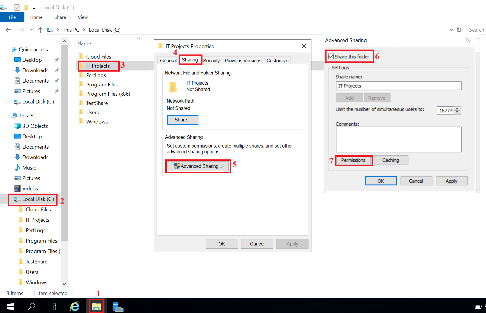

3. Select the default **Everyone** entry and select **Remove**.
4. Select **Add**, enter `IT Staff`, select **Check Names**, then **OK**.

   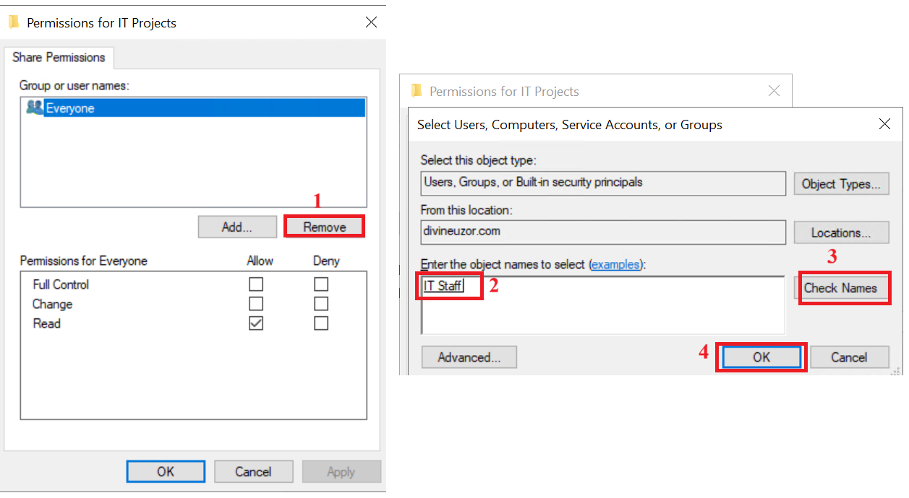

5. With **IT Staff** selected, select only **Allow** next to **Read**. Select **Apply**, **OK**, **OK** again, then **Close**.

   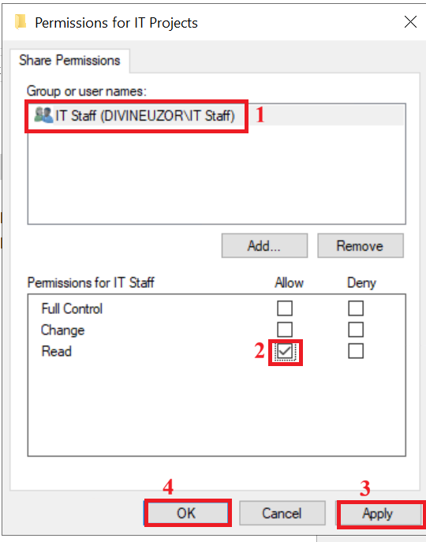

**What this establishes:** `IT Staff` has Modify on the NTFS side but only Read on the share side. When a member accesses the folder over the network, the more restrictive share permission limits the effective access to Read.

### Task 7: Test Network Access as Glory Davies (Rule 2 in Action)

1. On the client PC, sign out of the current account if necessary. At the sign-in screen, choose **Other user**.
2. Sign in with Glory Davies' domain account. The example logon format is `DIVINEUZOR\GloryD`; use the actual logon name configured for the account.

   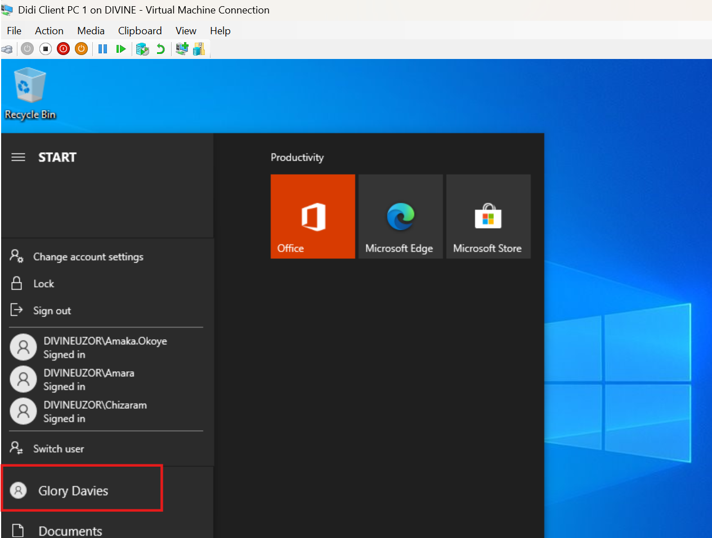

3. Open File Explorer, select the address bar, enter the network path `\\DIVINE-DCO1\IT Projects`, and press **Enter**.
4. Inside the folder, right-click an empty area and select **New**, then **Text Document**. The attempt should produce a **You need permission to perform this action** message.

   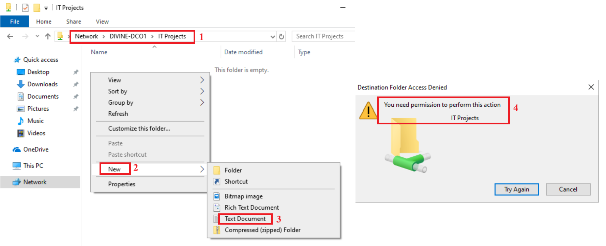

Although Task 5 confirmed that Glory has Modify through NTFS, she cannot create a file over the network because the share permission is Read only. Windows evaluates both permission layers, and the more restrictive one applies.

### Task 8: Grant Glory Davies Local Logon Rights, Then Confirm Local Access Behaves Differently

By default, standard users are not generally permitted to sign in locally to a domain controller. This lab grants Glory Davies the required local logon right through Group Policy so that local folder access can be compared with network access.

1. On DC01, open **Server Manager**, select **Tools**, then **Group Policy Management**. Alternatively, press `Win + R` and run `gpmc.msc`.
2. Expand **Forest**, **Domains**, `divineuzor.com`, then **Domain Controllers**.
   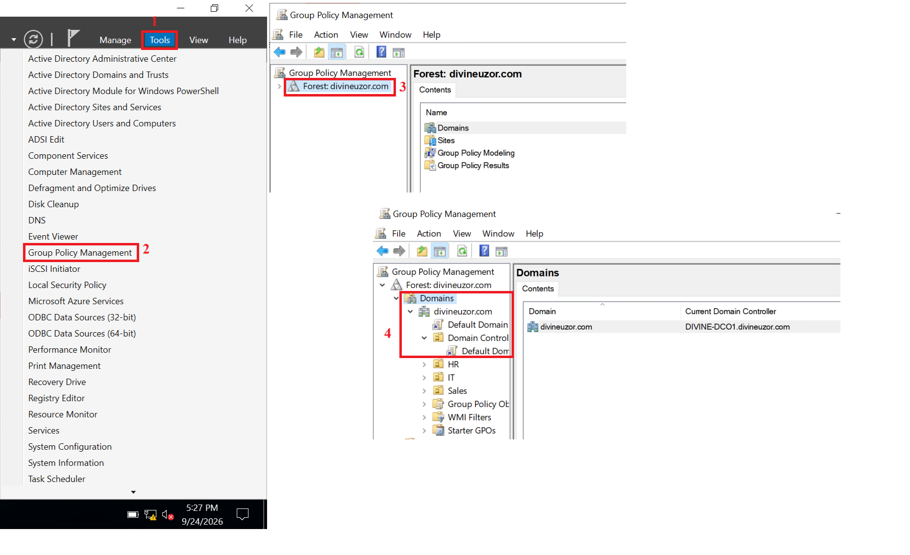

3. Right-click **Default Domain Controllers Policy** and select **Edit**.
4. In Group Policy Management Editor, navigate to **Computer Configuration → Policies → Windows Settings → Security Settings**.

   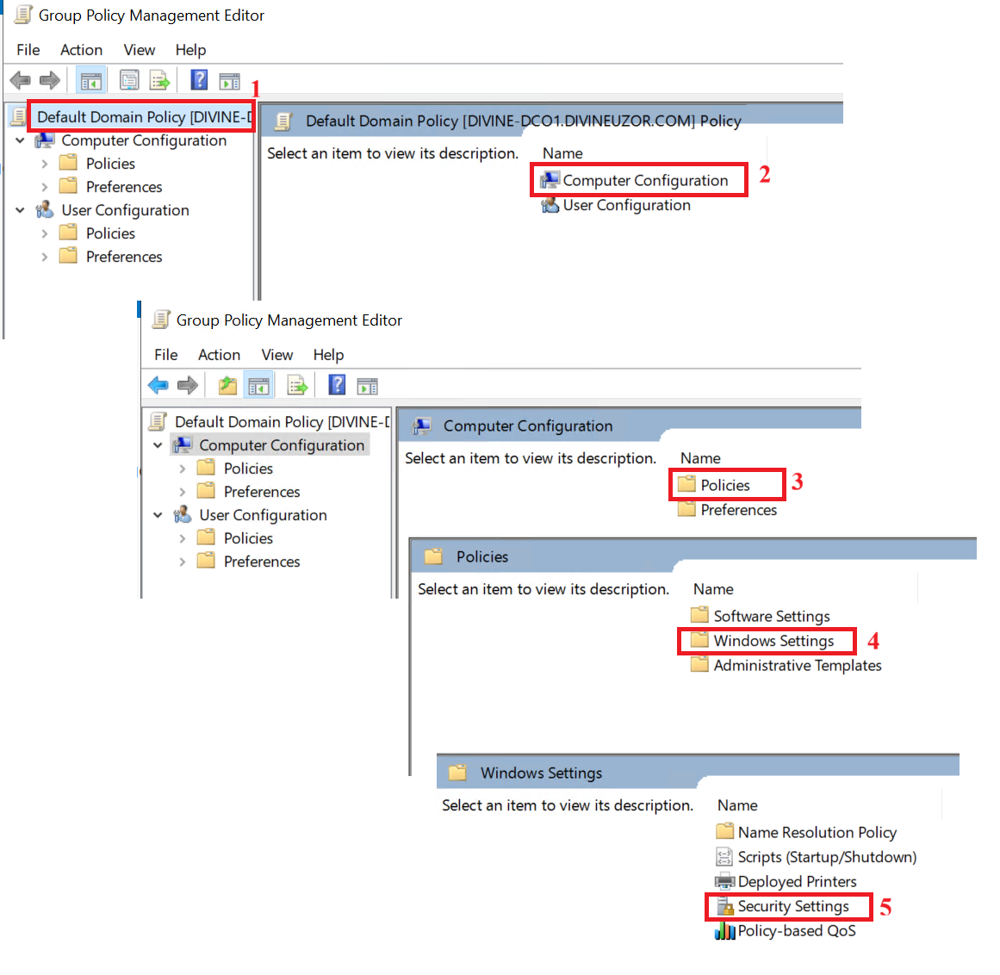

5. Select **Local Policies**, then **User Rights Assignment**.

   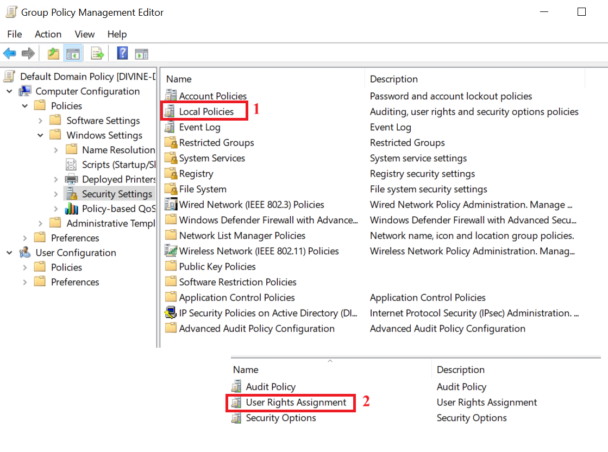

6. Double-click **Allow log on locally**. Select **Add User or Group**, enter `Glory Davies`, select **Check Names**, then **OK** twice.

   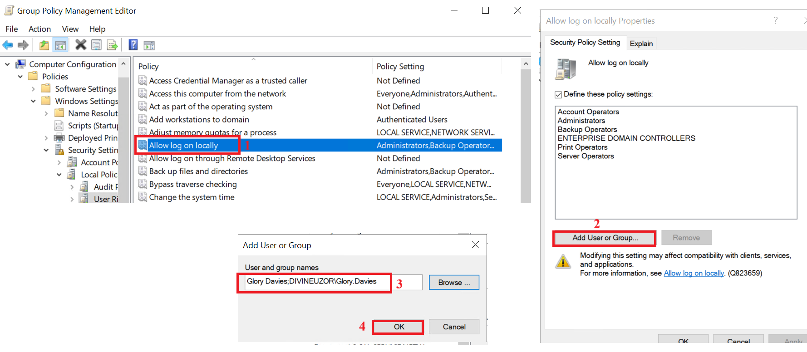

7. Close Group Policy Management Editor. Open Command Prompt and run:

   ```powershell
   gpupdate /force
   ```

   This applies the policy change immediately rather than waiting for the normal background refresh.

   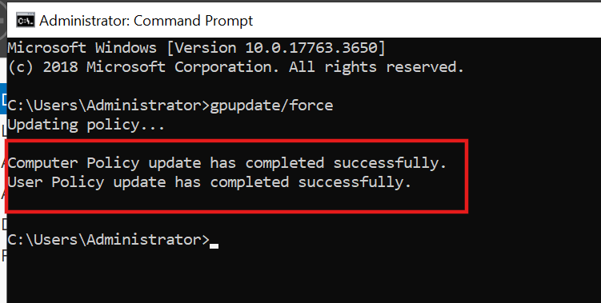

**Important lab note:** This change applies to every domain controller sharing the Default Domain Controllers Policy, which in this environment includes DC01 and DC02. Broadly granting local logon rights on a domain controller is not standard production practice. The permission is granted here only to test local access behavior. Consider removing the lab change afterward if the environment will be reused.

8. On DC01's own console (the Hyper-V Virtual Machine Connection window, not the client PC), sign out of the current account. Choose **Other user** and sign in with Glory Davies' domain account.

   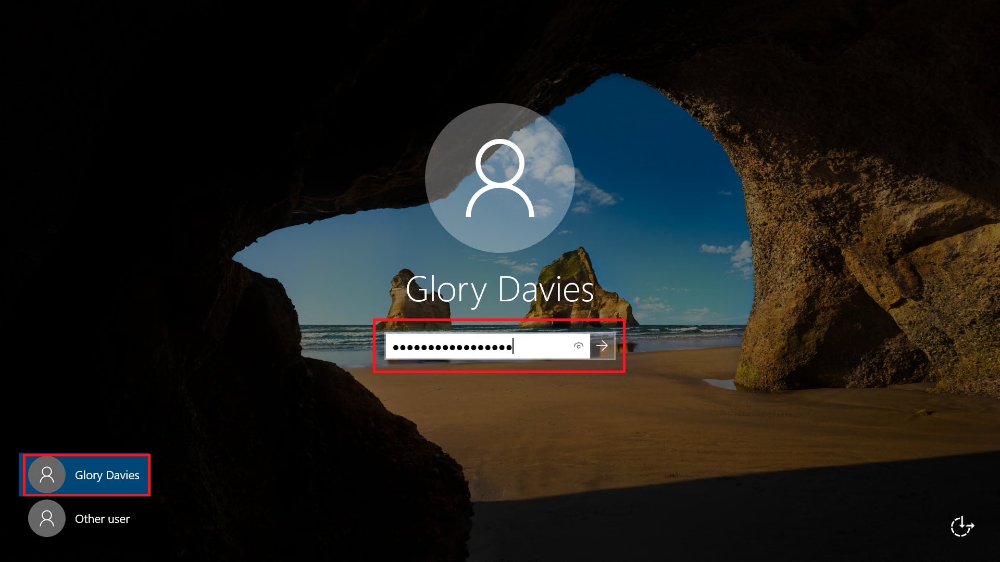

9. Open File Explorer and go directly to `C:\IT Projects` using the local path, not the network share path.
10. Right-click an empty area, select **New**, then **Text Document**, and confirm that the file is created successfully.

   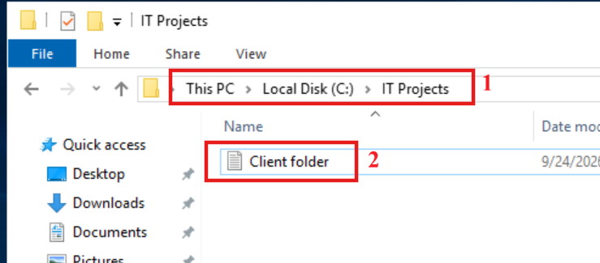

**Why the result differs:** When Glory accesses the folder over the network, share permissions also apply and restrict her to Read. When she accesses `C:\IT Projects` locally on the server, share permissions are bypassed and NTFS permissions govern access. Her Modify permission therefore allows the file to be created locally.

**Real-life IT scenario:  The confusing access ticket:** A user reports being able to edit files when signed in at the server but receiving Access Denied from their desktop. The account and NTFS permissions may be unchanged; the difference is that network access is also subject to share permissions, while local file-system access is not.

### Task 9: Confirm Default-Deny Behavior

Chisom CM Mmesoma, in the Sales OU, has not been added to `IT Staff` and has no direct permission on **IT Projects**. This task confirms that NTFS does not grant access by default.

1. On the client PC, sign out and sign back in as Chisom CM Mmesoma's domain account.

   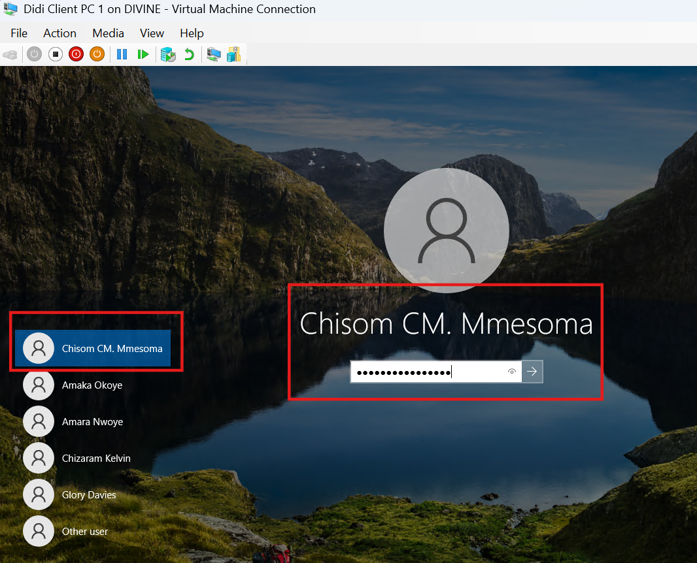

2. Open File Explorer, enter `\\DC01\IT Projects` in the address bar, and press **Enter**.

   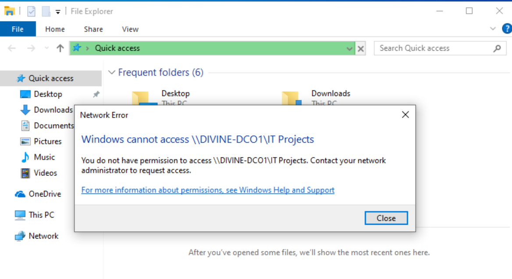

Chisom should be blocked from accessing the shared folder. Because she has no NTFS permission and no share permission from any source, no Allow permission exists to combine.

### Task 10: Demonstrate an Explicit Deny

This task uses Ada Obi, created in Task 1, to demonstrate that an explicit NTFS Deny overrides an Allow.

1. In Active Directory Users and Computers, double-click **IT Staff**, open the **Members** tab, select **Add**, enter `Ada Obi`, select **Check Names**, then **OK** twice.

   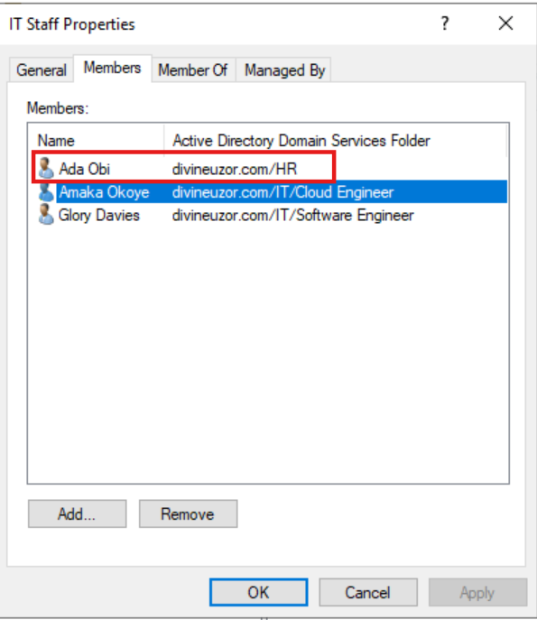

**Why add an HR user to an IT group?** This is a deliberate lab setup. Ada receives Modify through `IT Staff`; the next steps add an explicit Deny directly to her account to demonstrate how Deny overrides that Allow. This is not a recommendation to add HR users to IT groups in a production environment.

2. On DC01, right-click **IT Projects**, select **Properties**, open the **Security** tab, select **Edit**, then **Add**. Enter `Ada Obi`, select **Check Names**, then **OK**.
3. With **Ada Obi** selected, select **Deny** next to **Write**, then select **Apply**. Windows displays a security warning about Deny entries; select **Yes** to confirm.

   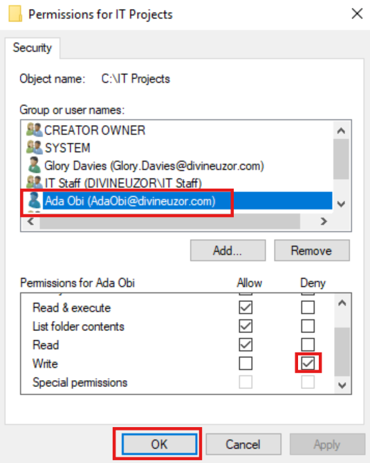

4. Select **Advanced**, open the **Effective Access** tab, select Ada Obi, then select **View effective access**.

   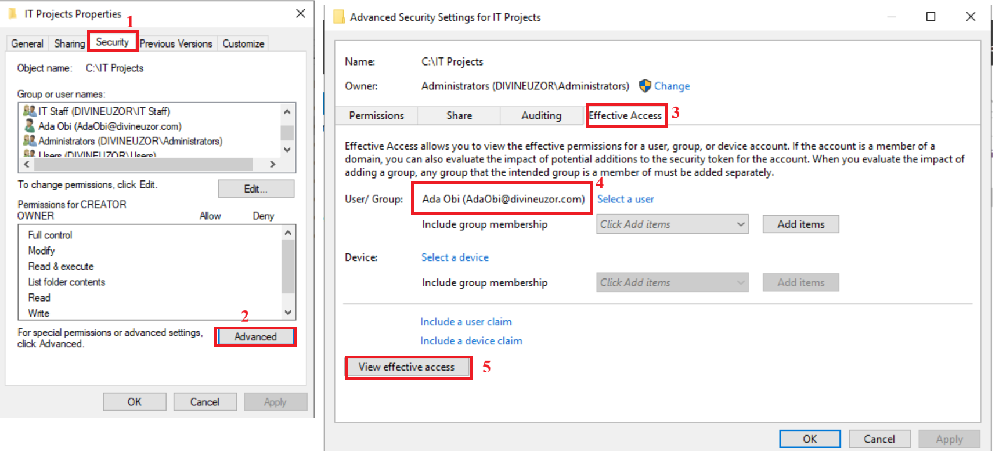

Ada Obi's Effective Access result shows Write and Create actions denied because of the NTFS File Permissions. Her explicit Deny overrides the Modify Allow inherited through `IT Staff`.

   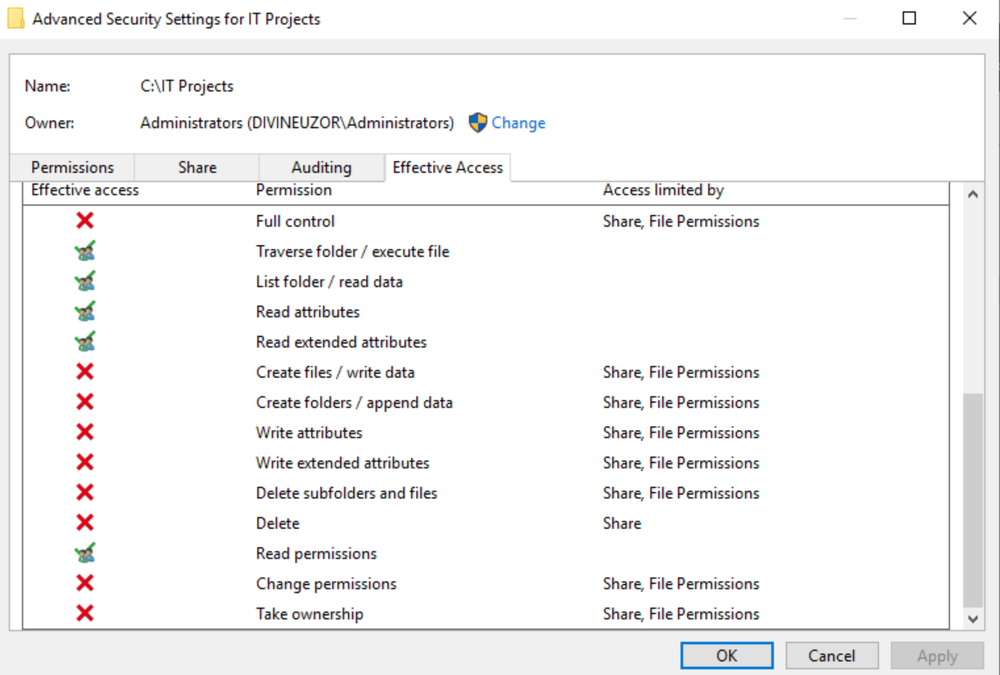

**Note:** Effective Access evaluates NTFS permissions; it does not display the share Read restriction. In a network access scenario, Ada is also limited by the share permission.

## Why This Matters for IT Support and Systems Administration

- **Troubleshooting access tickets:** Check whether the user has NTFS permission, whether the user has share permission when accessing over the network, and whether an explicit Deny exists.
- **Group-based permissions:** Assigning permissions to groups instead of individual users simplifies onboarding and offboarding.
- **Interpreting Effective Access:** The Effective Access tab evaluates NTFS permissions, not share permissions. This distinction helps prevent incorrect conclusions when network access is blocked by the share.
- **Comparing local and network access:** The same user can have different outcomes depending on whether the folder is accessed through a network share or directly through the server's local file system.

## Summary

You created a shared folder, assigned NTFS and share permissions using Active Directory users and groups, and tested how Windows evaluates access.

The exercises demonstrated that multiple NTFS Allow permissions combine, an explicit Deny overrides an Allow, and network access is limited by whichever is more restrictive between NTFS and share permissions. Local access on the server is governed by NTFS permissions alone.

The `IT Projects` folder, `IT Staff` group, and Ada Obi account can be retained for future labs or removed if the environment is being reset.
