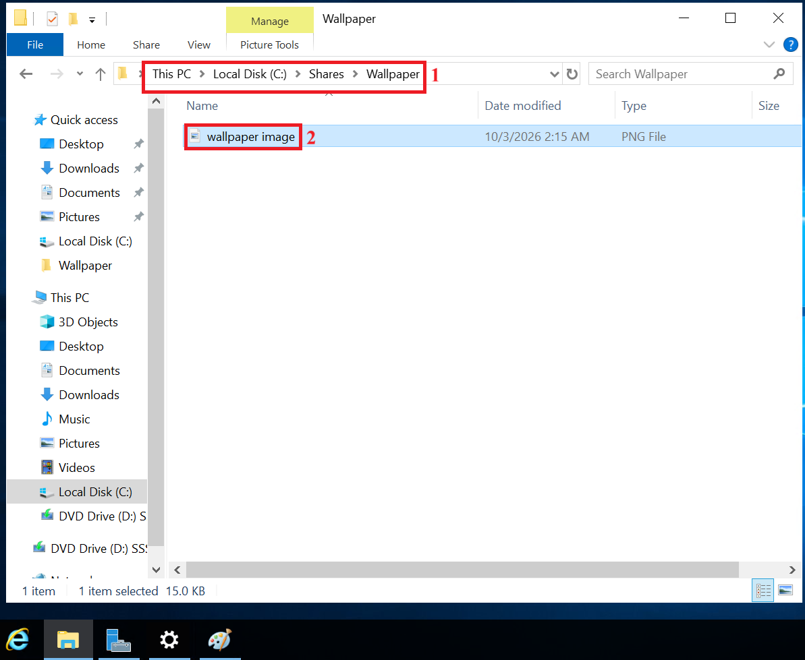
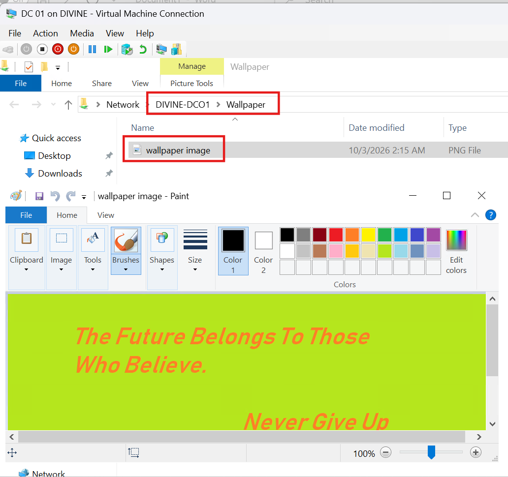
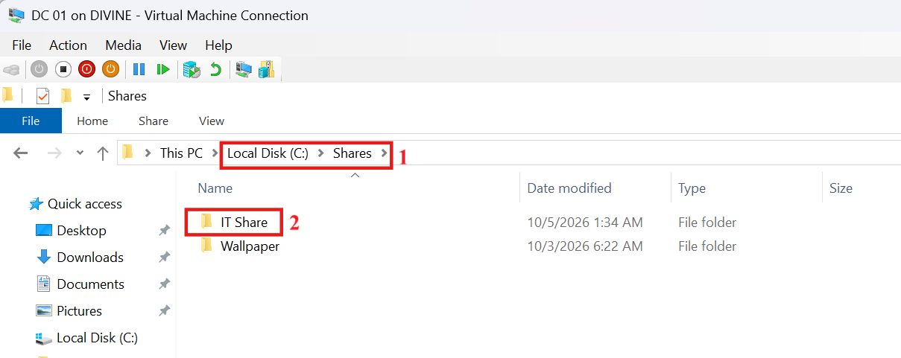
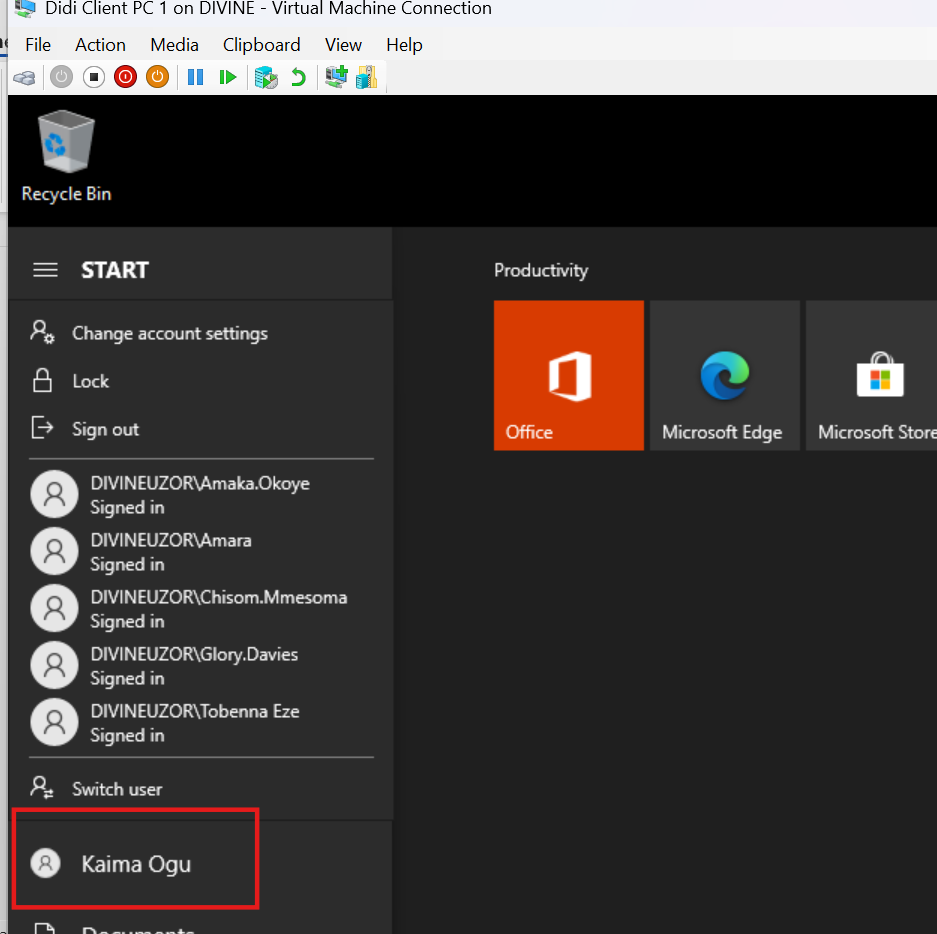
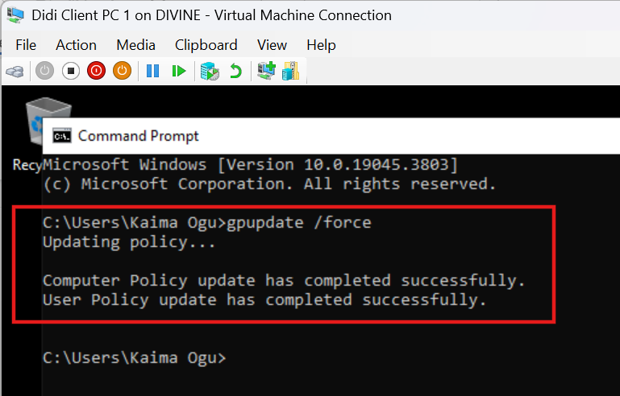
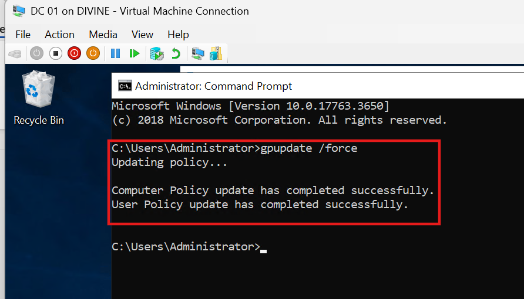

# Lab 12: Group Policy Management -- Wallpaper, Drive Mapping, and Account Security

## Overview

This lab demonstrates how Group Policy can be used to standardize user
desktops, provide controlled access to shared folders, and strengthen
domain account security in a Windows Server environment.

The exercises build on the Active Directory domain and Group Policy
configuration established in Lab 11. They reuse the existing IT OU, IT
Staff security group, IT Drive Map GPO, and GPO-Pilot-Users group,
extending those components to deliver additional administrative
outcomes.

The lab covers three practical objectives:

1.  Deploy a standard desktop wallpaper to users in the IT OU from a
    shared UNC path.
2.  Extend an existing drive-mapping GPO to provide a new shared folder
    to members of the IT Staff group.
3.  Configure domain password and account lockout policies.

## Lab Environment and Prerequisites

-   DC01 with Active Directory Domain Services and DNS working.
-   An OU named IT containing at least one user.
-   A Windows 10 client joined to the domain, with its DNS pointing to
    DC01.
-   The client computer account sits in an OU you can link a GPO to
    (called Client Computers below).

Where a task relies on something configured in Lab 11, the steps
identify the existing component and explain what is being added.

**Scenario:** The IT department needs a consistent desktop, access to a
shared folder restricted to an authorized group, and stronger account
security.

------------------------------------------------------------------------

## Task 1: Deploy a Standard Desktop Wallpaper

**Objective:** Every user in the IT OU receives the same desktop
wallpaper, loaded from a shared UNC path.

### Part A: Create the wallpaper folder on DC01

1.  Open File Explorer and go to `C:\`.
2.  Create a folder named `Shares`, open it, and create a folder named
    `Wallpaper`.

### Part B: Design the wallpaper

1.  Open Paint.
2.  Use the Text tool to write your text of choice.

3.  Select File → Save as → PNG picture and save it as `wallpaper.png`
    in `C:\Shares\Wallpaper`.

### Part C: Share the folder and assign permissions

1.  Right-click the Wallpaper folder and select Properties → Sharing →
    Advanced Sharing.
2.  Tick Share this folder, then click Permissions.
3.  Remove Everyone.
4.  Click Add, enter IT Staff, click Check Names, and tick Allow → Read.

5.  Click Add again, enter Administrators, click Check Names, and tick
    Allow → Read. Click OK twice.

6.  Open the Security tab and click Edit.
7.  Add IT Staff with Read & execute, List folder contents, Read.

8.  Make sure Administrators has Full control. Click Apply and OK.

9.  On the Sharing tab, note the network path.

UNC path to the file: `\\DIVINE-DCO1\Wallpaper`

**Note:** The IT group needs read access so their computers can load the
wallpaper. Administrators are added so you can manage and test the share
from DC01. Without this, Windows denies you access even though you're
the admin.

### Part D: Test the UNC path

1.  On DC01, press Win + R, paste the UNC path, and press Enter.
2.  The image should open. If you get "Access denied", check that
    Administrators appears in both the share permissions and the NTFS
    permissions.

### Part E: Create and link the GPO

1.  Open Server Manager → Tools → Group Policy Management.
2.  Right-click the IT OU and select Create a GPO in this domain, and
    Link it here. Name it IT-Wallpaper.

3.  Right-click the GPO and select Edit.
4.  Go to User Configuration → Policies → Administrative Templates →
    Desktop → Desktop.

5.  Open Desktop Wallpaper, select Enabled, enter the UNC path in
    Wallpaper Name, and set Wallpaper Style to Fill.
6.  Click Apply and OK.

### Part F: Verify on the client

1.  Sign in to the Windows 10 client PC as an IT user.
2.  Run `gpupdate /force`, then sign out and sign back in.

**Key takeaway:** Wallpaper is a user policy, so it applies at logon.
The users must be in the OU the GPO is linked to, and both share and
NTFS permissions must allow read access.

------------------------------------------------------------------------

## Task 2: Map a Network Drive

**Objective:** Automatically map a shared folder as a network drive for
members of one security group and confirm that users outside the group
cannot access it.

### Part A: Create a new user in the existing IT OU

1.  On the domain controller, open Server Manager → Tools → Active
    Directory Users and Computers.
2.  Expand divineuzor.com and right-click the existing IT OU.
3.  Select New → User.

4.  Enter first name Kaima, last name Ogu, and a user logon name.
5.  Click Next, set a password, and untick User must change password at
    next logon to keep testing simple.
6.  Click Next → Finish.

### Part B: Create a security group and add the user

1.  Right-click the IT OU and select the IT Staff security group.
2.  Open the group, go to the Members tab, and add Kaima Ogu.

### Part C: Create, share, and secure the folder

1.  In `C:\Shares`, create a folder named IT Share.

2.  Right-click the folder and select Properties → Sharing → Advanced
    Sharing.
3.  Tick Share this folder, then click Permissions.
4.  Remove Everyone.
5.  Click Add, enter IT Staff, click Check Names, and tick Allow →
    Change and Read.
6.  Click Add again, enter Administrators, click Check Names, and tick
    Allow → Full Control. Click OK twice.

7.  Open the Security tab and click Advanced.
8.  Click Disable inheritance, then select Convert inherited permissions
    into explicit permissions. Click OK.
9.  Click Edit.
10. Remove the general Users entry if present.
11. Click Add, enter IT Staff, and give it Modify.
12. Make sure Administrators has Full control, and leave SYSTEM in
    place.
13. Click Apply, then OK.

UNC path: `\\DIVINE-DCO1\IT Share`

**Note:** Administrators are added to both the share and NTFS
permissions so you can manage and test the folder from DC01. Without
that, Windows denies you access even though you are the admin, because
share permissions apply to UNC paths on the server too.

### Part D: Test the UNC path

On DC01, press Win + R, paste `\\DIVINE-DCO1\IT Share`, and press Enter.

1.  The folder should open. If you get "Access denied", check that
    Administrators appears in both the share permissions and the NTFS
    permissions.

### Part E: Configure the drive map GPO

#### Step 1: Update the security filtering

The existing GPO was filtered to a pilot group from the previous lab, so
users in IT Staff would not receive it until the group is added.

1.  Open Group Policy Management.
2.  Expand Forest → Domains → divineuzor.com → Group Policy Objects and
    select IT Drive Map.
3.  On the Scope tab, confirm that the GPO is linked to the IT OU. Under
    Security Filtering, you will see GPO-Pilot-Users, which was added in
    the previous lab.
4.  Click Add, enter IT Staff, click Check Names, and click OK.

The Security Filtering list should now show both GPO-Pilot-Users and IT
Staff.

#### Step 2: Add the new drive map

1.  Right-click IT Drive Map in the left pane and select Edit.

2.  Go to User Configuration → Preferences → Windows Settings → Drive
    Maps.

3.  The existing mapping from the previous lab is listed here. Do not
    change it.

4.  Right-click in the right pane and select New → Mapped Drive.

5.  On the General tab, set:

    -   Action: Create
    -   Location: `\\DIVINE-DCO1\IT Share` (use the exact share name
        from the Sharing tab, including the space)
    -   Reconnect: ticked
    -   Label as: IT Share
    -   Drive Letter: select Use and choose J:. Pick a letter the
        existing mapping does not use.

6.  Click Apply, then OK.

The Drive Maps list should now show two entries: the existing G: mapping
and the new J: mapping.

### Part F: Verify on the client

1.  On the Windows 10 client, sign in as Kaima Ogu.

2.  Run `gpupdate /force`, then sign out and back in.

3.  Open This PC and confirm IT Share (J:) appears.

4.  Open the drive and create a test file to confirm you have write
    access.

5.  Sign in as an IT user who is not in IT Staff group. The drive should
    not appear, or access should be denied.

**Key takeaway:** Share and NTFS permissions are evaluated together, and
the more restrictive one wins. Item-level targeting controls who
receives the mapping, while permissions control who can actually open
it. Administrators need explicit entries on both layers to manage the
folder.

------------------------------------------------------------------------

## Task 3: Password and Account Lockout Policy

**Objective:** Enforce strong passwords and lock accounts after repeated
failed sign-ins.

### Configuration

1.  In Group Policy Management, right-click Default Domain Policy and
    select Edit.
2.  Go to Computer Configuration → Policies → Windows Settings →
    Security Settings → Account Policies → Password Policy.

3.  Configure:

 | Policy | Value |
|---|---|
| Minimum password length | 12 characters |
| Password must meet complexity requirements | Enabled |
| Maximum password age | 90 days |

4.  Go to Account Lockout Policy and configure:

 | Policy | Value |
|---|---|
| Account lockout threshold | 5 invalid logon attempts |
| Account lockout duration | 15 minutes |
| Reset account lockout counter after | 15 minutes |

5.  Run `gpupdate /force` on DC01.

### Verification

1.  In Active Directory Users and Computers, try to reset a user's
    password to a weak value such as 123. It should be rejected.

2.  On the client, enter a wrong password five times for a test user.
    The account should lock.

3.  In ADUC, open the user's Account tab to see the lockout state, and
    unlock it.

**Key takeaway:** Domain password and lockout policies only take effect
when set at the domain level (Default Domain Policy). Linking them to an
OU does not change domain accounts.

## Conclusion

This lab covered three Group Policy tasks: user desktop settings, drive
mapping with item-level targeting and domain password and lockout
policy. Together they show the difference between user and computer
policies, how GPO linking and scope work, how share and NTFS permissions
interact and why account policies must be set at the domain level.
