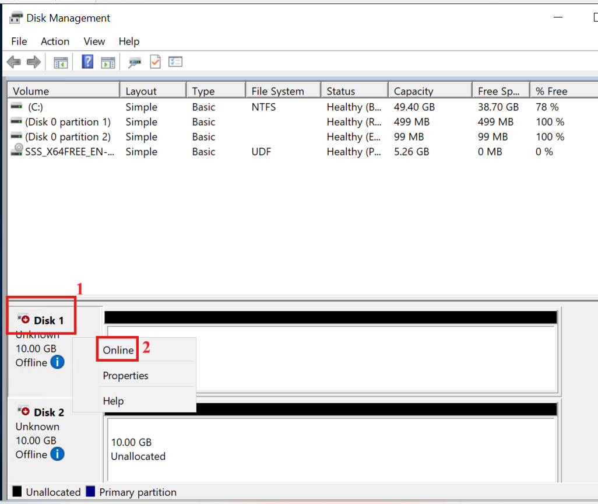
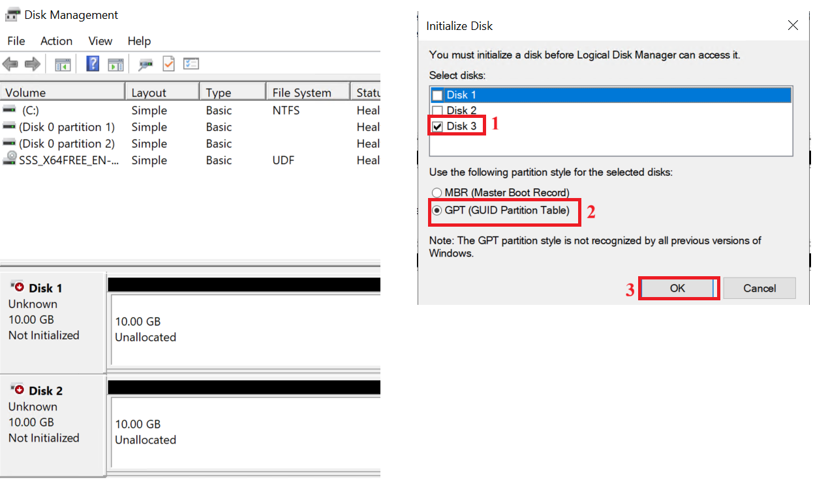
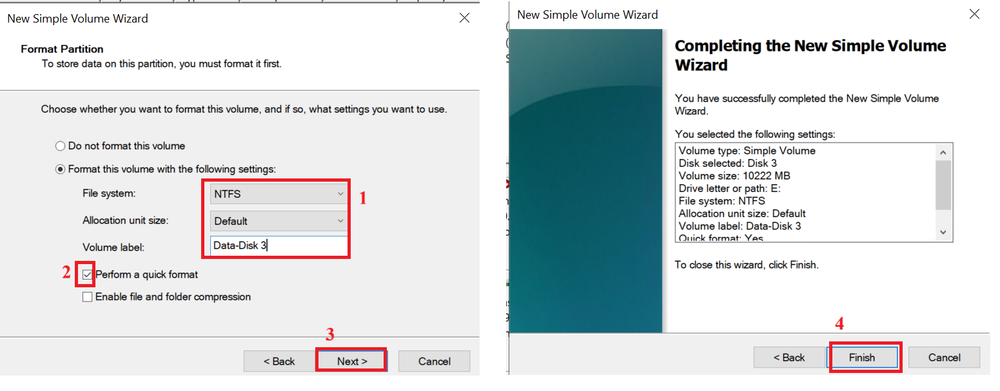
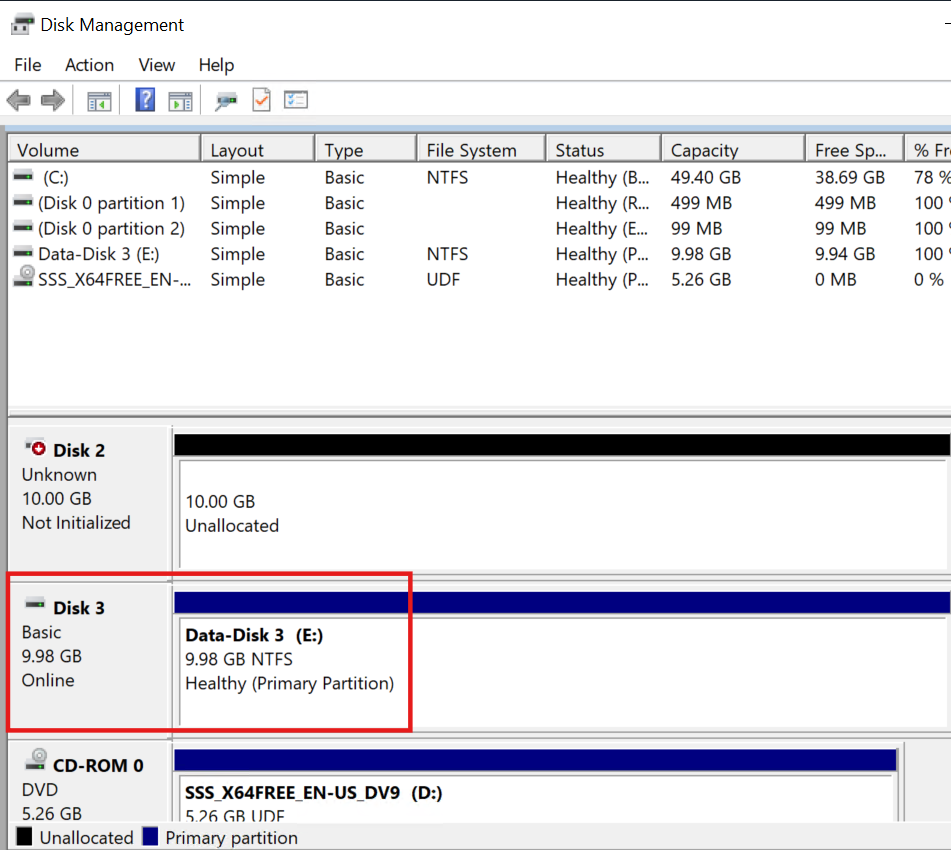
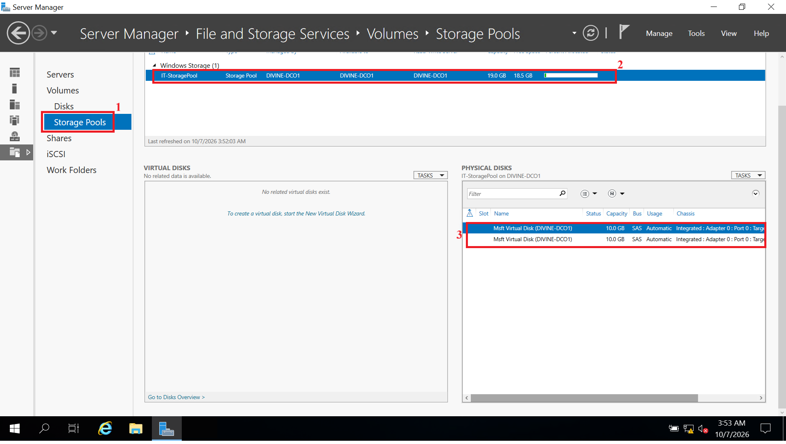
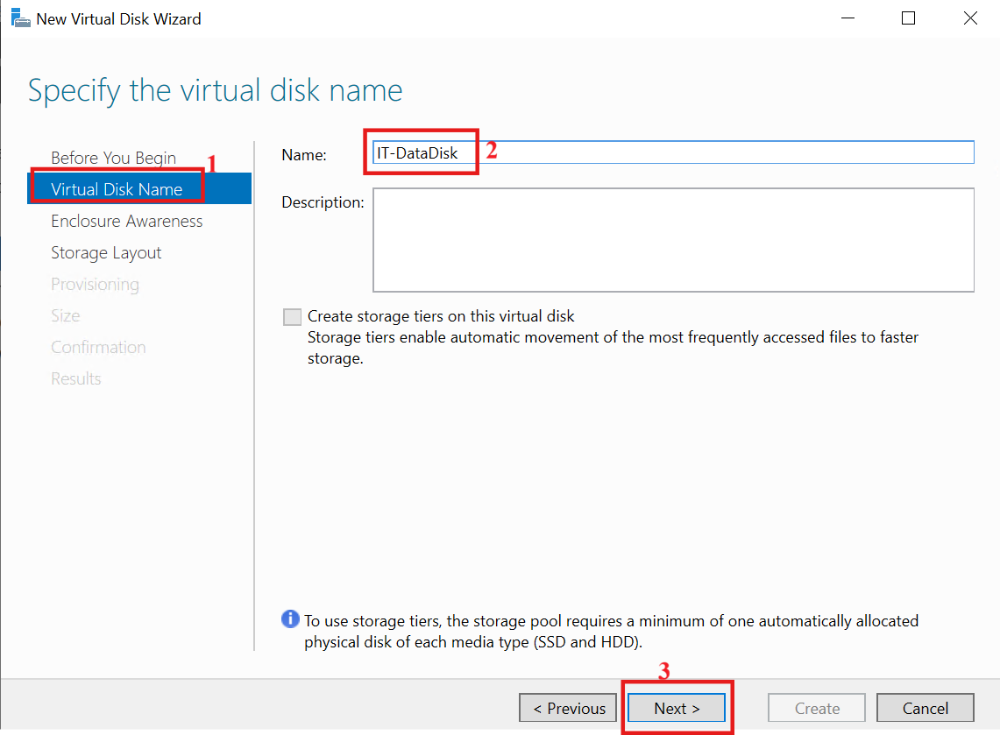
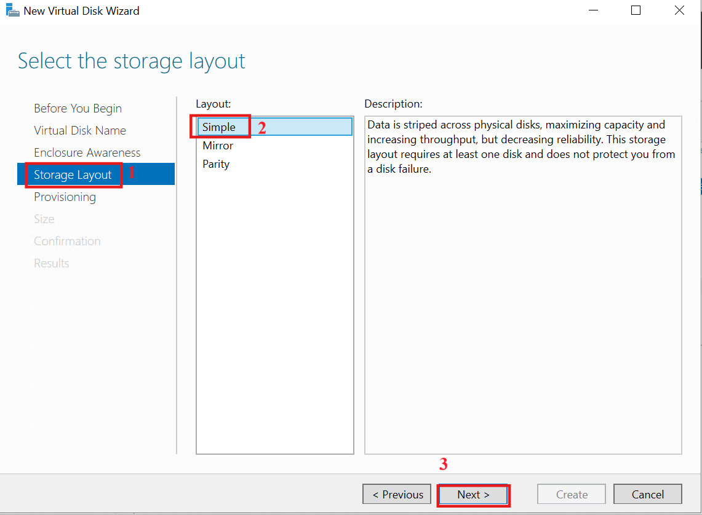
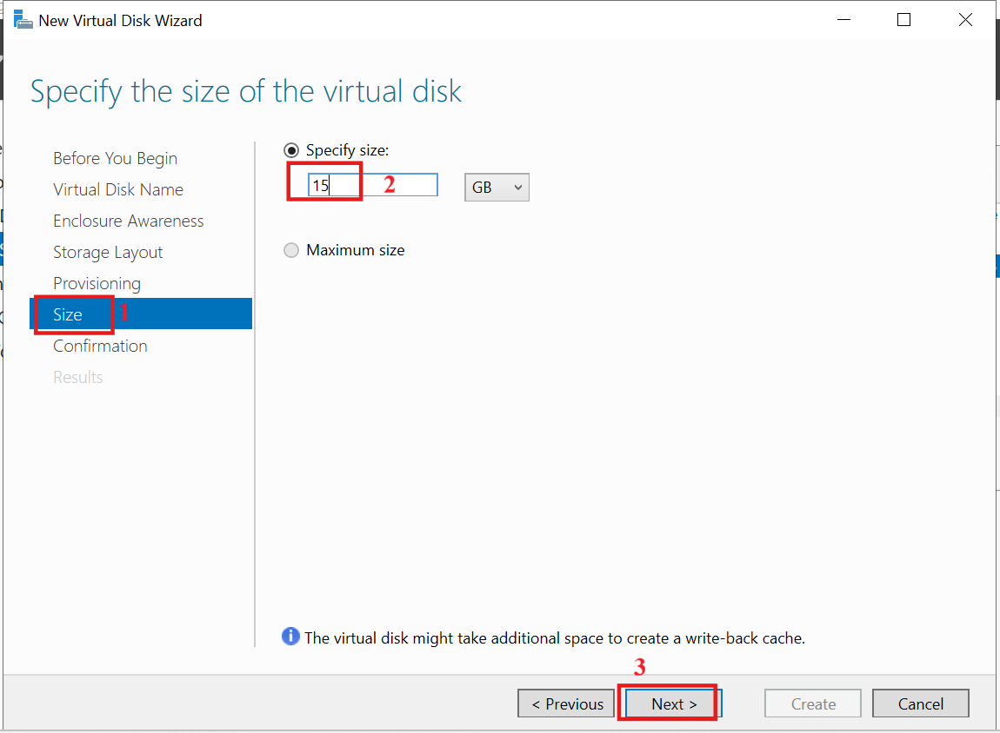

# Lab 13: Disk Management and Storage Pools

## Overview

Storage capacity is a core part of Windows Server administration. As
organizations store more data, administrators need to manage disks,
organize storage, and provide flexible capacity for applications and
users.

This lab demonstrates how to attach additional virtual disks to a
Windows Server, manage an individual disk using Disk Management, and
combine multiple disks into a Storage Pool using Storage Spaces. It then
creates a virtual disk and a usable NTFS volume from the pooled
capacity.

## Real-World Scenario

A Windows Server is running low on storage. The organization does not
want to replace the existing system disk, but additional disks are
available. The administrator needs to attach the disks, verify them,
combine selected disks into a Storage Pool, create a virtual disk from
the pool, and create a volume so Windows can use the storage.

## Lab Environment

-   One Windows Server virtual machine: DC01.
-   Hyper-V is used to create and attach three 10 GB virtual hard disks.
-   The additional disks are VHDX files stored on the physical computer
    running Hyper-V. They are not additional physical disks.

Disk Management and Storage Pools are local storage technologies. They
do not require communication between the domain controllers or the
client, so the additional disks are attached directly to DC01.

## Lab Objectives

By the end of this lab, you will be able to:

-   Identify the disks attached to a Windows Server.
-   Explain the difference between a disk, partition, volume, Storage
    Pool, and virtual disk.
-   Create and attach virtual hard disks in Hyper-V.
-   View disks in Disk Management and bring an offline disk online.
-   Identify unallocated disk space.
-   Initialize a disk and choose a partition style.
-   Create a partition and volume, and format it with NTFS.
-   Verify the new volume in File Explorer.
-   Create a Storage Pool from multiple disks.
-   Create a virtual disk from a Storage Pool.
-   Create and format a volume on the virtual disk.

## Storage Concepts

| Term | Meaning |
|---|---|
| Disk | A storage device presented to Windows. In this lab, the additional disks are Hyper-V virtual hard disks. |
| Partition | A defined section of a disk. |
| Volume | A storage area formatted with a file system such as NTFS, usually with a drive letter. |
| Storage Pool | A combined pool of capacity from multiple disks. |
| Virtual Disk | A disk created from a Storage Pool's capacity. |
| Initialize | Writing a partition table (GPT or MBR) to a new disk so Windows can create partitions on it. |

The relationship between the layers is:

**Disks → Storage Pool → Virtual Disk → Volume**

Note: Two different things are called a "virtual disk" in this lab. The
VHDX files created in Hyper-V are virtual hard disks that simulate
physical disks. The virtual disk created later is a Storage Spaces
object carved out of the pool.

------------------------------------------------------------------------

## Part 1: Prepare the Virtual Disks in Hyper-V

Three 10 GB virtual hard disks are created and attached to DC01.

### Step 1: Open the VM settings

1.  On the physical computer, open Hyper-V Manager.
2.  Right-click the DC01 virtual machine and select **Settings**.


### Step 2: Add the first virtual hard disk

1.  In the left pane, select **SCSI Controller**.
2.  Select **Hard Drive** and click **Add**.
3.  Click **New** to start the New Virtual Hard Disk Wizard.


### Step 3: Configure the first VHDX

In the wizard, choose:

| Setting | Value |
|---|---|
| Disk format | VHDX |
| Disk type | Dynamically expanding |
| Name | StorageDisk1.vhdx |
| Size | 10 GB |

-   In the "Before You Begin" page click **Next**.


-   Choose the disk type and click **Next**.

A dynamically expanding disk is suitable here because the file grows as
data is written, instead of using the full 10 GB of host storage
immediately.


-   Specify Name and Location.


-   Specify the disk size (for example, 10 GB).
-   Choose the storage location and click **Next**.


-   Review the configuration summary and click **Finish** to complete
    the disk creation process.


### Step 4: Create the second and third virtual hard disks

Repeat Steps 2 and 3 to create StorageDisk2.vhdx and StorageDisk3.vhdx
with the same settings (VHDX, dynamically expanding, 10 GB).

Click **Apply**, then **OK**, so all three disks are attached to the VM.


------------------------------------------------------------------------

## Part 2: Disk Management: Initialize, Partition, and Create a Volume

This part uses Disk 3. Disk 1 and Disk 2 are reserved for the Storage
Pool in Part 3, so do not initialize them or create volumes on them.

### Step 1: Open Disk Management

Start DC01 and sign in.

1.  Right-click the Start button and select **Disk Management**.
    Alternatively, press **Win + R**, type `diskmgmt.msc`, and press
    Enter.
2.  Locate the system disk and the three new disks.

### Step 2: Bring the disks online

1.  Right-click each disk label and select **Online**.



2.  The status changes to Not Initialized.


### Understanding the disk states

-   **Offline:** the disk is not available for normal storage
    operations.
-   **Online:** the disk is available to Windows. A new disk that is
    online but has no partition table is labelled Not Initialized. This
    is normal.
-   **Unallocated:** the space has not been assigned to a partition or
    volume.

### Step 3: Initialize Disk 3

1.  Right-click the Disk 3 label and select **Initialize Disk**.
2.  In the dialog, make sure only Disk 3 is ticked. Untick Disk 1 and
    Disk 2 if they are listed.
3.  Select the partition style **GPT (GUID Partition Table)** and click
    **OK**.



GPT is the modern standard and is suitable for disks of any size. MBR is
the older style, with a 2 TB limit.

Disk 3 now shows as Online with 10 GB of unallocated space.


### Step 4: Create a partition and volume

In Disk Management, the New Simple Volume wizard creates the partition
and the volume together.

1.  Right-click the unallocated space on Disk 3 and select **New Simple
    Volume**, then click **Next**.


2.  Use the maximum volume size then assign a drive letter (for example,
    E:).


3.  Format the volume as NTFS, with the default allocation unit size.
4.  Set the volume label to **Data-Disk3**, and leave **Perform a quick
    format** ticked.
5.  Click **Next**, then **Finish**.






### Step 5: Verify in File Explorer

1.  Open File Explorer and click **This PC**.


2.  Under Devices and drives, confirm the new volume (Data-Disk3 (E:))
    appears.


3.  Create a test text file on the drive to confirm it is usable.


This confirms the disk is online, initialized, partitioned, formatted,
and usable. Disk 1 and Disk 2 remain untouched for the Storage Pool.

------------------------------------------------------------------------

## Part 3: Create a Storage Pool

### Step 1: Open Storage Pools

1.  On DC01, open Server Manager.
2.  Select **File and Storage Services**, then **Storage Pools**.


### Step 2: Start the wizard

1.  In the STORAGE POOLS section, click **Tasks** and select **New
    Storage Pool**.
2.  On the name page, enter the name **IT-StoragePool**.
3.  Select the available disks group (the primordial pool) on DC01 and
    click **Next**.


### Step 3: Select the physical disks

The wizard lists the disks available for pooling. They appear as generic
virtual disks rather than by their VHDX file names, so identify them by
their 10 GB capacity.

1.  Tick both 10 GB disks.
2.  Leave Allocation set to **Automatic**.
3.  Click **Next**.


### Step 4: Confirm and create

1.  Review the summary and click **Create**.


2.  Wait for the results page to show completion, then click **Close**.


### Step 5: Verify the pool

Return to Server Manager → File and Storage Services → Storage Pools.
**IT-StoragePool** should be listed, with both disks shown under
Physical Disks and the combined capacity displayed. The total will be
slightly under 20 GB because Storage Spaces reserves some space for
metadata.



Open Disk Management again. The two disks that joined the pool no longer
appear as separate disks, because they are now managed by Storage
Spaces.


### What just happened

Before the pool, Windows saw two separate disks:

-   Disk 1 → 10 GB
-   Disk 2 → 10 GB

After the pool, their capacity is combined:

``` text
Disk 1 ──┐
         ├──> IT-StoragePool
Disk 2 ──┘
```

The next layers are the virtual disk and the volume:

``` text
Disk 1 ──┐
         ├──> Storage Pool ──> Virtual Disk ──> Volume
Disk 2 ──┘
```

------------------------------------------------------------------------

## Part 4: Create a Virtual Disk from the Storage Pool

Users do not save files to the pool itself. A virtual disk is created
from the pool, and a volume is created on that virtual disk.

### Step 1: Start the wizard

1.  In Storage Pools, right-click **IT-StoragePool** and select **New
    Virtual Disk**. You can also use Tasks in the VIRTUAL DISKS section.

    


### Step 2: Select the Storage Pool

Select **IT-StoragePool** and click **OK**.


### Step 3: Name the virtual disk

Enter **IT-DataDisk** as the name. Leave **Create storage tiers**
unticked and click **Next**.




### Step 4: Choose the storage layout

Select **Simple** and click **Next**.




### Step 5: Choose the provisioning type

Select **Thin** and click **Next**.


### Step 6: Specify the size

Enter **15 GB** and click **Next**.




### Step 7: Review and create

1.  Review the summary and click **Create**.


2.  On the results page, untick "Create a volume when this wizard
    closes", since the volume is created in Disk Management in the next
    part. Click **Close**.

    


**IT-DataDisk** should now appear under Virtual Disks with the pool as its source.


------------------------------------------------------------------------

## Part 5: Create a Volume

### Step 1: Locate and initialize the new disk

1.  Open Disk Management and verify that the newly created disk from the
    combined storage pool is available and ready to initialize.

    


### Step 2: Create the volume

1.  Right-click the unallocated space and select **New Simple Volume**.


2.  In the wizard:
    -   Use the full volume size.
    -   Assign a drive letter e.g F
    -   Format as NTFS with the default allocation unit size.
    -   Set the volume label to **IT-Data**.
    -   Leave **Perform a quick format** ticked.
3.  Click **Finish**.


-   Verify that the newly created volume appears in File Explorer and is
    ready to store data.


------------------------------------------------------------------------

## Verification

Confirm that:

-   Disk 3 was initialized (GPT), formatted as NTFS, and appears in File
    Explorer as **Data-Disk3 (E:)**.
-   Disk 1 and Disk 2 were left uninitialized, so they stayed eligible
    for the Storage Pool.
-   **IT-StoragePool** was created with both disks, and they no longer
    appear separately in Disk Management.
-   **IT-DataDisk** was created from the pool.
-   The **IT-Data (F:)** volume is formatted as NTFS and appears in File
    Explorer.

## Lab Summary

In this lab, you attach three 10 GB virtual hard disks to a Windows
Server in Hyper-V. You use one disk to practise the Disk Management
workflow and combine the other two into a Storage Pool. You will:

-   Creating and attaching virtual hard disks
-   Bringing disks online and initializing a disk
-   Creating a partition and NTFS volume, and verifying it in File
    Explorer
-   Creating a Storage Pool, a virtual disk, and a volume from pooled
    disks

## Key Takeaways

Disk Management manages individual disks and volumes. It is used to
bring disks online, initialize disks, create partitions and volumes,
assign drive letters, and manage unallocated space.

Storage Pools combine capacity from multiple eligible disks. From the
pool, administrators create virtual disks and then volumes that Windows
can use.

The structure is **Disk → Storage Pool → Virtual Disk → Volume**.
Understanding these layers makes storage easier to manage and
troubleshoot.

## Real-World Application

In a business, storage needs change over time. Instead of treating each
disk as an isolated resource, an administrator can use Storage Spaces to
organize disks into a pool and create virtual disks to match
requirements. This also keeps data capacity separate from the server's
operating-system disk.

In production, the layout, resiliency (such as Mirror or Parity), disk
types, and capacity planning would depend on the organization's
performance, availability, and data-protection needs.
