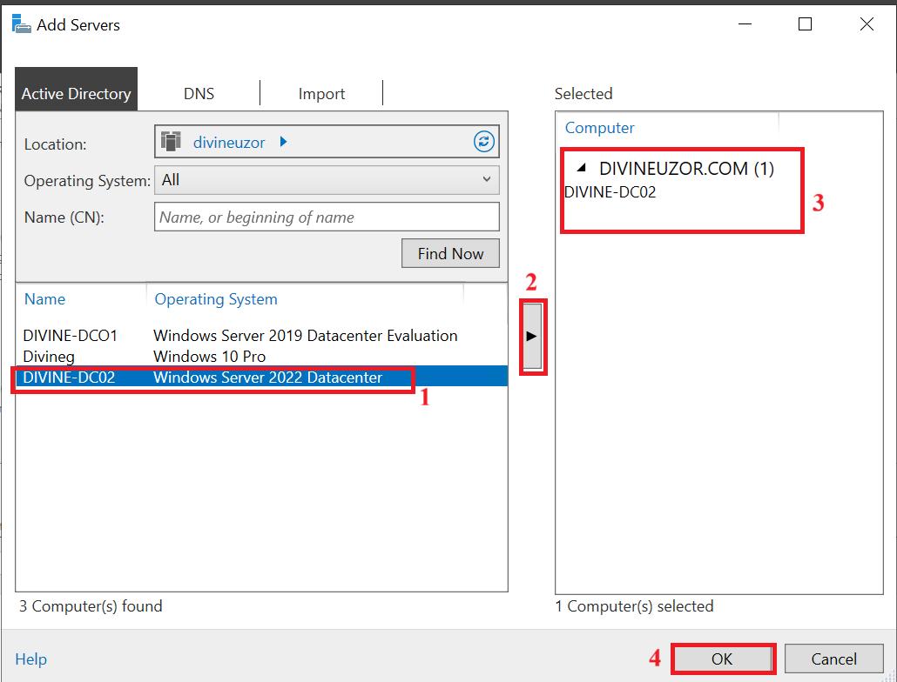
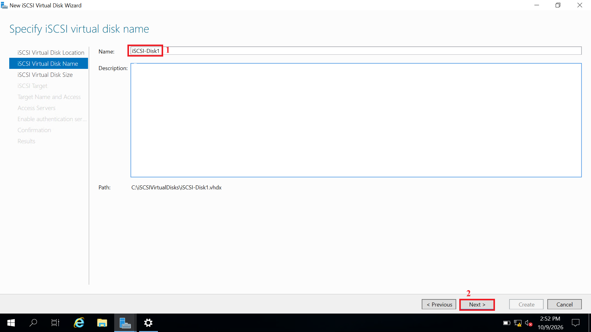
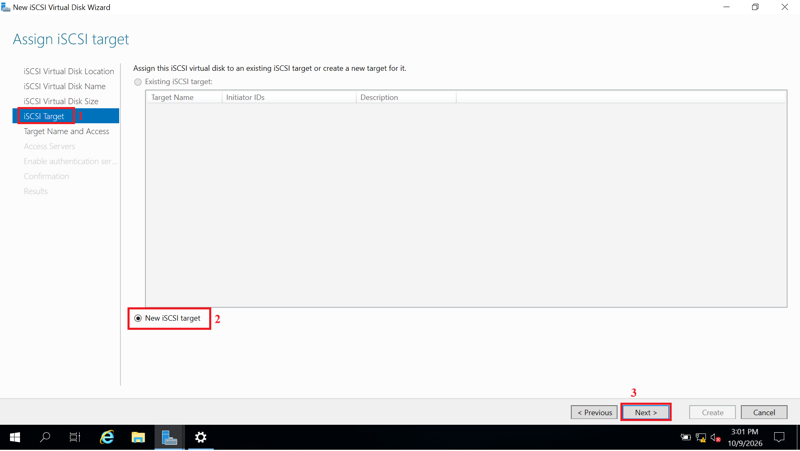
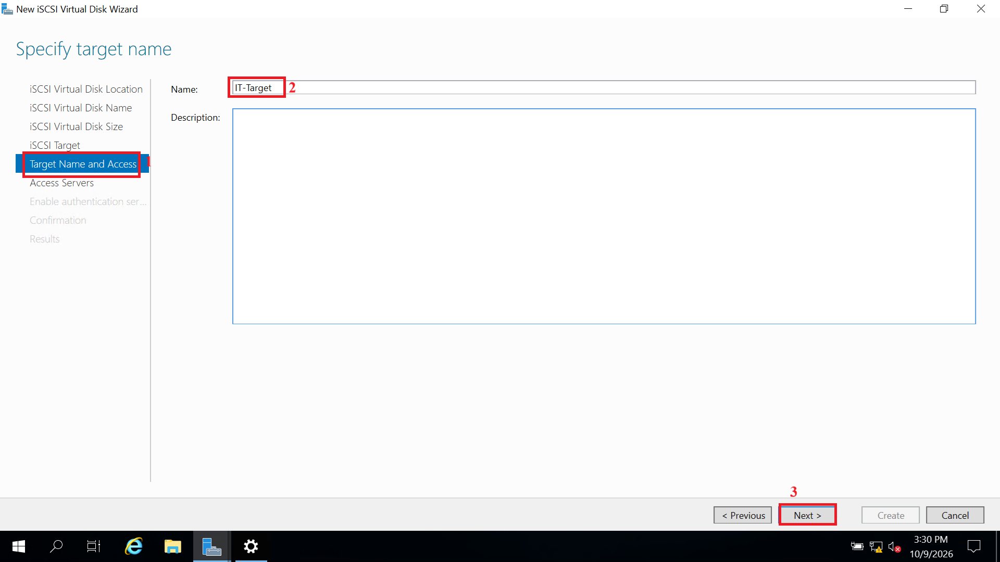
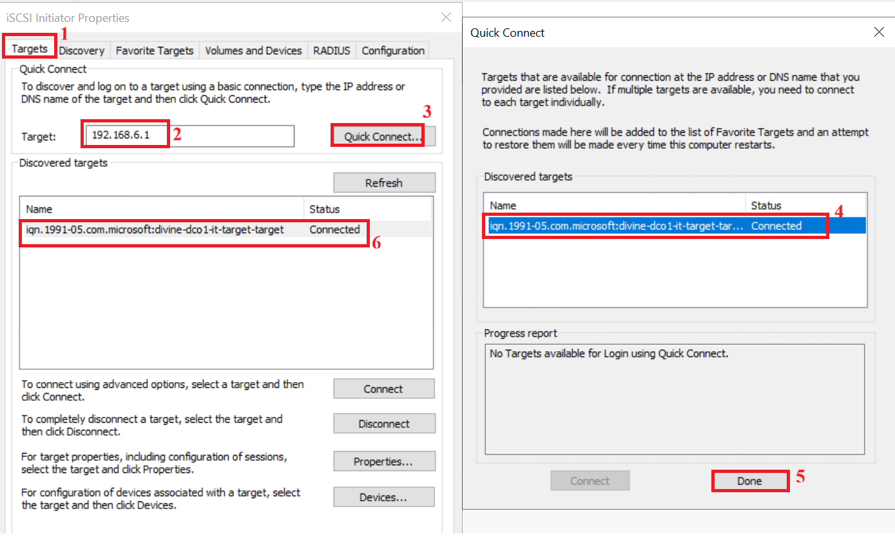

# Lab 14: iSCSI Target and Initiator Configuration

## Overview

This lab demonstrates how to provide remote block storage between two
Windows Server systems using iSCSI. One server is configured as the
iSCSI Target and hosts the virtual disk, while the second server acts as
the iSCSI Initiator and connects to that disk over the network.

The exercise follows the complete process: preparing both servers for
remote management, installing the iSCSI Target Server role, creating and
restricting access to an iSCSI target, connecting from the initiator,
and verifying that data written from the initiator is stored on the
target server.

## Scenario

An organization needs to provide additional storage to one of its
servers without installing a new physical disk in that server. An
administrator uses iSCSI to make a disk hosted by another server
available over the network.

The lab uses two domain controllers in the existing Windows Server
environment to demonstrate the target and initiator roles.

## Lab Environment

  | Server | Role in this lab |
|---|---|
| DC01 | iSCSI Target: holds the iSCSI virtual disk |
| DC02 | iSCSI Initiator: connects to the disk and uses it |

**Note:** In a real company, the target role would normally
run on a dedicated storage or file server. A domain controller is used
here only because it is the hardware available in this lab. Any Windows
Server with the role installed can be a target.

### Prerequisites

Before starting, confirm that:

-   Both servers are running and joined to the `divineuzor.com` domain.
-   DC01 and DC02 can reach each other. From DC02, run `ping DC01`. Use
    your server's actual name or IP address if it differs.
-   DC01 has at least 10 GB of free space. The lab uses a 5 GB
    dynamically expanding disk, which takes up little space until it
    fills.

## Lab Objectives

By the end of this lab you will be able to:

-   Manage multiple servers from one Server Manager console.
-   Install the iSCSI Target Server role.
-   Create an iSCSI virtual disk and an iSCSI target.
-   Restrict which server is allowed to connect.
-   Connect to the target from an iSCSI Initiator.
-   Bring the disk online, initialize it, and create a volume.
-   Verify that data saved from the initiator is stored on the target
    server.

------------------------------------------------------------------------

## 4. Part 1: Manage Both Servers from One Place

This step makes the rest of the lab easier. Server Manager on DC01 can
manage DC02 as well, so you can check both servers without switching
machines.

1.  On DC01, open Server Manager.
2.  Click Manage, then select Add Servers.
3.  On the Active Directory tab, click Find Now.

4.  Select DC02 and click the arrow to move it to the Selected list.
5.  Click OK.

6.  In the left pane, click All Servers. Both DC01 and DC02 should be
    listed.

## 5. Part 2: Install the iSCSI Target Server Role on DC01

1.  In Server Manager on DC01, click Manage, then Add Roles and
    Features.
2.  Click Next until you reach Server Selection. Select DC01 and click
    Next.

3.  On Server Roles, expand File and Storage Services, then File and
    iSCSI Services.

4.  Tick iSCSI Target Server. If a window appears asking to add required
    features, click Add Features. If no window appears, continue. DC01
    already has File and Storage Services installed, so nothing extra is
    needed.
5.  Click Next through the remaining pages, then click Install.

6.  When the installation succeeds, click Close.

### Verify

In Server Manager, click File and Storage Services. A new iSCSI option
should now appear in the left menu.

**Note:** The role normally opens the firewall rules it needs
automatically. If DC02 cannot connect later, check that the iSCSI Target
rules are enabled in Windows Defender Firewall on DC01.

## 6. Part 3: Create the iSCSI Virtual Disk and Target on DC01

### Step 1: Start the wizard

1.  In File and Storage Services, click iSCSI.
2.  Click Tasks, then select New iSCSI Virtual Disk.

### Step 2: Choose where the disk is stored

Select DC01 as the server and C: as the volume. The virtual disk file
will be stored in `C:\iSCSIVirtualDisks`. Click Next.

### Step 3: Name the disk

Enter the name iSCSI-Disk1 and click Next.

### Step 4: Set the size

1.  Enter a size of 5 GB.
2.  Select Dynamically expanding, which only uses space as data is
    written.
3.  Click Next.

### Step 5: Create a new iSCSI target

1.  Select New iSCSI target and click Next.

2.  Enter the target name IT-Target and click Next.

### Step 6: Choose which server is allowed to connect

This is the step that points the target to the access server.

1.  Click Add.
2.  Select Enter a value for the selected type.
3.  Set Type to IP Address and enter the IP address of DC02. To find it,
    run `ipconfig` on DC02.
4.  Click OK, then Next.

DC02 should now appear in the list of initiators allowed to access this
target.

**Tip:** You can also use Query initiator computer for ID and browse to
DC02 or identify it by DNS name. The IP address is the most reliable
choice for this lab.

### Step 7: Authentication

Leave Enable CHAP and Enable reverse CHAP unticked. They add password
protection between the servers and are not needed for this lab. Click
Next.

### Step 8: Confirm and create

1.  Review the summary and click Create.

2.  When the results show Completed, click Close.

### Verify

On the iSCSI page, iSCSI-Disk1 appears under iSCSI Virtual Disks and
IT-Target appears under iSCSI Targets. The status shows as Not
connected, because DC02 has not connected yet.

## 7. Part 4: Connect from DC02 (the Initiator)

1.  On DC02, open Server Manager, click Tools, then select iSCSI
    Initiator.

2.  If prompted that the Microsoft iSCSI service is not running, click
    Yes. This starts it and sets it to start automatically.
3.  In the iSCSI Initiator Properties window, open the Targets tab.
4.  In the Target box, enter the name or IP address of DC01, then click
    Quick Connect.
5.  In the Quick Connect window, the discovered target appears, and its
    name ends with it-target-target. Confirm the status shows Connected,
    then click Done.
6.  Back on the Targets tab, confirm the target now shows Connected.
    Click OK.

## 8. Part 5: Bring the Disk Online and Create a Volume on DC02

The connected iSCSI disk now appears in DC02's Disk Management, the same
way the Hyper-V disks did in the storage lab.

1.  On DC02, right-click the Start button and select Disk Management.
2.  Find the new 5 GB disk. It will probably be Offline or Not
    Initialized.

    

3.  If it is offline, right-click the disk label and select Online.
4.  Right-click the disk label and select Initialize Disk. Choose GPT
    and click OK.

5.  Right-click the unallocated space and select New Simple Volume.

6.  In the wizard, use the full size, assign a drive letter that is not
    in use (for example M:), format as NTFS, set the label to
    iSCSI-Data, and click Finish.

7.  Open File Explorer and click This PC. The new drive should appear.

## 9. Part 6: Test and Verify

### Step 1: Save a file from DC02

1.  On DC02, open the iSCSI-Data (M:) drive.
2.  Create a text file named test.txt with a short message, such as
    "Saved from DC02".

### Step 2: Check the connection from DC01

1.  On DC01, open Server Manager, then File and Storage Services, then
    iSCSI.
2.  iSCSI-Disk1 and IT-Target should now show Connected, and the
    initiator shown is DC02.

### Step 3: Find where the data actually lives

1.  On DC01, open File Explorer and go to `C:\iSCSIVirtualDisks`.
2.  Locate iSCSI-Disk1.vhdx. Its size grows as data is written to the
    disk.

This file is the disk that DC02 is using. You will not see test.txt
inside DC01's folders, because the file system on that disk belongs to
DC02. Only the single VHDX file is visible on DC01.

**Important:** Do not open or attach this VHDX file on DC01 while DC02
is connected to it. Two servers writing to the same disk can corrupt it.

Anything saved to M: on DC02 is stored inside the VHDX file on DC01.

## 10. Troubleshooting

  | Problem | What to check |
|---|---|
| DC02 cannot connect to the target | Run `ping DC01` from DC02. Confirm the iSCSI Target firewall rules are enabled on DC01. Try the IP address instead of the name. |
| Login fails after connecting | Check that DC02's IP address in the target's access list is correct. Edit the target's initiators in Server Manager if needed. |
| No target appears in Quick Connect | Confirm the role is installed on DC01, the target exists, and the address you entered is DC01's. |
| Disk is not visible on DC02 | Open Disk Management and look for an offline disk. Right-click it and select Online. |
| Disk shows Not Initialized | This is normal for a new disk. Initialize it as GPT. |

## 11. Key Takeaways

-   The target (DC01) holds an iSCSI virtual disk, and the initiator
    (DC02) connects to it.
-   The target decides which servers are allowed to connect using the
    access servers list.
-   On the initiator, the iSCSI disk is managed in Disk Management, just
    like any local disk.
-   iSCSI does not sync data. The disk lives on the target and is used
    remotely.
-   Never let two servers write to the same iSCSI disk at once unless
    they are part of a cluster.

## Conclusion

In this lab, you install the iSCSI Target Server role on one domain
controller, create an iSCSI virtual disk and target, and connect a
second domain controller using the iSCSI Initiator. You then initialize
the disk, create an NTFS volume, and verify that data written from the
initiator is stored on the target server. This demonstrates how Windows
Server can provide remote block storage over a network.

