# Lab 15: DFS Namespaces and Replication

## Overview

As organizations grow, shared folders can become distributed across
multiple servers. Users may need to remember different server paths, and
access to files can be disrupted when a server becomes unavailable.

This lab demonstrates how Windows Server Distributed File System (DFS) addresses these challenges. DFS Namespaces presents shared folders through a single path, while DFS Replication keeps selected folders synchronized between servers.

Using two Windows Server domain controllers and a domain-joined client, the lab covers configuring a domain-based namespace, adding shared folders, setting up a second namespace server, and testing replication in both directions.

## Business Scenario

An organization has shared folders spread across two servers. Users have
to remember which server holds which folder, and if one server goes
offline, its files become unreachable. The administrator uses a DFS
Namespace to bring the shared folders under one path and DFS Replication
to keep an important folder synchronized between both servers.

## Lab Environment

  -----------------------------------------------------------------------
  | Machine | Role in this lab |
|---|---|
| DC01 | Namespace server, replication member, and host of the shares from earlier labs (IT Projects, IT Share, Cloud Files) |
| DC02 | Second namespace server, replication member, and host of the new Reports folder |
| Client PC | Used to test access through the namespace |


The namespace and its folders will be:

  -----------------------------------------------------------------------
  | Namespace folder | Points to (folder target) |
|---|---|
| IT-Projects | `\\DIVINE-DCO1\IT Projects` |
| IT-Share | `\\DIVINE-DCO1\IT Share` |
| Cloud Files | `\\DIVINE-DCO1\Cloud Files` |
| Reports | `\\DIVINE-DCO2\Reports` and `\\DIVINE-DCO1\Reports` (replicated) |

  -----------------------------------------------------------------------

The single path users will type is:

`\\divineuzor.com\Company`

## Pre-requisites

-   DC01 and DC02 are running, joined to the domain, and can reach each
    other (ping works both ways).
-   DC02 is listed in DC01's Server Manager under All Servers.
-   The IT Projects and IT Share shares from earlier labs still exist on
    DC01.

## 3. Lab Objectives

-   Install the DFS Namespaces and DFS Replication role services.
-   Create a domain-based namespace.
-   Add existing shared folders as namespace folders.
-   Create a folder on a second server and add its shared path to the
    namespace.
-   Add a second namespace server.
-   Replicate a folder between two servers and test the sync.

## 4. Part 1: Install the DFS Role Services

The roles must be installed on both servers.

### On DC01

1.  In Server Manager, click Manage, then Add Roles and Features.


2.  Click Next until Server Selection. Select DC01 and click Next.


3.  On Server Roles, expand File and Storage Services, then File and
    iSCSI Services.

4.  Tick DFS Namespaces and DFS Replication. If a window asks to add features, click Add Features.

 


5.  Click Next through the remaining pages, then click Install.


6.  When the installation succeeds, click Close.


### On DC02

Repeat the same steps, but at Server Selection choose DC02.


### Verify

On DC01, click Tools in Server Manager. DFS Management should now be in
the list.


## 5. Part 2: Create and Share a Folder on DC02

### Step 1

1.  On DC02, open File Explorer and go to `C:\`. DC02 does not have a
    Shares folder yet, so create one named Shares.
2.  Open it and create a folder named Reports.


The folder is now `C:\Shares\Reports` on DC02.

Note: Shares is only a parent folder to keep things tidy, and it mirrors
the structure on DC01. The Reports folder is the one that matters,
because it will be shared and added to the namespace.

3.  Right-click Reports and select Properties → Sharing → Advanced
    Sharing. Tick Share this folder.
4.  Click Permissions and remove Everyone. Add IT Staff with Allow →
    Change and Read, and add Administrators with Allow → Full Control.
    Click OK twice.


5.  Open the Security tab and click Advanced. Click Disable inheritance,
    then Convert inherited permissions into explicit permissions.
6.  Click Edit. Remove the Users entry. Add IT Staff with Modify. Keep
    Administrators and SYSTEM with Full control. Click Apply, then OK.


Important: Keep SYSTEM in the permissions. The DFS Replication service
runs as SYSTEM, and replication will fail without it.

6.  Test the shared path. On DC02, press Win + R, type
    `\\DIVINE-DCO2\Reports`, and press Enter. The folder should open.

The shared path is:

`\\DIVINE-DC02\Reports`

## 6. Part 3: Create the Namespace

1.  On DCO1, open Server Manager, click Tools, then DFS Management.
2.  Right-click Namespaces and select New Namespace.
3.  Namespace Server: click browse, enter DIVINE-DCO1 and click check
    names, then ok. Click Next.

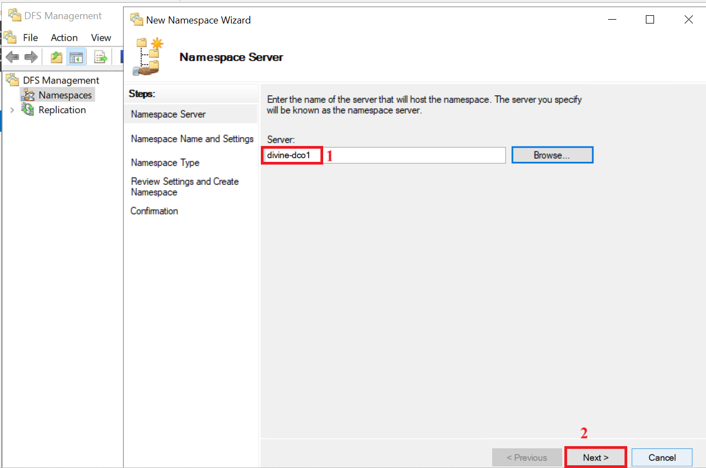

4.  Namespace Name and Settings: enter Company. Leave the default
    shared-folder permissions and click Next.


5.  Namespace Type: select Domain-based namespace and leave Enable
    Windows Server 2008 mode ticked. The preview shows
    `\\divineuzor.com\Company`. Click Next.


6.  Review the settings and click Create.

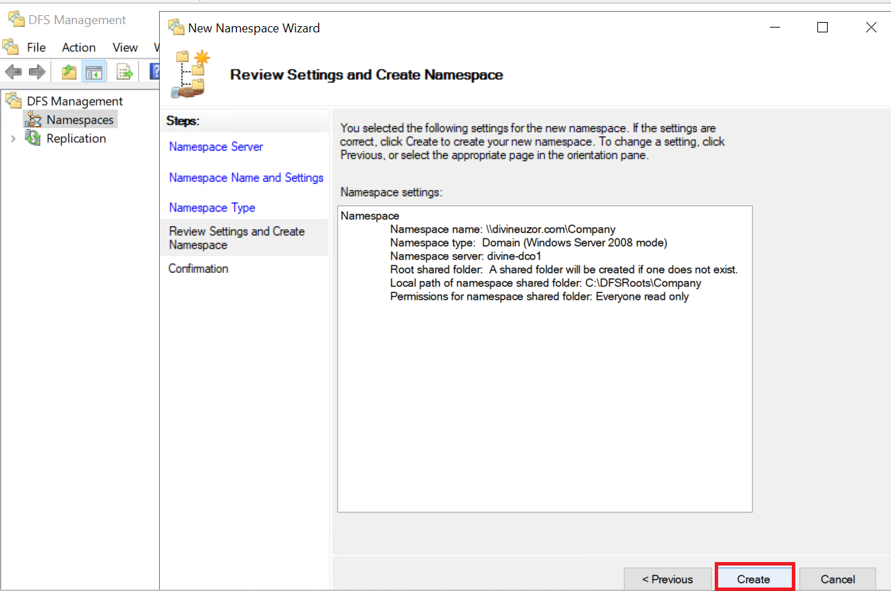

7.  When the confirmation shows Success, click Close.

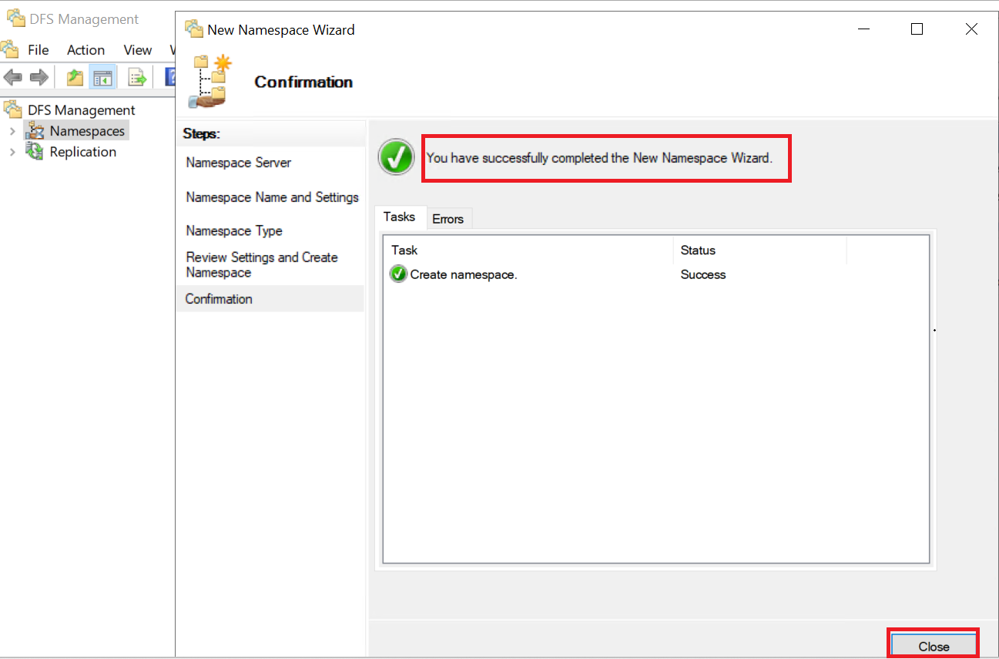

### Verify

Under Namespaces, `\\divineuzor.com\Company` should now appear.

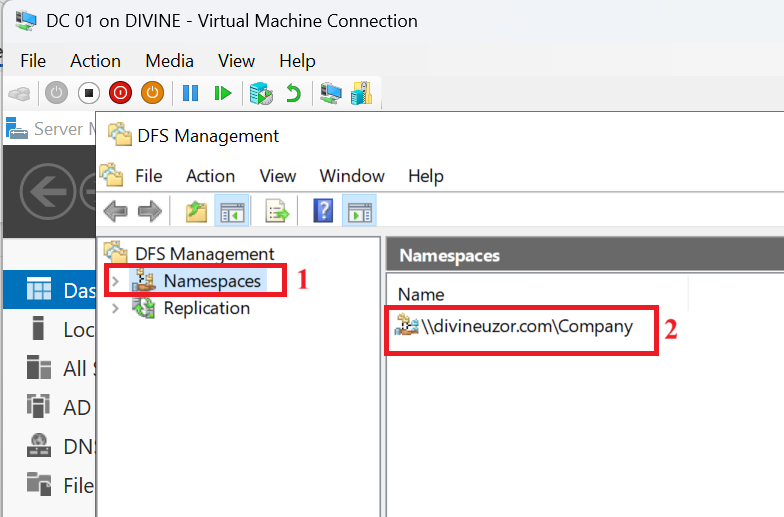

## 7. Part 4: Add DC02 as a Second Namespace Server

This keeps the namespace available even if DC01 goes offline.

1.  Right-click `\\divineuzor.com\Company` and select Add Namespace
    Server.
2.  Enter DIVINE-DC02, leave the default settings, and click OK.


3.  Select the namespace and open the Namespace Servers tab. Both DC01
    and DC02 should be listed.


## 8. Part 5: Add Folders to the Namespace

### Step 1: Add the shares from earlier labs

1.  Right-click `\\divineuzor.com\Company` and select New Folder.
2.  Enter the name IT-Projects.
3.  Click Add, enter the folder target `\\DIVINE-DCO1\IT Projects`, and
    click OK.
4.  Click OK to create the folder.

Repeat for the IT-share and Cloud Files:

 | Folder name | Folder target |
|---|---|
| IT-Share | `\\DIVINE-DCO1\IT Share` |
| Cloud Files | `\\DIVINE-DCO1\Cloud Files` |

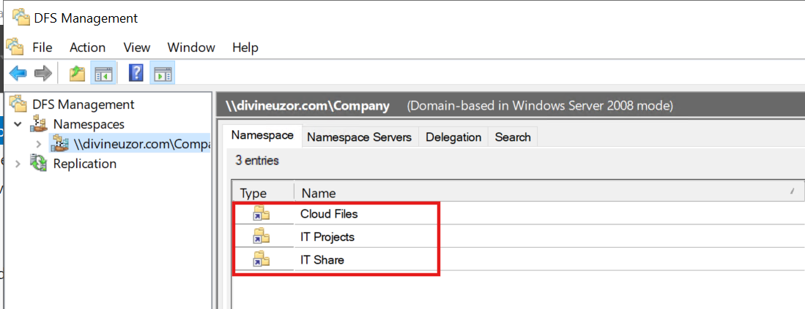

### Step 2: Add the folder from DC02

1.  Create another new folder named Reports.
2.  Add the folder target `\\DIVINE-DCO2\Reports`.
3.  Click OK.


## 9. Part 6: Test the Namespace

1.  On the client PC, sign in as a user who is a member of IT Staff.
2.  Open File Explorer and type this in the address bar:
    `\\divineuzor.com\Company`
3.  The namespace folders appear under that one path. Open each one to
    confirm it works.


Note: A namespace does not grant access. The permissions on the real
shared folders still apply, so a user who is not in IT Staff will see
the folders but be denied when opening them.

## 10. Part 7: Configure DFS Replication

The Reports folder will be kept identical on DC01 and DC02.

### Step 1: Create the matching folder on DC01

1.  On DC01, `C:\Shares` already exists from earlier labs. Open it and
    create a new folder named Reports.


2.  Share it as Reports using the same permissions as Part 2.

The folder on DC01 is `C:\Shares\Reports`, and its shared path is
`\\DIVINE-DCO1\Reports`.

The shared path is `\\DIVINE-DCO1\Reports`.

### Step 2: Add the second folder target

1.  In DFS Management, expand the namespace and select the Reports
    folder.
2.  Click Add Folder Target in the right pane. Enter
    `\\DIVINE-DCO1\Reports` and click OK.


3.  When asked "Do you want to create a replication group to replicate
    the folder targets?", click Yes.


### Step 3: Run the Replicate Folder Wizard

1.  Replication Group and Replicated Folder Name: accept the default
    names and click Next.


2.  Replication Eligibility: confirm both servers are listed as eligible
    and click Next.


3.  Primary Member: select DIVINE-DCO1 and click Next. The primary
    member is the server whose content is treated as the starting point
    for the first sync.

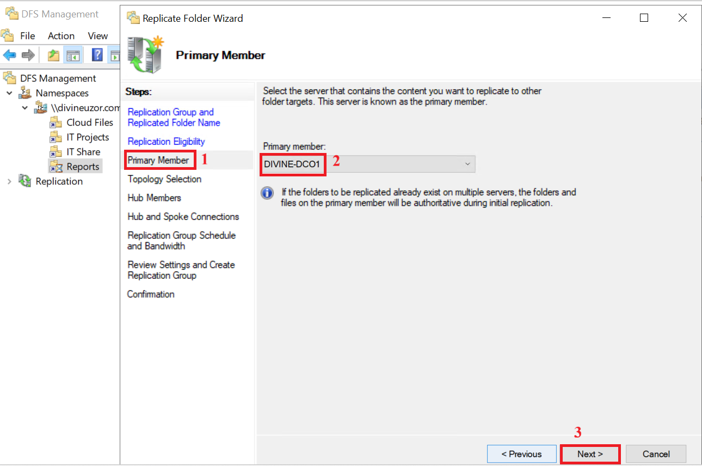

4.  Topology Selection: select Full mesh and click Next.

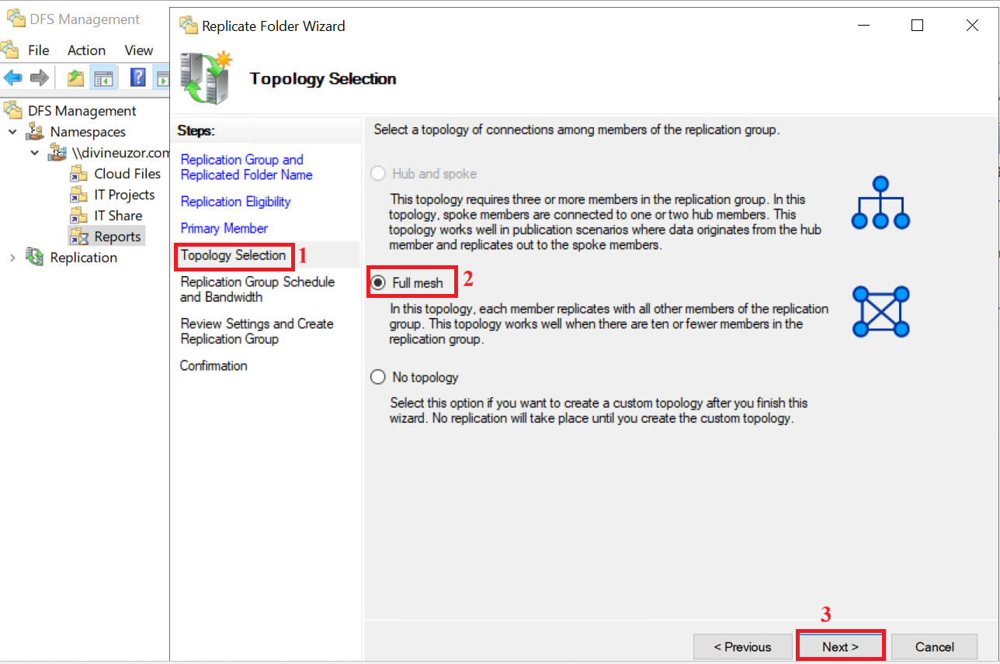

5.  Replication Group Schedule and Bandwidth: select Replicate
    continuously using the specified bandwidth with Full bandwidth, and
    click Next.


6.  Review the settings and click Create.


7.  When the confirmation shows Success, click Close.


8.  If a message says replication may be delayed, click OK.

### Step 4: Make the servers pick up the new settings

Replication does not start the moment the wizard finishes. Each server
has to retrieve the new settings from Active Directory, which can take
up to an hour by default. To speed it up, run this on DC01 in an
elevated Command Prompt:

``` cmd
dfsrdiag PollAD /Member:divineuzor.com\DIVINE-DCO1

dfsrdiag PollAD /Member:divineuzor.com\DIVINE-DCO2
```

Or use PowerShell:

``` powershell
Update-DfsrConfigurationFromAD
```

### Verify

1.  In DFS Management, select the Reports folder. It now shows two
    folder targets.


2.  Expand Replication in the left pane, select the replication group,
    and open the Memberships tab. Both servers are listed.


Note: A hidden DfsrPrivate folder may appear inside the replicated folder. This folder is created and managed by the DFS Replication service. It contains internal working folders, including Staging and ConflictAndDeleted, which support replication processing and file-conflict handling. Do not manually delete or modify it.

## 11. Part 8: Test Replication

### Step 1: Replicate from DC01 to DC02

1.  On DC01, open `C:\Shares\Reports` and create a text file named
    from-DC01.txt.

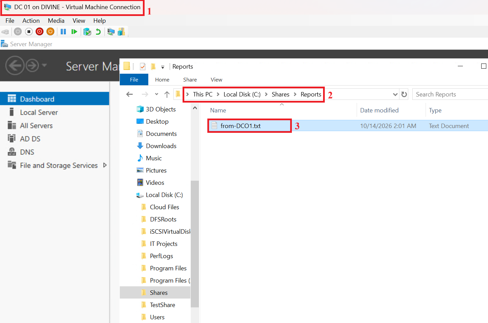

2.  On DC02, open `C:\Shares\Reports`. The file should appear.

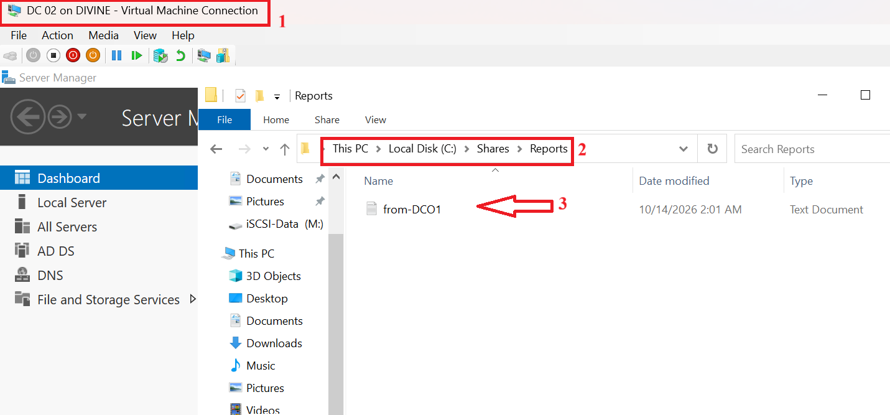

### Step 2: Replicate from DC02 to DC01

1.  On DC02, create a text file named from-DC02.txt in
    `C:\Shares\Reports`.

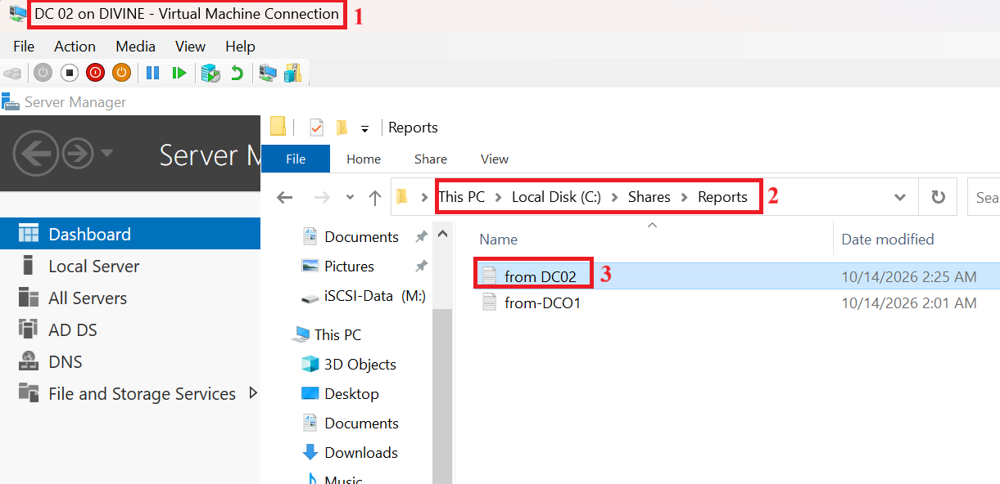

2.  Check `C:\Shares\Reports` on DC01. The file should appear.

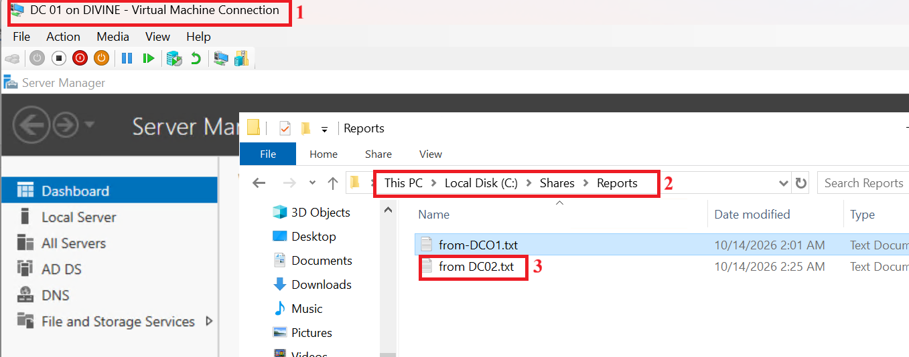

This confirms replication works in both directions.

### Step 3: Confirm users see one path

On the client PC, open:

`\\divineuzor.com\Company\Reports`

Both files appear, no matter which server the client is sent to.


### Optional: Show that replication is not a backup

1.  On DC01, delete from-DC01.txt.
2.  After a minute or two, check DC02. The file is gone from there as
    well.


This shows that deletions are replicated too, so replication must never
replace a backup.

## 12. Verification

Confirm that:

-   DFS Namespaces and DFS Replication are installed on both servers.
-   The namespace `\\divineuzor.com\Company` exists, with DC01 and DC02
    as namespace servers.
-   The shares from earlier labs and the DC02 Reports folder appear
    under the namespace.
-   The client can open the folders through the single namespace path.
-   The replication group has two members, and files created on either
    server appear on the other.


  ## 13. Troubleshooting

| Problem | What to check |
|---|---|
| Namespace wizard cannot find the server | Confirm the DFS roles are installed on that server, and that you typed the exact computer name. |
| "Access denied" when opening a folder | Both share permissions and NTFS permissions must allow the user's group. |
| Folder target is rejected | Confirm the share exists and the path is typed exactly, including spaces. |
| Replication does not start | Wait, or run `dfsrdiag PollAD` or `Update-DfsrConfigurationFromAD` to pick up the new settings. |
| Files do not replicate | Confirm SYSTEM has Full control on both folders, the DFS Replication service is running in services.msc, and the servers can reach each other. |
| File appears on one server only | Replication is not instant. Wait a few minutes and refresh. 

## 14. Key Takeaways

-   A namespace gives users one path to folders that live on different
    servers. It does not move or copy files.
-   Folder targets are the real shared folders behind each namespace
    folder.
-   Replication keeps a folder identical on multiple servers, in both
    directions.
-   Replication takes time to start and is not instant.
-   Replication is not a backup, because deletions replicate too.
-   Users still need permissions on the real folders.

## Conclusion

In this lab I installed the DFS role services on two domain controllers,
created a domain-based namespace, and added the shared folders from my
earlier labs plus a new folder created on the second server. I then
added a second namespace server and configured DFS Replication to keep a
folder identical between both servers. Finally, I signed in to a
domain-joined client PC as a user and opened the namespace path. The
tests confirmed that one path reaches every folder, that changes
replicate in both directions, and that users see the same files through
the namespace.
