# Windows Server Administration with PowerShell

## Overview

PowerShell provides a repeatable way to administer Windows Server, inspect system and network settings, manage Active Directory objects, automate account creation, run commands remotely, and generate reports.

You will progress from basic PowerShell commands to practical Windows Server administration tasks in an Active Directory domain. The exercises cover command discovery and help, system and network checks, Active Directory management, user and group administration, bulk user creation from a CSV file, remote administration of a second server, reporting, and safe cleanup.

## Lab Environment

| Machine | Name | IP address | Role in this lab |
|---|---|---|---|
| Domain controller 1 | `DIVINE-DCO1` | `192.168.6.1` | Where the commands are run |
| Domain controller 2 | `DIVINE-DC02` | `192.168.6.3` | Remote target |
| Client PC | `Divineg` | `192.168.6.2` | Reachability test |

The domain is `divineuzor.com`. All commands are run on the first domain controller (referred to as DC01) unless stated otherwise.

## Prerequisites

- A Windows Server domain controller with Active Directory installed, which includes the Active Directory PowerShell tools.
- Permission to sign in as a domain administrator.

**Note:** Passwords used in this lab are for a test environment only. Never put real passwords in a script.

---

## Task 1: Open PowerShell and Run Your First Commands

### Step 1: Open PowerShell as Administrator

This opens PowerShell with the permissions needed to manage the server.

Click Start, search for Windows PowerShell, right-click it, and select **Run as administrator**.

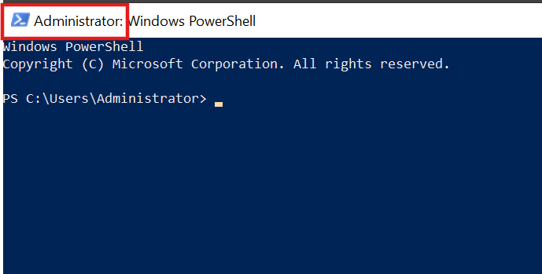

### Step 2: Run your first command

This command displays the current date and time.

```powershell
Get-Date
```

You should see today's date and time printed on the screen.

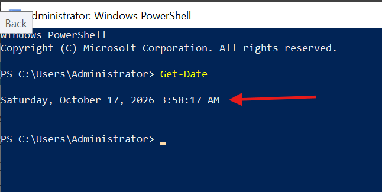

### Step 3: Check the PowerShell version

This command shows which version of PowerShell is installed.

```powershell
$PSVersionTable.PSVersion
```

You should see: a table with Major, Minor, and Build numbers, such as 5.1 on Windows Server 2019.

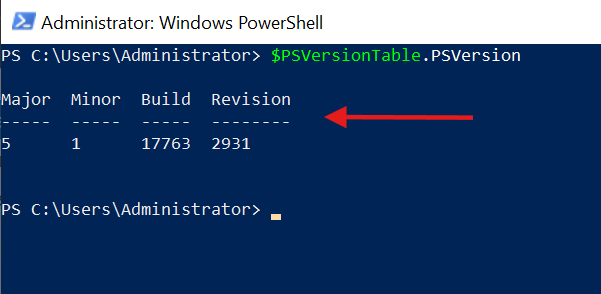

### Step 4: Clear the screen

This command wipes the screen so you can start fresh. `cls` is an alias for `Clear-Host`.

```powershell
cls
```

You should see: an empty window.

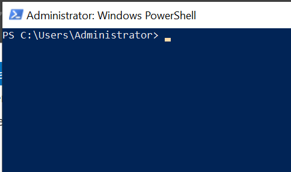

### Step 5: Create a working folder

This command creates a folder called PSLab on the C: drive to hold the files made in this lab.

```powershell
New-Item -Path C:\PSLab -ItemType Directory
```

You should see: a short table confirming a new directory named PSLab.

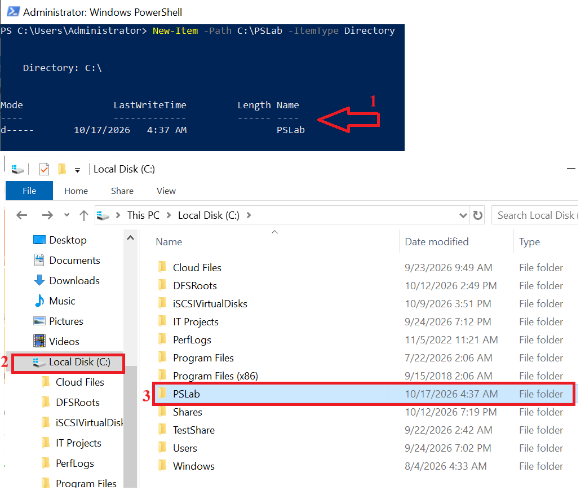

### Step 6: Start recording your session

This command starts a transcript, which saves everything you type and see into a text file.

```powershell
Start-Transcript -Path C:\PSLab\transcript.txt
```

You should see: a message that the transcript has started.

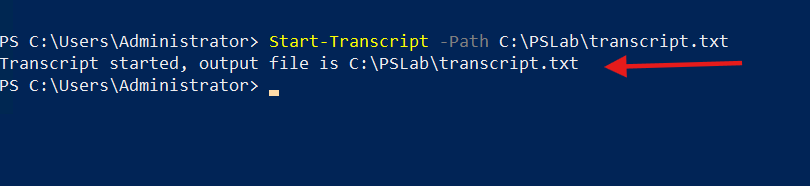

---

## Task 2: Find Commands and Get Help

You don't need to memorize every command. PowerShell can search for them and explain them.

### Step 1: Search for commands by noun

This command lists every command that works on processes (programs that are running).

```powershell
Get-Command -Noun Process
```

You should see: a list such as Get-Process, Start-Process, and Stop-Process.

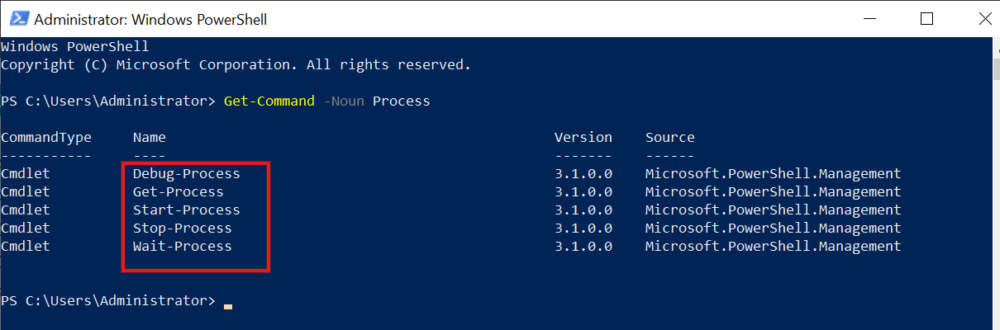

### Step 2: Narrow the search by verb

This command shows only the commands that get information about services.

```powershell
Get-Command -Verb Get -Noun Service
```

You should see: one or two commands, including Get-Service.

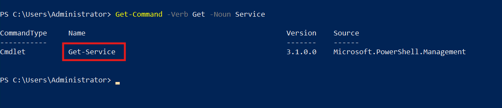

### Step 3: Read the help for a command

This command shows what Get-Process does and how to use it.

```powershell
Get-Help Get-Process
```

You should see: the command's name, a short description, and its syntax.

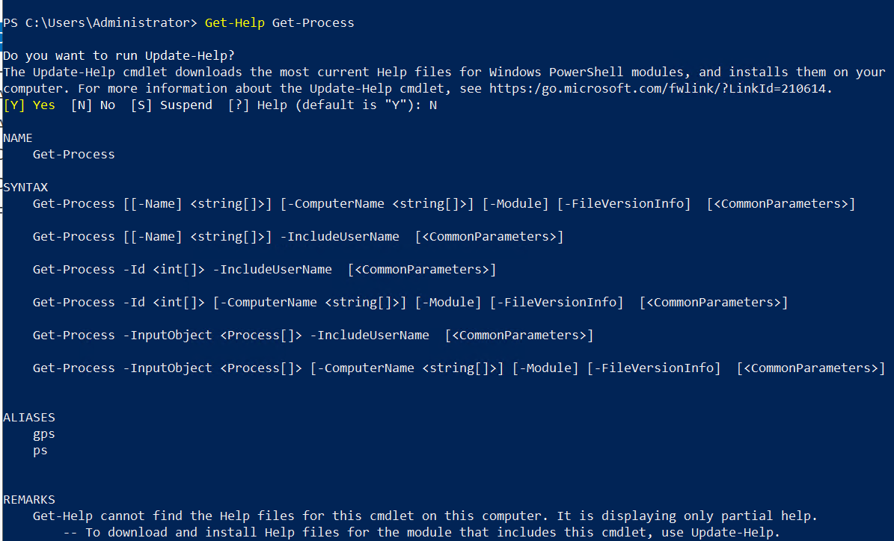

If the help seems short, that is normal in a lab with no internet access.

### Step 4: Look up an alias

This command reveals the real command behind the nickname dir.

```powershell
Get-Alias dir
```

You should see: dir is an alias for Get-ChildItem, the command that lists files and folders.

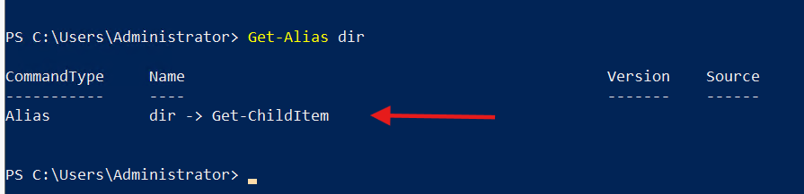

---

## Task 3: Look at Your Computer

PowerShell can report on the health and settings of a computer.

### Step 1: Show basic system details

This command displays the computer name, domain, and operating system.

```powershell
Get-ComputerInfo -Property CsName, CsDomain, OsName, OsVersion
```

You should see: the server name, divineuzor.com, and the Windows Server version. It may take a few seconds.

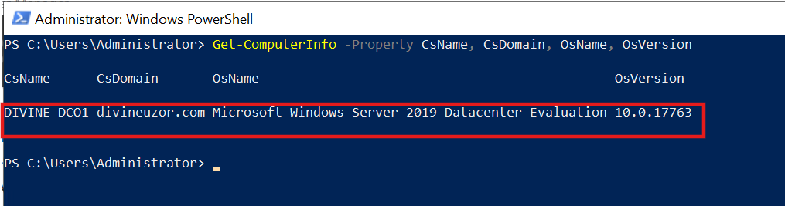

### Step 2: Show the disks

This command lists the drives, their sizes, and how much free space they have.

```powershell
Get-Volume
```

You should see: a table of drives such as C:, with size and free space.

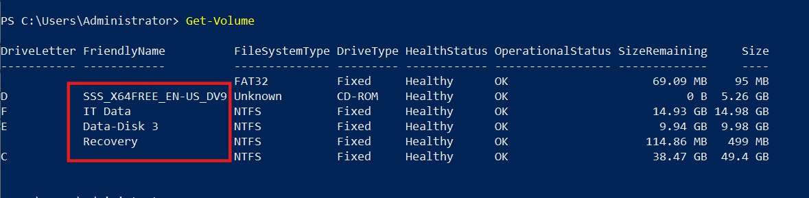

### Step 3: Show running programs

This command lists every process running on the server.

```powershell
Get-Process
```

You should see: a long list with names, IDs, and memory use.

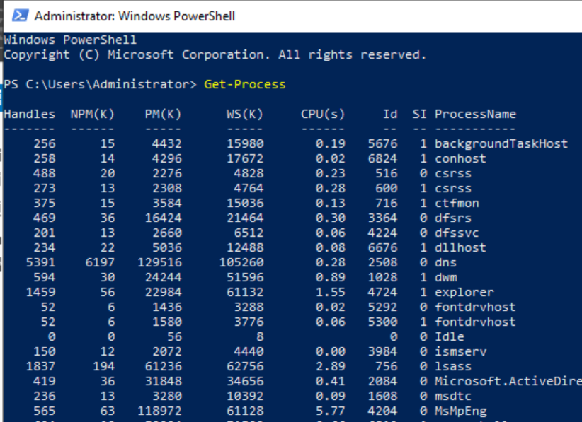

### Step 4: Show services

This command lists the background services and whether each one is running or stopped.

```powershell
Get-Service
```

You should see: a long list with a Status column showing Running or Stopped.

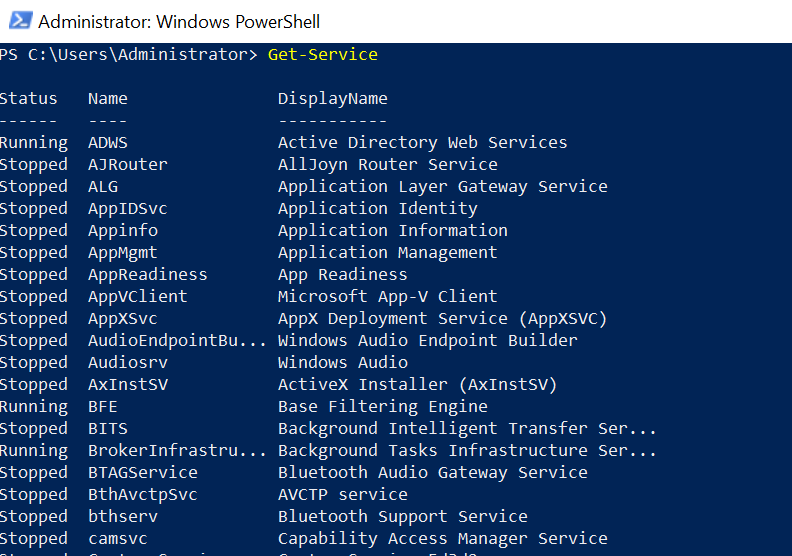

### Step 5: Read the event log

This command shows the five newest entries in the System event log, where Windows records what has happened.

```powershell
Get-EventLog -LogName System -Newest 5
```

You should see: five recent log entries with the time, type, and source.

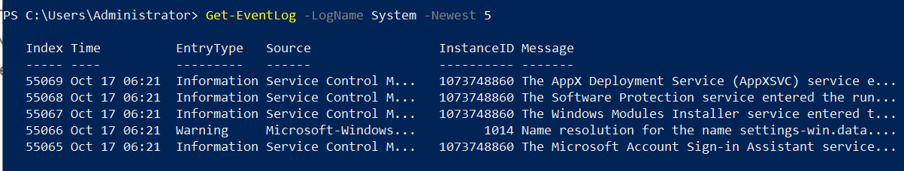

---

## Task 4: Chain Commands and Store Values

The last task printed long lists. Here you will learn how to filter them, and how to store information in variables.

### Step 1: Show only the five busiest programs

This command passes all processes through the pipeline, sorts them by CPU use, and keeps only the first five.

```powershell
Get-Process | Sort-Object CPU -Descending | Select-Object -First 5 Name, Id, CPU
```

You should see: a short table of five processes, ordered by CPU use.

| Part | Meaning |
|---|---|
| `Get-Process` | Get all processes |
| `\|` | Pass the result to the next command |
| `Sort-Object CPU -Descending` | Put the busiest first |
| `Select-Object -First 5 Name, Id, CPU` | Keep the first five and show three columns |

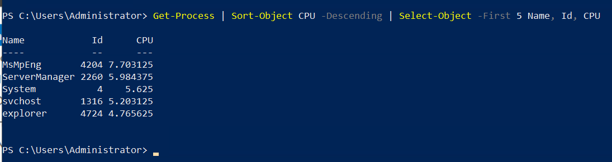

### Step 2: Show only the running services

This command keeps only the services whose status is Running.

```powershell
Get-Service | Where-Object Status -eq "Running"
```

You should see: a shorter list in which every Status is Running.

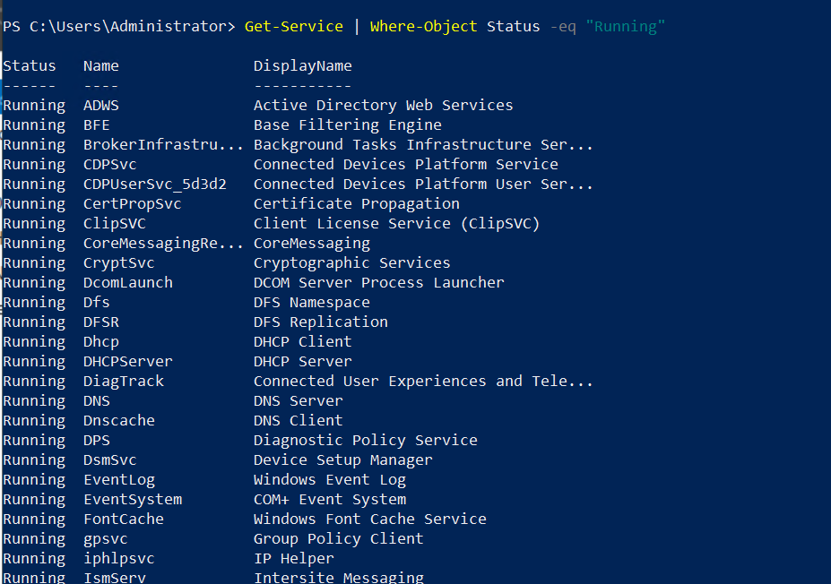

### Step 3: Count the running services

This command counts how many services are running.

```powershell
Get-Service | Where-Object Status -eq "Running" | Measure-Object
```

You should see: a Count value showing the total.

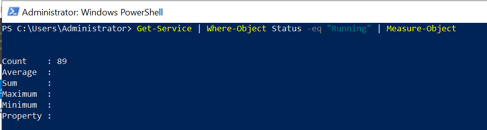

### Step 4: Create and use a variable

This command stores a word in a variable and then prints it back.

```powershell
$Name = "Divine"
Write-Host "Hello, $Name"
```

You should see: Hello, Divine.

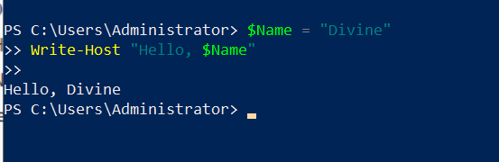

### Step 5: Use a variable inside a command

This command stores a folder path in a variable and uses it to list the folder's contents.

```powershell
$Folder = "C:\PSLab"
Get-ChildItem $Folder
```

You should see: the contents of C:\PSLab, which contains transcript.txt.

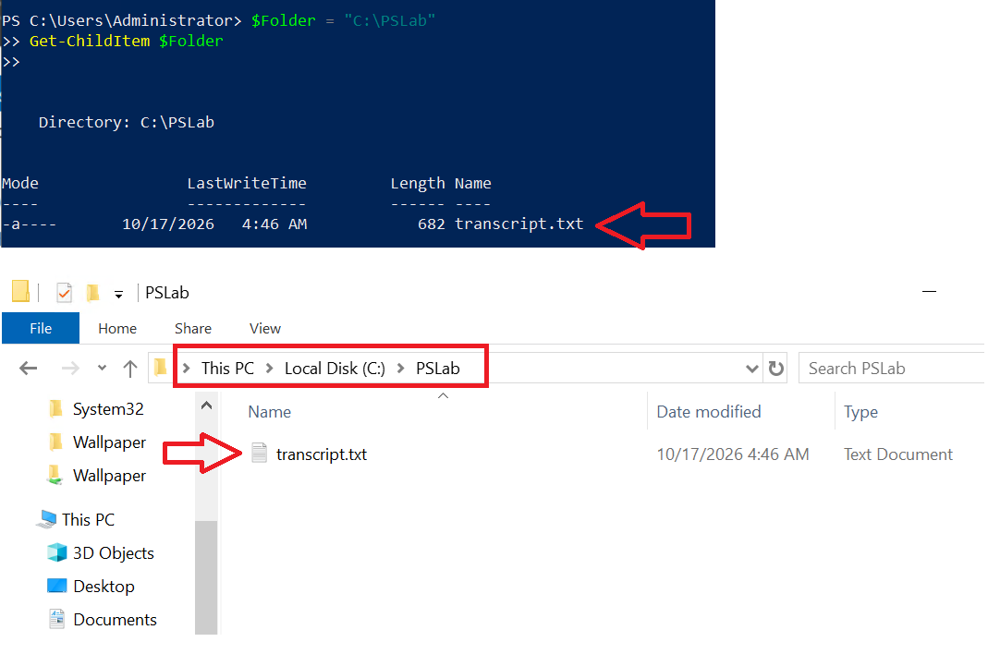

Variables let you type a value once and reuse it. You will use them later to create user accounts.

---

## Task 5: Check the Network

These commands test whether servers and computers can reach each other.

### Step 1: Show the IP address

This command shows this server's IPv4 address.

```powershell
Get-NetIPAddress -AddressFamily IPv4 | Select-Object InterfaceAlias, IPAddress, PrefixLength
```

You should see: 192.168.6.1 with a prefix length of 27.

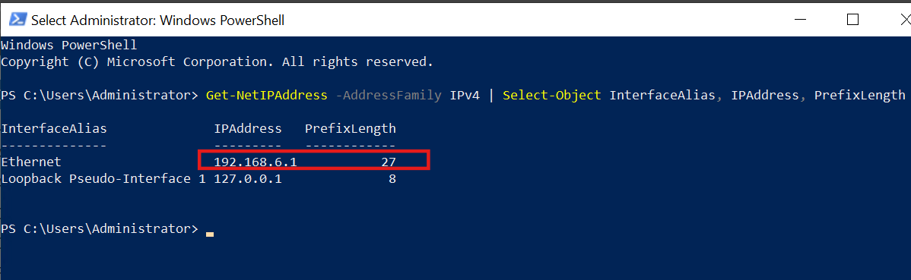

### Step 2: Test reachability

This command sends test messages to the second server and the client PC, like the old ping command.

```powershell
$Server = "DIVINE-DC02"
Test-Connection -ComputerName $Server -Count 2
Test-Connection -ComputerName Divineg -Count 2
```

You should see replies from both computers.

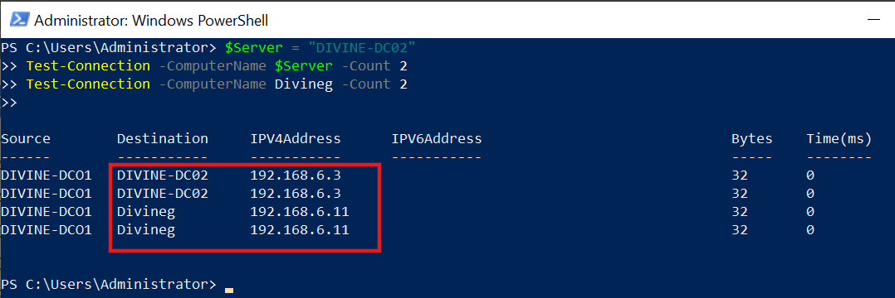

### Step 3: Test a specific network port

This command checks whether the second server accepts connections on port 389, used by Active Directory.

```powershell
Test-NetConnection -ComputerName $Server -Port 389
```

You should see: TcpTestSucceeded : True.

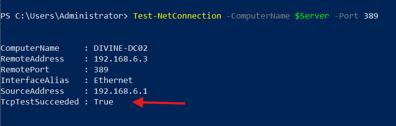

### Step 4: Test name lookup

This command checks that DNS can turn the domain name into an IP address.

```powershell
Resolve-DnsName divineuzor.com
```

You should see: the domain name with an IP address.

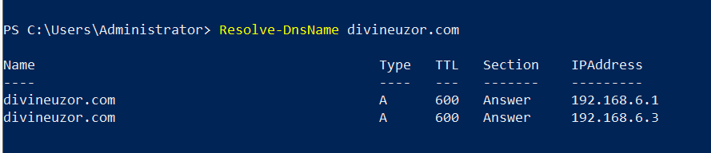

---

## Task 6: Explore Active Directory

Active Directory is the database of users, computers, and groups in a domain. These commands only read from it, so nothing is changed.

### Step 1: Show domain details

This command shows the domain's name and basic settings.

```powershell
Get-ADDomain | Select-Object Name, DomainMode, PDCEmulator
```

You should see: the domain name and the server acting as the main domain controller.

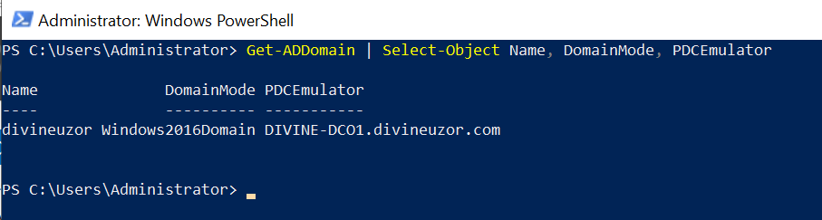

### Step 2: List the domain controllers

This command lists the domain controllers and their IP addresses.

```powershell
Get-ADDomainController -Filter * | Select-Object Name, IPv4Address
```

You should see both servers with their addresses.

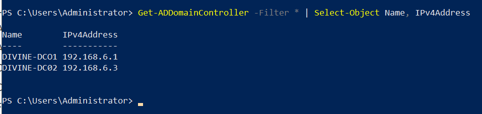

### Step 3: List the OUs

This command lists every organizational unit (OU), which is a folder inside Active Directory that holds users and computers.

```powershell
Get-ADOrganizationalUnit -Filter * | Select-Object Name, DistinguishedName
```

You should see each OU with its DistinguishedName, which is its full address in the directory, such as OU=Cloud Engineer,OU=IT,DC=divineuzor,DC=com.

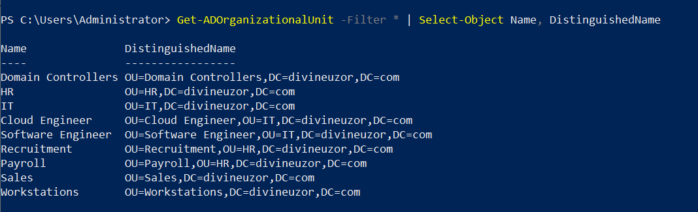

How to read a DistinguishedName: read it from right to left. DC=divineuzor,DC=com is the domain, OU=IT is an OU inside it, and OU=Cloud Engineer is an OU inside that one.

### Step 4: List the users

This command lists the user accounts and whether each is enabled.

```powershell
Get-ADUser -Filter * | Select-Object Name, SamAccountName, Enabled
```

You should see the existing users, and True or False under Enabled.

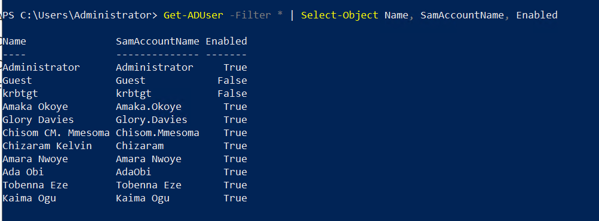

### Step 5: List the groups

This command lists the groups in the domain.

```powershell
Get-ADGroup -Filter * | Select-Object Name, GroupScope
```

You should see the groups and their scopes.

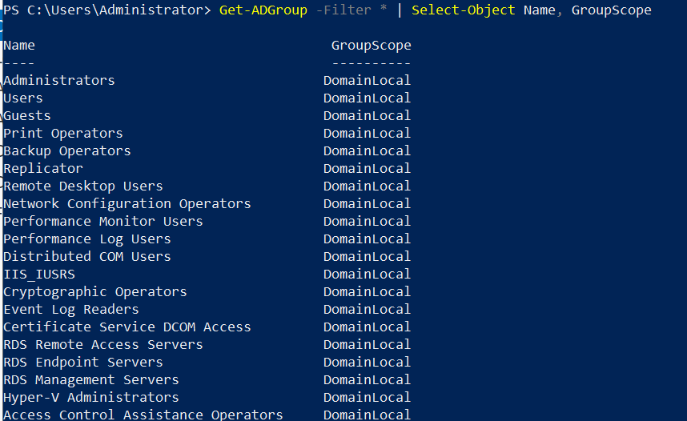

---

## Task 7: Create an OU and a Group

From here, you will change the environment. A separate OU keeps your test objects away from your real ones.

### Step 1: Create an OU

This command creates a new OU called PowerShell-Lab at the top of the domain.

```powershell
New-ADOrganizationalUnit -Name "PowerShell-Lab" -Path "DC=divineuzor,DC=com"
```

You should see: no message. In PowerShell, silence usually means success.

| Part | Meaning |
|---|---|
| `-Name` | The name of the new OU |
| `-Path` | Where to create it. Here, the top of the domain. |

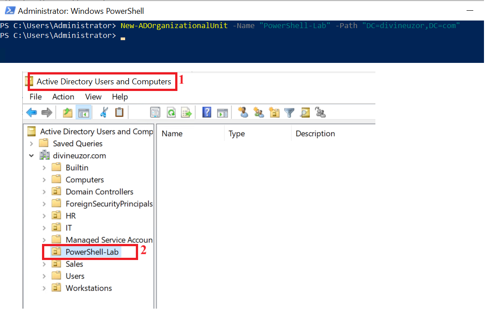

### Step 2: Check the OU exists

This command looks up the OU you just made.

```powershell
Get-ADOrganizationalUnit -Identity "OU=PowerShell-Lab,DC=divineuzor,DC=com"
```

You should see: the OU's name and DistinguishedName.

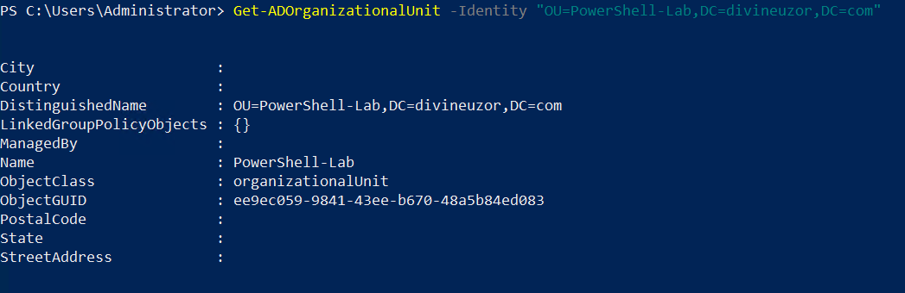

### Step 3: Create a group

This command creates a security group inside the new OU.

```powershell
New-ADGroup -Name "PS-Lab-Users" -GroupScope Global -GroupCategory Security -Path "OU=PowerShell-Lab,DC=divineuzor,DC=com"
```

You should see no message.

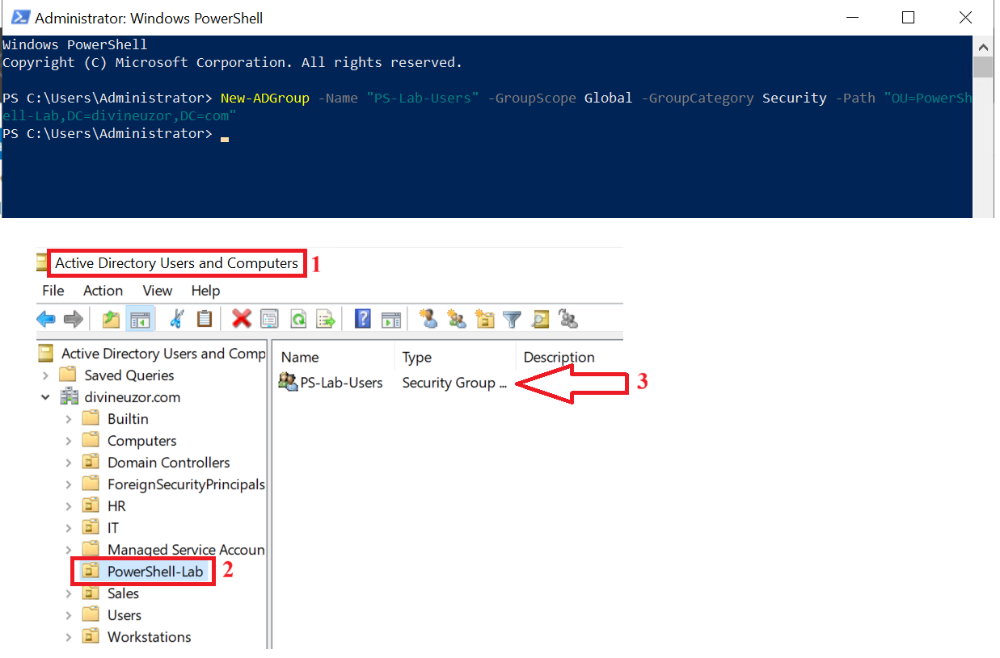

### Step 4: Check the group exists

This command looks up the new group.

```powershell
Get-ADGroup -Identity "PS-Lab-Users"
```

You should see: the group's name, scope, and category.

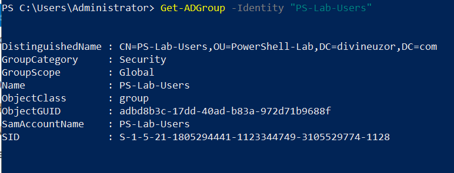

---

## Task 8: Create User Accounts

This task covers creating users in several ways and explains why a new account sometimes appears disabled.

**Key idea:** A new user account created without a password is disabled. To make a working account, give it a password and turn it on with `-Enabled $true`.

### Step 1: Preview before creating (-WhatIf)

This command shows what would happen if you created a user, without creating anything.

```powershell
New-ADUser -Name "Preview User" -SamAccountName "puser" -WhatIf
```

You should see a message that starts What if: Performing the operation "New" on target.... No user is created.

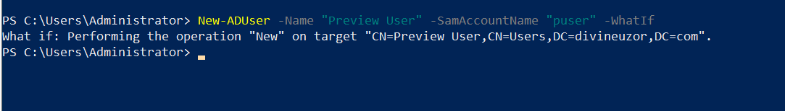

`-WhatIf` is a safety switch. Before running a command that changes things, you can add it to check the result first.

### Step 2: Create a user using variables

This command stores the OU path and a hidden password in variables, then creates an enabled user with them.

```powershell
$OUPath = "OU=PowerShell-Lab,DC=divineuzor,DC=com"
$Password = Read-Host "Enter a password for the new user" -AsSecureString

New-ADUser `
 -Name "Tola Bello" `
 -GivenName "Tola" `
 -Surname "Bello" `
 -SamAccountName "tbello" `
 -UserPrincipalName "tbello@divineuzor.com" `
 -Path $OUPath `
 -AccountPassword $Password `
 -Enabled $true
```

You should see: a prompt to type the password, with the characters hidden, and then no message after the user is created.

| Part | Meaning |
|---|---|
| `$OUPath` | A variable holding where to create the user |
| `-Name` | The account's full name |
| `-GivenName` and `-Surname` | First name and last name |
| `-SamAccountName` | The short login name |
| `-Path $OUPath` | The OU to create the user in, taken from the variable |
| `AccountPassword $Password` | The password, taken from the variable |
| `-Enabled $true` | Turns the account on |

The backtick ` at the end of a line tells PowerShell the command continues on the next line. Make sure no spaces come after it. Your password must meet the domain's password rules.

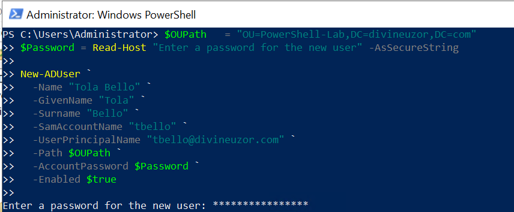

### Step 3: Create a user without variables

This command creates a second user by typing every value directly into the command, with no variables.

```powershell
New-ADUser `
 -Name "Emeka Obi" `
 -GivenName "Emeka" `
 -Surname "Obi" `
 -SamAccountName "eobi" `
 -UserPrincipalName "eobi@divineuzor.com" `
 -Path "OU=PowerShell-Lab,DC=divineuzor,DC=com" `
 -AccountPassword (ConvertTo-SecureString "Lab@Pass2026!x" -AsPlainText -Force) `
 -Enabled $true
```

You should see: no message, and when you check Active Directory you’ll see the newly created users for both Emeka Obi and Tola Bello.

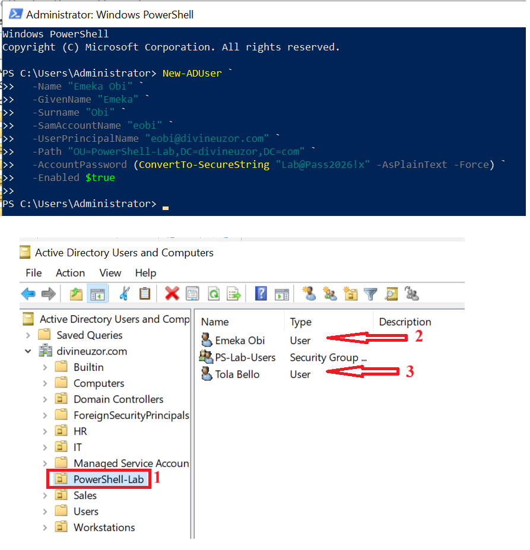

`ConvertTo-SecureString -AsPlainText -Force` turns typed text into the protected format Active Directory expects. Putting a password in a command as plain text is acceptable only in a lab. The variable method with Read-Host in Step 2 is the safer habit.

### Step 4: Check both users

This command lists the users in the lab OU and shows whether each is enabled.

```powershell
Get-ADUser -Filter * -SearchBase "OU=PowerShell-Lab,DC=divineuzor,DC=com" | Select-Object Name, SamAccountName, Enabled
```

You should see: both users, with Enabled set to True.

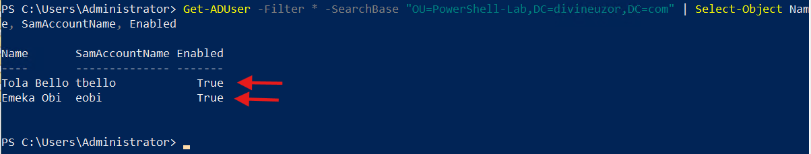

### Step 5: See why accounts get disabled

This command creates a user with no password and then checks its status.

```powershell
New-ADUser -Name "No Password" -SamAccountName "nopass" -Path "OU=PowerShell-Lab,DC=divineuzor,DC=com"
Get-ADUser -Identity nopass | Select-Object Name, Enabled
```

You should see: Enabled set to False, because the account has no password.

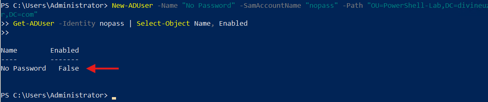

Now fix it. This command sets a password on the account and then turns it on.

```powershell
Set-ADAccountPassword -Identity nopass -Reset -NewPassword (ConvertTo-SecureString "Lab@Pass2026!x" -AsPlainText -Force)
Enable-ADAccount -Identity nopass
Get-ADUser -Identity nopass | Select-Object Name, Enabled
```

You should see: Enabled now set to True.

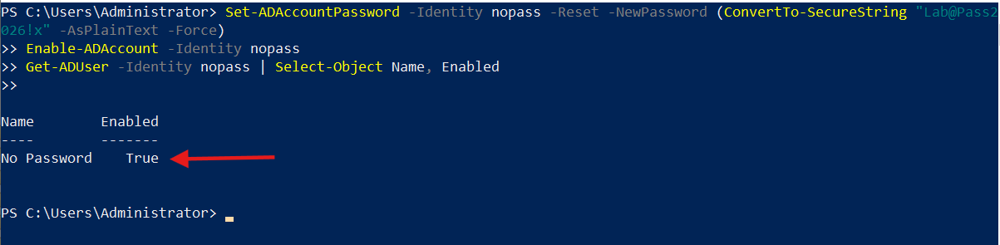

### Step 6: Find an OU inside another OU

This command lists the OUs that sit directly inside the IT OU, so you can copy the exact name.

```powershell
Get-ADOrganizationalUnit -Filter * -SearchBase "OU=IT,DC=divineuzor,DC=com" -SearchScope OneLevel | Select-Object Name, DistinguishedName
```

You should see: the OUs inside IT, such as Cloud Engineer and Software Engineer, each with its DistinguishedName.

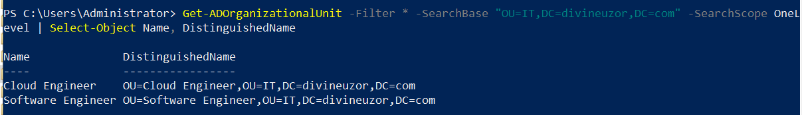

### Step 7: Create a user inside the nested OU

This command creates a user directly inside one of the OUs you found, using a variable for the path.

```powershell
$NestedOU = "OU=Cloud Engineer,OU=IT,DC=divineuzor,DC=com"
$Password = Read-Host "Enter a password" -AsSecureString

New-ADUser `
 -Name "Zainab Musa" `
 -GivenName "Zainab" `
 -Surname "Musa" `
 -SamAccountName "zmusa" `
 -UserPrincipalName "zmusa@divineuzor.com" `
 -Path $NestedOU `
 -AccountPassword $Password `
 -Enabled $true

Get-ADUser -Identity zmusa | Select-Object Name, Enabled, DistinguishedName
```

Replace the value of `$NestedOU` with the exact DistinguishedName you saw in Step 6.

You should see: the user with Enabled as True, and a DistinguishedName that shows the nested OU.

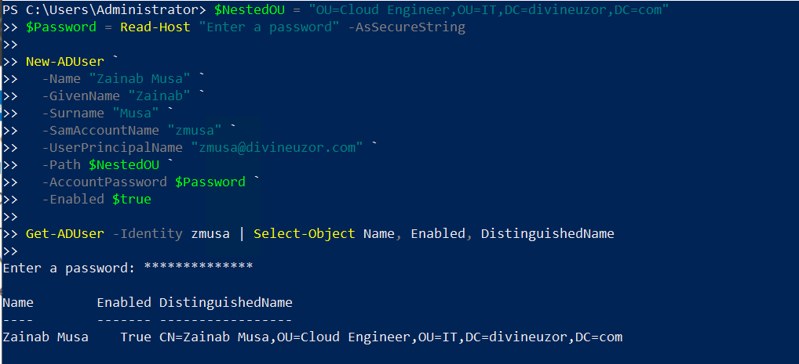

### Step 8: Check in the graphical tool

This step opens the usual Windows tool to confirm PowerShell made the same changes you would have made by clicking.

Open Active Directory Users and Computers, refresh, and look in the IT OU and the nested OU.

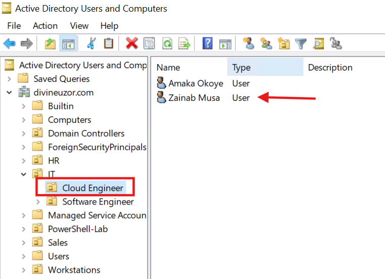

---

## Task 9: Build Commands Visually in PowerShell ISE

You don't have to memorize every parameter. The ISE has a panel that builds commands from a form.

### Step 1: Open PowerShell ISE and search for a command

This opens the white scripting window and finds a command by keyword.

1. Click Start, search for Windows PowerShell ISE, right-click it, and select Run as administrator.
2. If the Commands panel isn't visible, select View → Show Command Add-on.
3. In the search box, type `aduser` and select `New-ADUser`.

You should see: a form with a box for each option of the command.

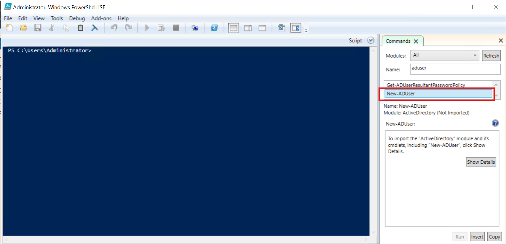

### Step 2: Fill in the form

This step gives the command its details without typing them from memory.

Fill in Name, GivenName, Surname, SamAccountName, UserPrincipalName, and Path. Leave AccountPassword empty, because that box can't take a hidden password.

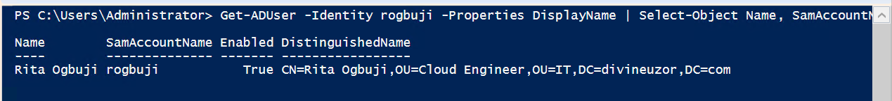

### Step 3: Copy the command into the script pane

This turns the form into a finished command that you can read and edit.

1. Click Copy at the bottom of the form.
2. Click in the white script pane at the top and paste.
3. At the end of the pasted line, add `-AccountPassword $Password -Enabled $true`. If you opened a new ISE window, set `$Password = Read-Host "Enter a password" -AsSecureString` first.
4. Press F5 to run it.

You should see: the user created with no error message, and the command visible in the script pane.

Seeing the finished command is a good way to learn how parameters fit together.


---

## Task 10: Manage Users and Groups

Creating accounts is only the start. Administrators spend much of their time changing them.

### Step 1: Add users to the group

This command puts three users into the PS-Lab-Users group.

```powershell
Add-ADGroupMember -Identity "PS-Lab-Users" -Members tbello, eobi, nopass
```

You should see: no message.

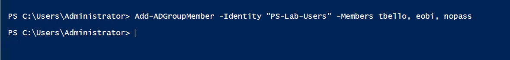

### Step 2: View the group members

This command lists who is in the group.

```powershell
Get-ADGroupMember -Identity "PS-Lab-Users" | Select-Object Name, SamAccountName
```

You should see: the three users.

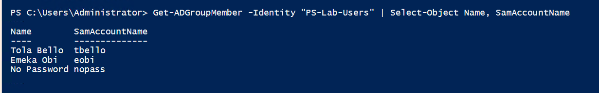

### Step 3: Update a user's details

This command sets a job title and department on a user, then displays them.

```powershell
Set-ADUser -Identity tbello -Title "Cloud Engineer" -Department "IT"
Get-ADUser -Identity tbello -Properties Title, Department | Select-Object Name, Title, Department
```

You should see: the title and department filled in.

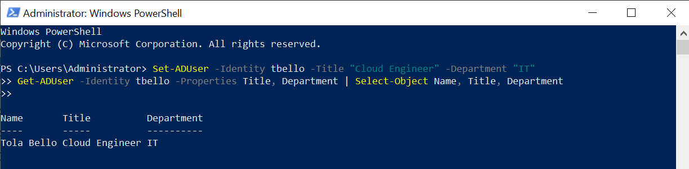

### Step 4: Disable an account

This command turns off an account, which is what an administrator does when someone leaves, and then lists all disabled accounts.

```powershell
Disable-ADAccount -Identity eobi
Get-ADUser -Filter 'Enabled -eq $false' | Select-Object Name, SamAccountName
```

You should see: Emeka Obi in the list of disabled accounts.

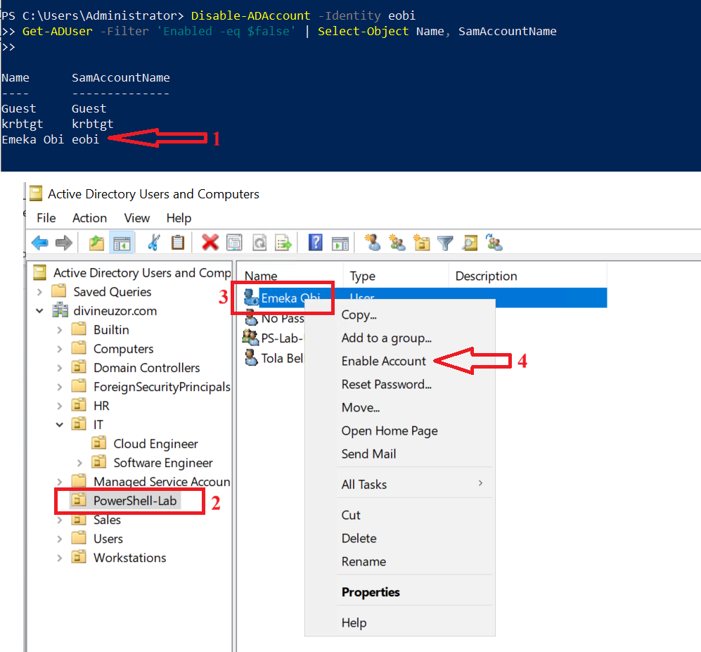

### Step 5: Enable the account again

This command turns the account back on and confirms it.

```powershell
Enable-ADAccount -Identity eobi
Get-ADUser -Identity eobi | Select-Object Name, Enabled
```

You should see: Enabled set to True.

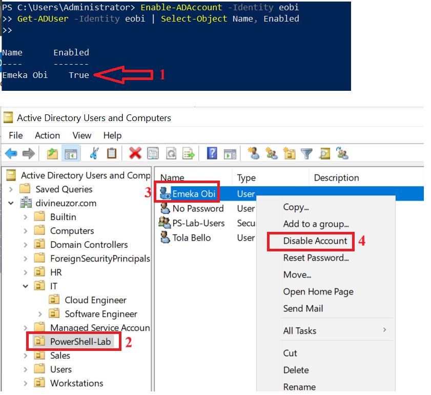

---

## Task 11: Create Many Users from a File

This is where automation pays off: one short script creates a whole list of users.

### Step 1: Create a CSV file of new users

This command writes a small spreadsheet-style file of three people and displays it.

```powershell
$csv = @"

FirstName,LastName,Username,Department

Ada,Nwosu,anwosu,IT

Chidi,Okeke,cokeke,IT

Fatima,Yusuf,fyusuf,HR

"@

$csv | Set-Content -Path C:\PSLab\newusers.csv
Import-Csv C:\PSLab\newusers.csv
```

You should see: a table of three people with their usernames and departments.

The closing `"@` must start at the very beginning of its line.

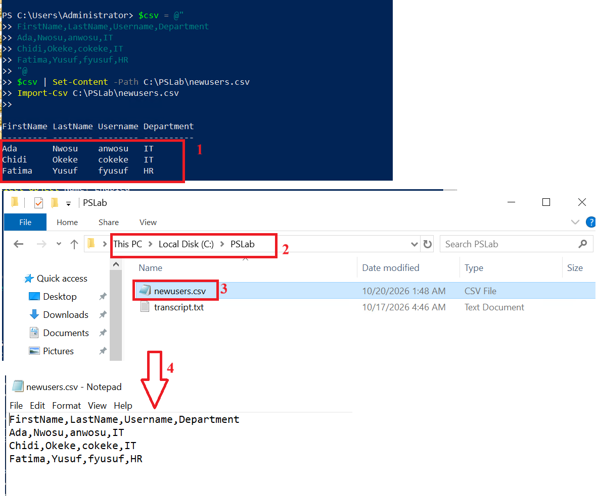


### Step 2: Create all the users with a loop

This command reads each row of the file and creates one user for it.

```powershell
$Password = Read-Host "Enter a password for the new users" -AsSecureString

Import-Csv C:\PSLab\newusers.csv | ForEach-Object {
  New-ADUser `
      -Name "$($_.FirstName) $($_.LastName)" `
      -GivenName $_.FirstName `
      -Surname $_.LastName `
      -SamAccountName $_.Username `
      -UserPrincipalName "$($_.Username)@divineuzor.com" `
      -Department $_.Department `
      -Path "OU=PowerShell-Lab,DC=divineuzor,DC=com" `
      -AccountPassword $Password `
      -Enabled $true
}
```

You should see: a password prompt and then no message.


| Part | Meaning |
|---|---|
| `Import-Csv ...` | Reads the file, one row at a time |
| `ForEach-Object { ... }` | Repeats the commands inside the braces for every row |
| `$_` | The row currently being processed |
| `$_.FirstName` | The value in that row's FirstName column |


### Step 3: Check the new users

This command lists the users and their departments.

```powershell
Get-ADUser -Filter * -SearchBase "OU=PowerShell-Lab,DC=divineuzor,DC=com" -Properties Department | Select-Object Name, SamAccountName, Department, Enabled
```

You should see: the three new users, plus the earlier ones, all enabled.


---

## Task 12: Check Services, Roles, and Shares

PowerShell can also report on what is installed and running on a server.

### Step 1: Check key services

This command shows whether the main directory, DNS, DHCP, and file-replication services are running.

```powershell
Get-Service -Name DHCPServer, DFSR, DNS, NTDS, Netlogon | Select-Object Name, Status, StartType
```

You should see: each service with a Status of Running.


This environment has the DHCP and DFS Replication roles installed. If you don't have a service, PowerShell reports that it can't be found, and you can remove it from the list.

### Step 2: List installed roles and features

This command lists everything installed on the server.

```powershell
Get-WindowsFeature | Where-Object Installed | Select-Object Name, DisplayName
```

You should see: roles such as Active Directory Domain Services and DNS Server.


### Step 3: Check the DHCP scope

This command shows the DHCP scope, which is the range of addresses the server can give out to computers.

```powershell
Get-DhcpServerv4Scope
```

You should see: the scope name, address range, and state.


### Step 4: Check DHCP leases and failover

These commands show which computers received addresses, and the failover relationship between the two DHCP servers.

```powershell
Get-DhcpServerv4Lease -ScopeId 192.168.6.0
Get-DhcpServerv4Failover
```

You should see: leased addresses and the failover partner's details. If no computer has taken an address yet, the lease list can be empty.


### Step 5: List the shared folders

This command shows the folders this server is sharing on the network.

```powershell
Get-SmbShare | Select-Object Name, Path
```

You should see: the shares and the folders they point to.


### Step 6: Preview installing a feature

This command shows what installing the Telnet Client feature would do, without installing it.

```powershell
Install-WindowsFeature -Name Telnet-Client -WhatIf
```

You should see: a What if message describing the installation. Nothing is installed.


---

## Task 13: Manage Another Server Remotely

One administrator can run commands on other servers without signing in to them.

### Step 1: Run a command on the second server

This command runs two commands on DIVINE-DC02 and returns the results to your screen.

```powershell
Invoke-Command -ComputerName DIVINE-DC02 -ScriptBlock { hostname; Get-Service DHCPServer }
```

You should see: the second server's name and the status of its DHCP service.

| Part | Meaning |
|---|---|
| `Invoke-Command` | Run something on another computer |
| `-ComputerName` | Which computer to run it on |
| `-ScriptBlock { ... }` | The commands to run, written inside the braces |


### Step 2: Open an interactive session

This starts a session in which everything you type runs on the second server, and then leaves it.

```powershell
Enter-PSSession -ComputerName DIVINE-DC02
Get-Service DFSR
Exit-PSSession
```

You should see: the prompt change to start with [DIVINE-DC02], which shows you are working on that server. After Exit-PSSession, the prompt returns to normal.


---

## Task 14: Create Reports

Administrators often need to hand over a list. PowerShell can save results to files.

### Step 1: Export users to a CSV file

This command saves a list of all users to a CSV file, which you can open in Excel, and then opens it.

```powershell
Get-ADUser -Filter * | Select-Object Name, SamAccountName, Enabled | Export-Csv -Path C:\PSLab\ad-users.csv -NoTypeInformation
notepad C:\PSLab\ad-users.csv
```

You should see: Notepad opening with a table of users.


### Step 2: Create a web page report

This command saves the lab users as an HTML page and opens it in a browser.

```powershell
Get-ADUser -Filter * -SearchBase "OU=PowerShell-Lab,DC=divineuzor,DC=com" |
ConvertTo-Html -Property Name, SamAccountName, Enabled | Out-File C:\PSLab\ps-lab-users.html

Invoke-Item C:\PSLab\ps-lab-users.html
```

You should see: a web page with a table of users.


---

## Task 15: Clean Up and Stop Recording

Finish by removing the test objects safely and closing the transcript.

### Step 1: Preview the removal

This command shows which users would be deleted from the lab OU, without deleting them.

```powershell
Get-ADUser -Filter * -SearchBase "OU=PowerShell-Lab,DC=divineuzor,DC=com" |
Remove-ADUser -WhatIf
```

You should see: a What if line for each user, and no deletion.


### Step 2: Remove the test objects

These commands delete the lab users, the group, the nested-OU user, and the lab OU. Run them only if the preview showed just your test users.

```powershell
Get-ADUser -Filter * -SearchBase "OU=PowerShell-Lab,DC=divineuzor,DC=com" |
Remove-ADUser -Confirm:$false

Remove-ADGroup -Identity "PS-Lab-Users" -Confirm:$false

Remove-ADUser -Identity zmusa -Confirm:$false

Set-ADOrganizationalUnit -Identity "OU=PowerShell-Lab,DC=divineuzor,DC=com" -ProtectedFromAccidentalDeletion $false

Remove-ADOrganizationalUnit -Identity "OU=PowerShell-Lab,DC=divineuzor,DC=com" -Confirm:$false
```

You should see: no message.

A new OU is protected from accidental deletion by default, which is why it must be unprotected before it can be removed.


### Step 3: Stop the transcript

This command stops recording and saves the file.

```powershell
Stop-Transcript
```

You should see: a message that the transcript has stopped and where it was saved.


### Step 4: Open the transcript

This command opens the saved record of your whole session.

```powershell
notepad C:\PSLab\transcript.txt
```

You should see: every command you typed and every result, in order.


---

## Verification

Confirm that:

- The transcript file exists and records the whole session.
- Both the variable and non-variable users showed Enabled: True.
- The account with no password showed Enabled: False, then True after the fix.
- The nested-OU user's DistinguishedName shows the nested OU.
- The users from the CSV file were created.
- DHCP, services, and shares were retrieved with PowerShell.
- A command ran on the second server from the first.
- The CSV and HTML reports were created.

## Troubleshooting

| Problem | What to check |
|---|---|
| "The term 'New-ADUser' is not recognized" | Run the command on a domain controller, or install the Active Directory PowerShell tools. |
| "The password does not meet the length, complexity, or history requirement" | Use a longer, more complex password that meets your domain's policy. |
| "Cannot find an object with identity..." | Check the spelling, and the OU path with `Get-ADOrganizationalUnit -Filter *`. |
| "Access is denied" | Reopen PowerShell with Run as administrator. |
| A command stops with a red error after a backtick | Make sure there is no space after the backtick ` |
| Invoke-Command fails | Check that the second server is running, the name is correct, and Test-Connection works. |
| A script file won't run | Check `Get-ExecutionPolicy`. Commands typed directly are not affected by it. |

## Skills Demonstrated

- PowerShell fundamentals: cmdlets, parameters, Get-Command, Get-Help, aliases, the pipeline, and variables.
- Session logging with transcripts.
- System, network, and service diagnostics.
- Active Directory administration: OUs, groups, and user accounts.
- Safe change management with `-WhatIf`.
- Bulk automation with CSV files and loops.
- Remote administration of a second server.
- Reporting with Export-Csv and ConvertTo-Html.

## Key Takeaways

- PowerShell lets you manage Windows from the keyboard, and anything you click, you can usually type.
- Commands are named Verb-Noun, so they are easy to guess and search for.
- The pipeline passes results from one command to the next.
- Variables hold values you reuse, and Read-Host -AsSecureString keeps passwords hidden.
- A new account with no password is disabled, so supply a password and use -Enabled $true.
- -WhatIf previews a change before it happens.
- One short script can create many accounts, and one administrator can manage many servers.

## Conclusion

You used PowerShell to administer a Windows Server domain, progressing from basic commands to practical administration tasks. You discovered commands and used help, inspected a server, tested network connectivity, explored Active Directory, created OUs, groups, and users, and provisioned users in bulk from a CSV file. You also reviewed DHCP, services, and shares, ran commands remotely on a second server, generated reports, and completed administrative cleanup with the session recorded in a transcript.
