# LAB 18: AUTOMATING EMPLOYEE ONBOARDING, ROLE CHANGES, AND OFFBOARDING IN ACTIVE DIRECTORY

**Capstone Project: Windows Server Infrastructure**

#### Project Summary

| **The problem**  | Employee accounts are created, changed, and closed by hand. Accounts land in the wrong OU, staff keep access from old roles, and leavers' accounts stay enabled.                                            |
|------------------|-------------------------------------------------------------------------------------------------------------------------------------------------------------------------------------------------------------|
| **The solution** | PowerShell automation that reads HR requests from CSV files, validates them, applies approved rules, and records every action in an audit log.                                                              |
| **The proof**    | An employee onboarded, a role change that moves access from Sales to IT, and a leaver whose account is disabled. Each is verified in Active Directory, on the second controller, and from a Windows client. |
| **Skills shown** | Active Directory, PowerShell automation, security groups, NTFS and share permissions, replication, Hyper-V, testing and documentation                                                                       |

## 1. Overview

Managing employee accounts is a routine IT responsibility. When people join, change roles, or leave, IT must update their Active Directory account, OU placement, and access. Done by hand, this is slow and inconsistent.

This capstone automates the employee identity lifecycle in the divineuzor.com domain built across Labs 1 to 17. It processes three kinds of request from CSV files:

- **Onboarding:** create the account, set attributes, place it in the right OU, and assign approved groups.

- **Role change:** update attributes, move the account, grant the new access, and remove the access that no longer applies.

- **Offboarding:** disable the account, revoke access, move it to a Disabled Users OU, and record the reason.

The project also covers input validation, duplicate detection, audit logging, reporting, replication checks, and sign-in and access tests from a domain-joined client.

## 2. Business Scenario

Divineuzor has three departments: Human Resources (HR), Information Technology (IT), and Sales. HR sends requests to IT whenever someone joins, changes role, or leaves. IT needs a consistent process that:

- places employees in the correct OUs

- keeps department and job title attributes accurate

- grants access only through approved security groups

- removes old access on a role change and revokes it on departure

- records every successful and failed operation

## 3. Lab Objectives

- Assess an existing Active Directory environment before automating it, and record what the assessment finds.

- Define an access matrix that drives the automation.

- Build PowerShell scripts for onboarding, role changes, and offboarding.

- Validate input and detect duplicate accounts.

- Log every operation without recording passwords.

- Verify changes on the read-only domain controller.

- Prove from a Windows client that access follows group membership.

## 4. Lab Environment

| **Machine**         | **Operating system** | **Role in this lab**                                 |
|---------------------|----------------------|------------------------------------------------------|
| DC01 (DIVINE-DCO1)  | Windows Server 2019  | Writable domain controller, DNS, script host         |
| DC02 (DIVINE-DC02)  | Windows Server 2022  | Second domain controller, used to verify replication |
| Client PC (Divineg) | Windows 10           | Domain-joined client for sign-in and access tests    |

Domain: divineuzor.com. All machines run as Hyper-V virtual machines.

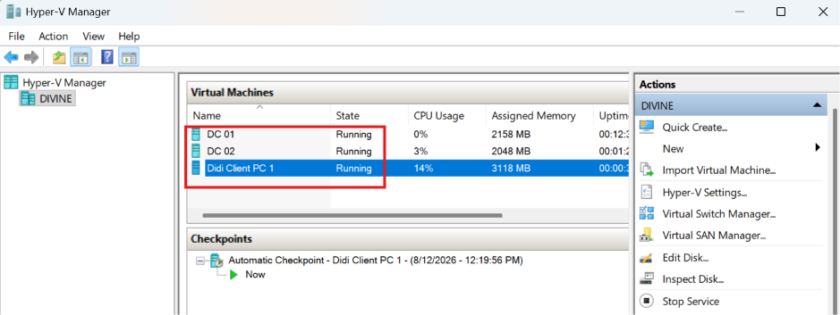

| **Machine** | **IP address**                                                                 |
|-------------|--------------------------------------------------------------------------------|
| DCO1        | 192.168.6.1                                                                    |
| DC02        | 192.168.6.3                                                                    |
| Client PC   | 192.168.6.2 (or an address from the DHCP scope (192.168.6.10 to 192.168.6.30)) |

Make all directory changes on DC01 and use DC02 only to verify. Changing the same object on both controllers at once can cause replication conflicts.

#### What already exists

| **Item**          | **Details**                                                                                                |
|-------------------|------------------------------------------------------------------------------------------------------------|
| OUs               | HR with Recruitment and Payroll, IT with Cloud Engineer and Software Engineer. A Sales OU also exists.     |
| Groups            | IT Staff, CLOUD ENG, CLOUD SNR, GPO-Pilot-Users                                                            |
| Employees         | Including Glory Davies, Amaka Okoye, Amara Nwoye, Chizaram Kelvin, Ada Obi, and Chisom CM. Mmesoma (Sales) |
| IT Projects share | Share-level Read for IT Staff, NTFS Modify for IT Staff. Chisom was refused access.                        |

#### What this lab adds

| **Item**                        | **Purpose**                                                        |
|---------------------------------|--------------------------------------------------------------------|
| HR Staff and Sales Staff groups | Access for HR and Sales employees                                  |
| Disabled Users OU               | Holds accounts of employees who have left                          |
| Sales-Docs share                | A resource only Sales Staff can open, to prove access follows role |
| Testemployee                    | A test employee who will leave                                     |
| C:\Employee-Lifecycle           | Scripts, rules, requests, logs, and reports                        |

#### Security groups

| **Group**       | **Used for**                                                  |
|-----------------|---------------------------------------------------------------|
| IT Staff        | General IT access                                             |
| CLOUD ENG       | Cloud engineering access                                      |
| CLOUD SNR       | Senior cloud role. Managed, but never assigned automatically. |
| GPO-Pilot-Users | Group Policy testing. **Never changed by this automation.**   |
| HR Staff        | New. Access for HR employees.                                 |
| Sales Staff     | New. Access for Sales employees.                              |

## 5. How This Capstone Builds on Earlier Labs

| **Earlier labs**                                                           | **How they are used here**                                                       |
|----------------------------------------------------------------------------|----------------------------------------------------------------------------------|
| Labs 1 to 3: Hyper-V and Windows Server 2019                               | The virtual machines that host the whole project                                 |
| Lab 4: promoting a domain controller                                       | The divineuzor.com domain                                                        |
| Lab 5: Active Directory, OUs, users, groups                                | The structure that the scripts inspect and manage                                |
| Lab 6: Joining a client                                                    | The Windows 10 client used for sign-in and access tests                          |
| Lab 8 and the follow-up that returned DC02 to a standard domain controller | DC02, used to verify replication                                                 |
| Labs 9 and 10: NTFS and share permissions                                  | The IT Projects and Sales-Docs shares that prove access follows group membership |
| Labs 11 and 12: Group Policy                                               | Placing an account in an OU also places it in that OU's policy scope             |
| Labs 15 and 16: DFS and DHCP                                               | Reused services on the same servers, and the DHCP scope the client may use       |
| Lab 17: PowerShell administration                                          | CSV processing, variables, secure passwords, loops, and error handling           |

## PART 1: PREPARATION AND ASSESSMENT

### Task 1: Prepare the Working Folders

One organized folder keeps scripts, rules, requests, logs, and reports together.

1.  On DC01, open Windows PowerShell as administrator.

2.  Create the folders:

```powershell
New-Item -ItemType Directory -Path `

"C:\Employee-Lifecycle\Config", `

"C:\Employee-Lifecycle\Scripts", `

"C:\Employee-Lifecycle\Input", `

"C:\Employee-Lifecycle\Logs", `

"C:\Employee-Lifecycle\Reports"
```

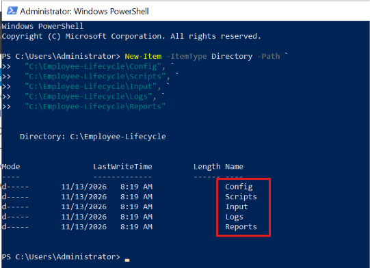

3.  Confirm they exist:

```powershell
Get-ChildItem "C:\Employee-Lifecycle"
```

| **Folder** | **Holds**                   |
|------------|-----------------------------|
| Config     | The role matrix (the rules) |
| Scripts    | The PowerShell scripts      |
| Input      | HR request files            |
| Logs       | Audit logs                  |
| Reports    | Reports                     |

### Task 2: Verify the Environment

Confirm the tools and the domain before changing anything.

1.  Check that the Active Directory module is available and import it:

```powershell
Get-Module -ListAvailable ActiveDirectory

Import-Module ActiveDirectory
```

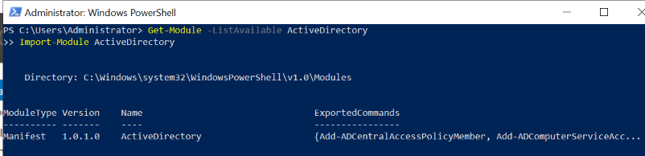

2.  Show the domain:

```powershell
Get-ADDomain | Select-Object Name, DNSRoot, DomainMode, PDCEmulator
```

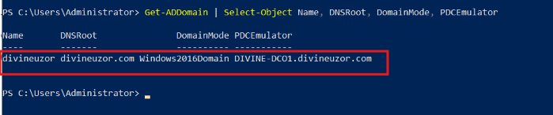

3.  Show the domain controllers and their types:

```powershell
Get-ADDomainController -Filter * |

Select-Object Name, IPv4Address, IsReadOnly, OperatingSystem |

Format-Table -AutoSize
```

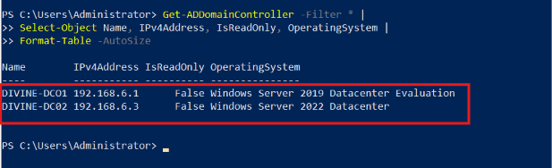

### Task 3: Inspect the Existing Directory

Record the current state before automating, so every later change can be explained.

1.  List the OUs:

```powershell
Get-ADOrganizationalUnit -Filter * |

Select-Object Name, DistinguishedName |

Format-Table -AutoSize
```

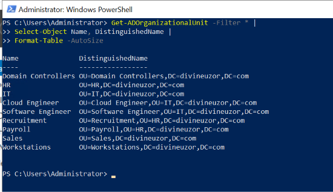

2.  List the employee accounts, excluding built-in and system accounts:

```powershell
Get-ADUser -Filter * -Properties Department, Title, Enabled |

Where-Object {

$\_.SamAccountName -notin @("Administrator","Guest","DefaultAccount") -and

$\_.SamAccountName -notlike "krbtgt*"

} |

Select-Object Name, SamAccountName, Department, Title, Enabled, DistinguishedName |

Format-Table -AutoSize
```

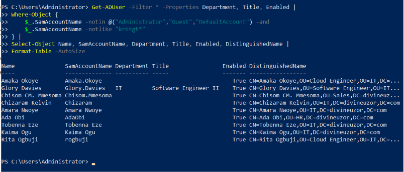

3.  List the groups:

```powershell
Get-ADGroup -Filter * |

Select-Object Name, GroupScope, GroupCategory, DistinguishedName |

Format-Table -AutoSize
```

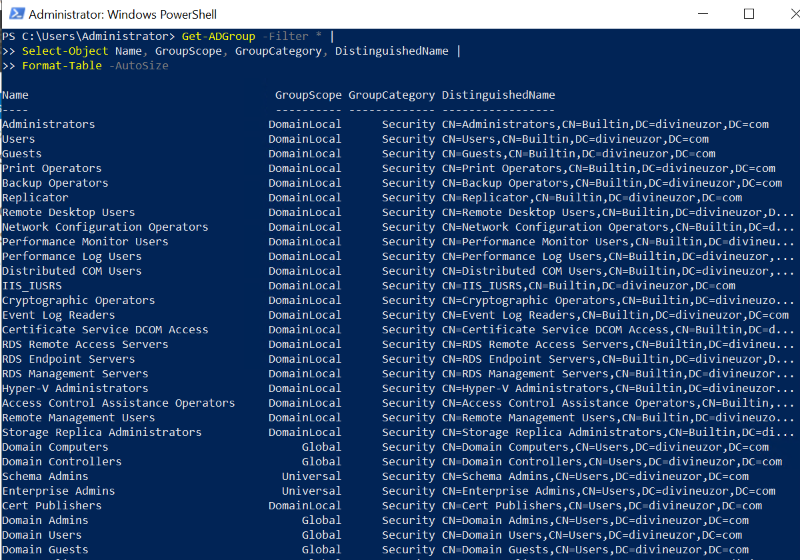

4.  List the members of the groups the automation will manage or avoid:

```powershell
Get-ADGroupMember "IT Staff"

Get-ADGroupMember "CLOUD ENG"

Get-ADGroupMember "CLOUD SNR"

Get-ADGroupMember "GPO-Pilot-Users"
```

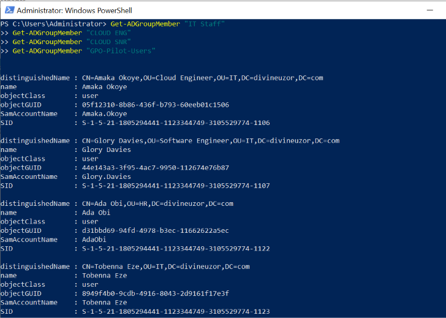

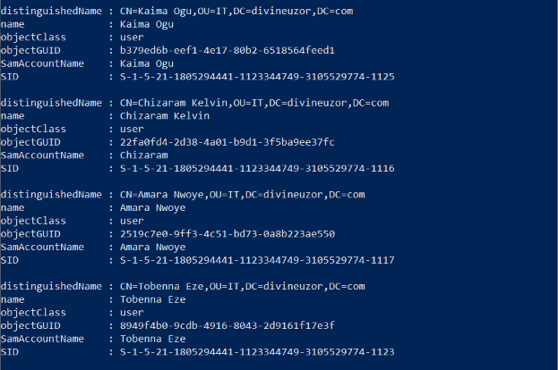

### Task 4: Record the Assessment Findings

Review the output from Task 3. Note anything that does not match the access matrix, and what this project does about it. These items were set up deliberately in earlier labs, so the automation documents them and does not change them.

| **What I found**                                             | **Why it exists**                              | **What this project does**                   |
|--------------------------------------------------------------|------------------------------------------------|----------------------------------------------|
| An HR employee (Ada Obi) is a member of IT Staff             | A permission test in Lab 9                     | Documented as an exception, not changed      |
| Some IT employees sit directly in the IT OU, not in a sub-OU | Account setup in Lab 10                        | Documented, not changed                      |
| The Sales employee (Chisom) belongs to no access group       | She was only used to test permissions in Lab 9 | Fixed in Task 8 by adding her to Sales Staff |

The automation only changes accounts named in an HR request, so these existing accounts stay as they are.

### Task 5: Create the Baseline Inventory Report

This report is the "before" picture. A matching report at the end shows what the automation changed.

1.  Run:

```powershell
$ReportPath = "C:\Employee-Lifecycle\Reports\Employee-Inventory-Before.csv"

Get-ADUser -Filter * -Properties Department, Title, Enabled, MemberOf |

Where-Object {

$\_.SamAccountName -notin @("Administrator","Guest","DefaultAccount") -and

$\_.SamAccountName -notlike "krbtgt*"

} |

Select-Object Name, SamAccountName, Department, Title, Enabled,

@{Name="OU"; Expression={ ($\_.DistinguishedName -split ',', 2)[1] }},

@{Name="Groups"; Expression={

($\_.MemberOf | ForEach-Object { ($\_ -split ',')[0] -replace '^CN=','' }) -join '; '

}} |

Export-Csv -Path $ReportPath -NoTypeInformation
```

2.  Open the file in Excel or Notepad.

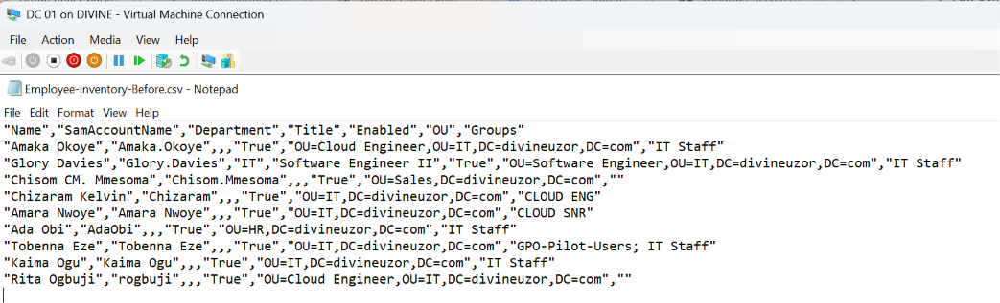

### Task 6: Review the Existing Shares and Permissions

Group membership only matters when a group has permissions on a resource, so review what exists.

```powershell
Get-SmbShare | Select-Object Name, Path, Description | Format-Table -AutoSize

Get-SmbShareAccess -Name "IT Projects"

$ITProjectsPath = (Get-SmbShare -Name "IT Projects").Path

(Get-Acl $ITProjectsPath).Access |

Select-Object IdentityReference, FileSystemRights, AccessControlType |

Format-Table -AutoSize
```

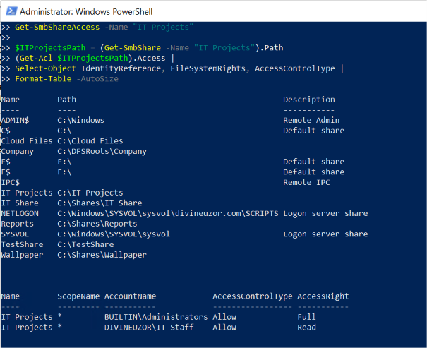

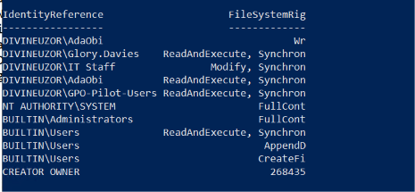

The share path is taken from the share itself, so it works wherever the folder is.

## PART 2: DESIGN AND TEST DATA

### Task 7: Define the Access Matrix

The matrix lists each role, its OU, and the groups it receives. The scripts read this file, so changing a rule means editing one line.

1.  Create the file:

```powershell
@"
Department,JobTitle,TargetOU,Groups
HR,Recruitment Officer,Recruitment,HR Staff
HR,Payroll Officer,Payroll,HR Staff
IT,Cloud Engineer,Cloud Engineer,IT Staff;CLOUD ENG
IT,Software Engineer,Software Engineer,IT Staff
IT,IT Support,IT,IT Staff
Sales,Sales Representative,Sales,Sales Staff
"@ | Set-Content "C:\Employee-Lifecycle\Config\RoleMatrix.csv"
```

2.  Display it:

```powershell
Import-Csv "C:\Employee-Lifecycle\Config\RoleMatrix.csv" | Format-Table -AutoSize
```

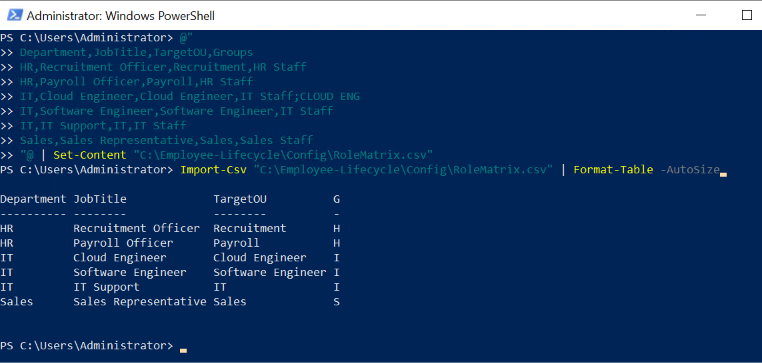

Group Management Considerations

- Multiple group memberships in the role matrix are separated by semicolons.
- CLOUD SNR is reserved for senior roles and is not assigned automatically.
- GPO-Pilot-Users is excluded from lifecycle automation to preserve its separate role in Group Policy testing.


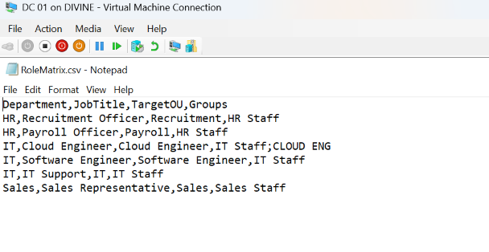

### Task 8: Create the Access Groups and the Test Employees

This script prepares the test data. It creates the HR Staff and Sales Staff groups, adds the existing Sales employee, Chisom, to Sales Staff, and creates a test employee who will later leave. Anything that already exists is left alone.

1.  Open PowerShell ISE or Visual Studio Code on DC01 and create a file named Seed-TestData.ps1 in C:\Employee-Lifecycle\Scripts.

2.  Enter:

```powershell
Import-Module ActiveDirectory

$Domain = Get-ADDomain

$DomainDN = $Domain.DistinguishedName

# 1. Create the HR and Sales access groups if they do not exist

$NewGroups = @(

@{ Name = "HR Staff"; Path = "OU=HR,$DomainDN" },

@{ Name = "Sales Staff"; Path = "OU=Sales,$DomainDN" }

)

foreach ($Group in $NewGroups) {

if (-not (Get-ADGroup -Filter "Name -eq '$($Group.Name)'")) {

New-ADGroup -Name $Group.Name -GroupScope Global -GroupCategory Security -Path $Group.Path

}

}

# 2. Use the existing Sales employee, Chisom, as the role-change test employee


$Chisom = @(Get-ADUser -Filter "Name -like 'Chisom*'")

if ($Chisom.Count -ne 1) {

throw "Expected one account matching 'Chisom*' but found $($Chisom.Count)."

}

$ChisomSam = $Chisom[0].SamAccountName

$ChisomInfo = Get-ADUser -Identity $ChisomSam -Properties Department, Title


# Fill in the department and title only if they are empty


if ([string]::IsNullOrWhiteSpace($ChisomInfo.Department)) {

Set-ADUser -Identity $ChisomSam -Department "Sales"

}

if ([string]::IsNullOrWhiteSpace($ChisomInfo.Title)) {

Set-ADUser -Identity $ChisomSam -Title "Sales Representative"

}

$SalesMembers = @(Get-ADGroupMember -Identity "Sales Staff").SamAccountName

if ($SalesMembers -notcontains $ChisomSam) {

Add-ADGroupMember -Identity "Sales Staff" -Members $ChisomSam

}

Write-Host "Chisom's logon name is: $ChisomSam"


# 3. Create a test employee to use for offboarding, if it does not exist


if (-not (Get-ADUser -Filter "SamAccountName -eq 'testemployee'")) {

$Password = Read-Host "Enter a password for the test employee account" -AsSecureString

New-ADUser `

-Name "Test Employee" `

-GivenName "Test" `

-Surname "Employee" `

-SamAccountName "testemployee" `

-UserPrincipalName "testemployee@$($Domain.DNSRoot)" `

-Department "IT" `

-Title "Cloud Engineer" `

-Path "OU=Cloud Engineer,OU=IT,$DomainDN" `

-AccountPassword $Password `

-Enabled $true

}

foreach ($GroupName in @("IT Staff", "CLOUD ENG")) {

$Members = @(Get-ADGroupMember -Identity $GroupName).SamAccountName

if ($Members -notcontains "testemployee") {

Add-ADGroupMember -Identity $GroupName -Members "testemployee"

}

}
```


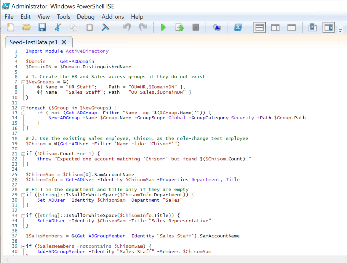

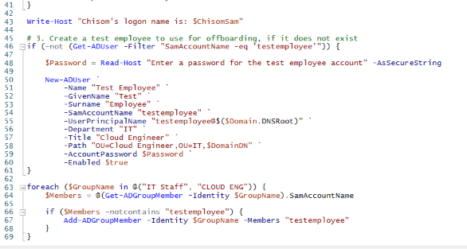

3.  Allow scripts in this session and run it:

```powershell
Set-ExecutionPolicy -Scope Process -ExecutionPolicy Bypass

C:\Employee-Lifecycle\Scripts\Seed-TestData.ps1
```

4.  If prompted, enter a password for the test employee that meets the domain policy. Remember it, because you will use it in the client tests.

5.  Note Chisom's logon name from the output.

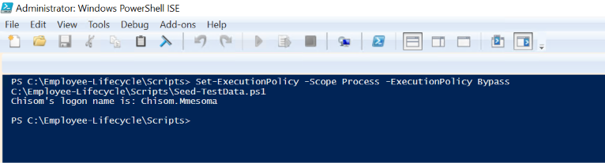

6.  Verify:

```powershell
Get-ADGroup -Filter "Name -like '*Staff'" | Select-Object Name, DistinguishedName

Get-ADUser -Filter "Name -like 'Chisom*'" -Properties Department, Title |

Select-Object Name, SamAccountName, Department, Title, DistinguishedName

Get-ADUser -Identity "testemployee" -Properties Department, Title |

Select-Object Name, Department, Title, DistinguishedName

Get-ADGroupMember "Sales Staff" | Select-Object Name, SamAccountName
```

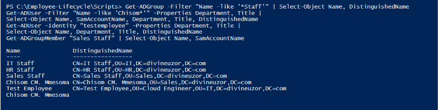

If you don't remember Chisom's password, reset it. Replace \<logon-name\> with the name from step 5:  
```powershell
Set-ADAccountPassword -Identity "\<logon-name\>" -Reset -NewPassword (Read-Host "New password" -AsSecureString)
```

### Task 9: Create a Protected Shared Folder

This share gives the group memberships something to control. Only Sales Staff, administrators, and the system can use it.

```powershell
New-Item -Path "C:\Shares\Sales-Docs" -ItemType Directory

Set-Content -Path "C:\Shares\Sales-Docs\Sales-Welcome.txt" -Value "Sales team documents"

New-SmbShare -Name "Sales-Docs" -Path "C:\Shares\Sales-Docs" `

-FullAccess "Administrators" -ChangeAccess "DIVINEUZOR\Sales Staff"

icacls "C:\Shares\Sales-Docs" /inheritance:r `

/grant "Administrators:(OI)(CI)F" "SYSTEM:(OI)(CI)F" "DIVINEUZOR\Sales Staff:(OI)(CI)M"
```


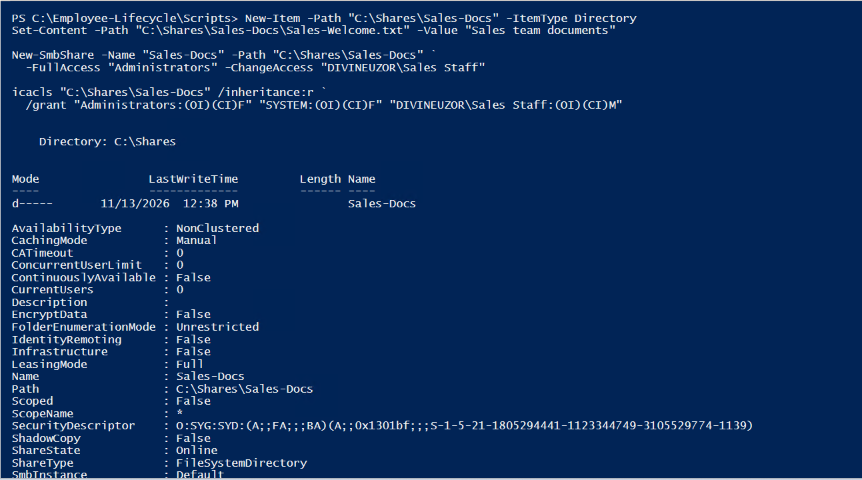

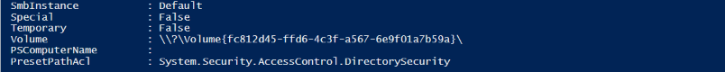

Verify both permission layers:

```powershell
Get-SmbShareAccess -Name "Sales-Docs"

icacls "C:\Shares\Sales-Docs"
```

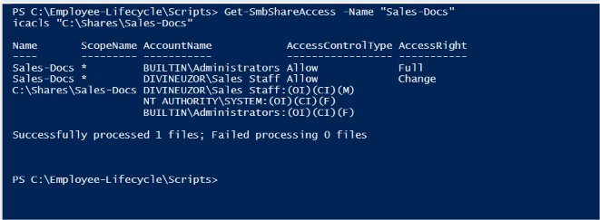

Share permissions and NTFS permissions both apply, and the stricter one wins.

### Task 10: Test Access Before Any Change

This is the baseline. Chisom is a Sales employee. She should open the Sales share, and the IT share should refuse her, as it did in Lab 9.

1.  On the Windows 10 client, sign in as DIVINEUZOR\\Chisom's logon name\>.

2.  Open File Explorer and go to \\DIVINE-DCO1\IT Projects. Windows should refuse access.

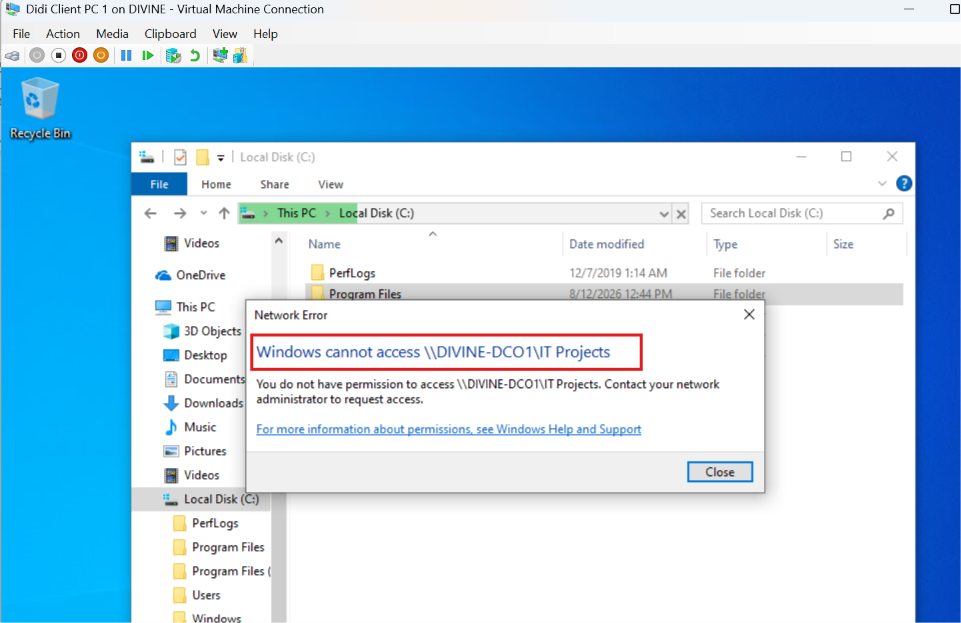

3.  Go to \\DIVINE-DCO1\Sales-Docs. It should open.

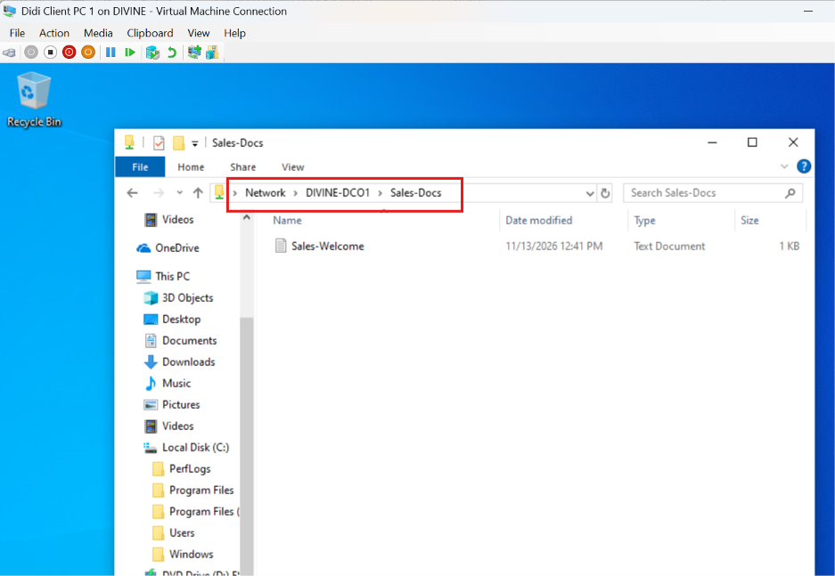

4.  Open Command Prompt and run:

```powershell
whoami /groups
```

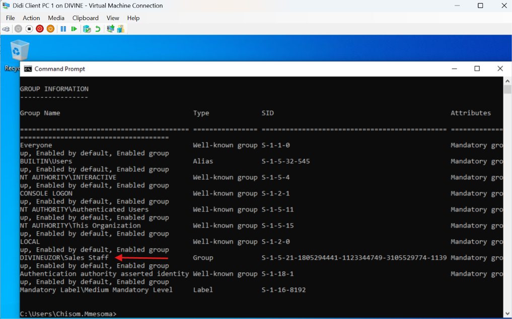

5.  Sign out.

### Task 11: Prepare the HR Request Files

Each file is an HR request. No passwords are ever stored in them.

1.  On DC01, create the three request files. The role-change file looks up Chisom's real logon name:

```powershell
$Chisom = Get-ADUser -Filter "Name -like 'Chisom*'"

@"

FirstName,LastName,SamAccountName,UserPrincipalName,Department,JobTitle,TargetOU

Nina,Patel,npatel,npatel@divineuzor.com,IT,Cloud Engineer,Cloud Engineer
"@ | Set-Content "C:\Employee-Lifecycle\Input\Onboarding.csv"

@"

SamAccountName,NewDepartment,NewJobTitle,NewOU

$($Chisom.SamAccountName),IT,Software Engineer,Software Engineer

"@ | Set-Content "C:\Employee-Lifecycle\Input\RoleChanges.csv"

@"

SamAccountName,Reason

testemployee,Employment ended

"@ | Set-Content "C:\Employee-Lifecycle\Input\Offboarding.csv"
```

2.  Review them:

```powershell
Import-Csv "C:\Employee-Lifecycle\Input\Onboarding.csv" | Format-Table -AutoSize

Import-Csv "C:\Employee-Lifecycle\Input\RoleChanges.csv" | Format-Table -AutoSize

Import-Csv "C:\Employee-Lifecycle\Input\Offboarding.csv" | Format-Table -AutoSize
```

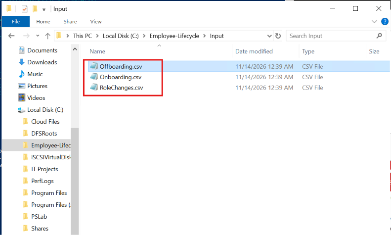

## PART 3: EMPLOYEE ONBOARDING

### Task 12: Create the Shared Helper Script

All three scripts use the same settings and helper functions, so they live in one file.

1.  Create a file named Lifecycle-Common.ps1 in C:\Employee-Lifecycle\Scripts.

2.  Enter:

```powershell
# Lifecycle-Common.ps1

# Shared settings and helper functions used by all employee lifecycle scripts.

Import-Module ActiveDirectory

$LifecycleRoot = "C:\Employee-Lifecycle"

$MatrixFile = "$LifecycleRoot\Config\RoleMatrix.csv"

$Domain = Get-ADDomain

$DomainDN = $Domain.DistinguishedName

$DomainDNS = $Domain.DNSRoot


# Groups the automation may add or remove, in addition to the groups in the role matrix


$ExtraManagedGroups = @("CLOUD SNR")

function Write-Log {

param([string]$Message)

$Entry = "$(Get-Date -Format 'yyyy-MM-dd HH:mm:ss') - $Message"

Add-Content -Path $LogFile -Value $Entry

Write-Host $Entry

}

function Get-RoleMatrix {

if (-not (Test-Path $MatrixFile)) {

throw "The role matrix file was not found."

}

Import-Csv $MatrixFile

}

function Get-RoleRule {

param([string]$Department, [string]$JobTitle)

$RoleMatrix |

Where-Object { $\_.Department -eq $Department -and $\_.JobTitle -eq $JobTitle } |

Select-Object -First 1

}

function Get-GroupList {

param([string]$Groups)

@($Groups -split ';' | ForEach-Object { $\_.Trim() } | Where-Object { $\_ })

}

function Format-ItemList {

param($Items)

if (@($Items).Count -gt 0) { @($Items) -join '; ' } else { 'none' }

}

function Get-ManagedGroups {

$FromMatrix = foreach ($Rule in $RoleMatrix) { Get-GroupList $Rule.Groups }

@($FromMatrix + $ExtraManagedGroups) | Sort-Object -Unique

}

function Resolve-TargetOU {

param([string]$Name)

$Found = @(Get-ADOrganizationalUnit -Filter "Name -eq '$Name'")

if ($Found.Count -eq 0) { throw "The OU '$Name' does not exist." }

if ($Found.Count -gt 1) { throw "More than one OU is named '$Name'." }

$Found[0].DistinguishedName

}

$RoleMatrix = Get-RoleMatrix
```

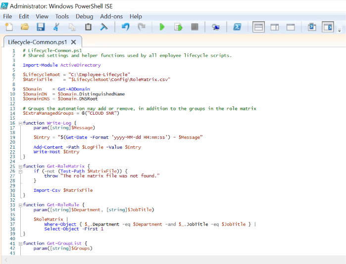

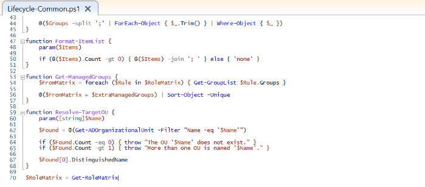

| **Function**      | **Purpose**                                                      |
|-------------------|------------------------------------------------------------------|
| Write-Log         | Writes a timestamped line to the log and the screen              |
| Get-RoleMatrix    | Loads the access matrix                                          |
| Get-RoleRule      | Finds the rule for a department and job title                    |
| Get-GroupList     | Splits the semicolon-separated groups                            |
| Get-ManagedGroups | Lists every group the automation may add or remove               |
| Resolve-TargetOU  | Finds an OU's full path, and fails if it is missing or ambiguous |
| Format-ItemList   | Prints a list, or none when it is empty                          |

### Task 13: Create the Onboarding Script

The script validates each request before creating anything, and logs every outcome.

1.  Create a file named Onboard-Employees.ps1 in C:\Employee-Lifecycle\Scripts.

2.  Enter:

```powershell
. "$PSScriptRoot\Lifecycle-Common.ps1"

$ErrorActionPreference = "Stop"

$InputFile = "$LifecycleRoot\Input\Onboarding.csv"

$LogFile = "$LifecycleRoot\Logs\Onboarding.log"

if (-not (Test-Path $InputFile)) {

throw "The onboa
)

foreach ($Employee in (Import-Csv $InputFile)) {

try {

foreach ($Field in $RequiredFields) {

if ([string]::IsNullOrWhiteSpace($Employee.$Field)) {

throw "Required field '$Field' is empty."

}

}

$Sam = $Employee.SamAccountName.Trim()

$UPN = $Employee.UserPrincipalName.Trim()

$Department = $Employee.Department.Trim()

$JobTitle = $Employee.JobTitle.Trim()

$TargetOU = $Employee.TargetOU.Trim()

if ($Sam -notmatch '^[a-zA-Z0-9.\_-]{1,20}$') {

throw "The SamAccountName format is invalid."

}

if ($UPN -notmatch '^[^@\s'']+@[^@\s'']+$') {

throw "The UserPrincipalName format is invalid."

}

if ($UPN.Split('@')[1] -ne $DomainDNS) {

throw "The UPN suffix does not match the company domain."

}

$Rule = Get-RoleRule -Department $Department -JobTitle $JobTitle

if ($null -eq $Rule) {

throw "No approved role matches '$Department / $JobTitle'."

}

if ($Rule.TargetOU -ne $TargetOU) {

throw "The requested OU '$TargetOU' does not match the approved OU '$($Rule.TargetOU)'."

}

$OUPath = Resolve-TargetOU -Name $Rule.TargetOU

if (Get-ADUser -Filter "SamAccountName -eq '$Sam'") {

throw "The account name already exists."

}

if (Get-ADUser -Filter "UserPrincipalName -eq '$UPN'") {

throw "The User Principal Name already exists."

}

$SecurePassword = Read-Host "Enter temporary password for $Sam" -AsSecureString

New-ADUser `

-Name "$($Employee.FirstName) $($Employee.LastName)" `

-GivenName $Employee.FirstName `

-Surname $Employee.LastName `

-SamAccountName $Sam `

-UserPrincipalName $UPN `

-Department $Department `

-Title $JobTitle `

-Path $OUPath `

-AccountPassword $SecurePassword `

-Enabled $true `

-ChangePasswordAtLogon $true

$Groups = Get-GroupList $Rule.Groups

try {

foreach ($Group in $Groups) {

Add-ADGroupMember -Identity $Group -Members $Sam

}

}

catch {

Write-Log "PARTIAL: Created $Sam but could not add groups - $($\_.Exception.Message)"
continue

}

Write-Log "SUCCESS: Created $Sam in $($Rule.TargetOU) as $JobTitle. Groups: $(Format-ItemList $Groups)."

}

catch {

Write-Log "FAILED: $($Employee.SamAccountName) - $($\_.Exception.Message)"

}

}
```

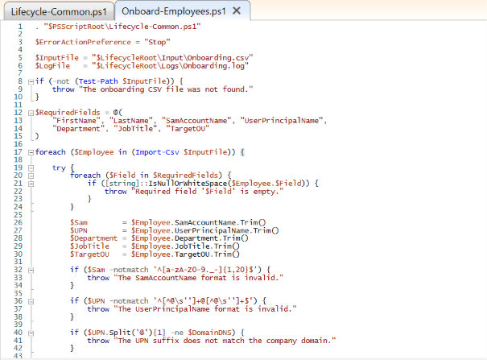

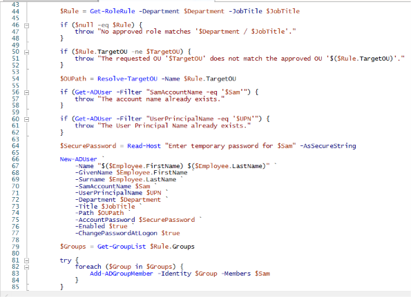

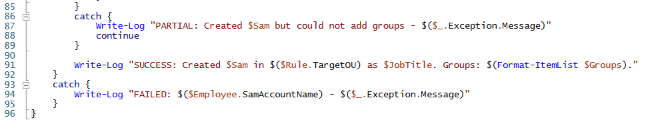

| **Command**                       | **Purpose**                                                    |
|-----------------------------------|----------------------------------------------------------------|
| Import-Csv                        | Reads the HR requests                                          |
| Get-RoleRule and Resolve-TargetOU | Apply the approved rule and find the real OU                   |
| Get-ADUser -Filter                | Detects duplicate account names and UPNs                       |
| Read-Host -AsSecureString         | Collects a temporary password without showing it               |
| New-ADUser                        | Creates the account, enabled and forced to change its password |
| Add-ADGroupMember                 | Grants the approved groups                                     |
| try / catch                       | Records a failure and moves on to the next employee            |

Validation happens first, and the password is requested only after every check passes. A request that fails any check never reaches New-ADUser.

### Task 14: Run the Onboarding Script

1.  On DC01, open PowerShell as administrator and run:

```powershell
Set-ExecutionPolicy -Scope Process -ExecutionPolicy Bypass

C:\Employee-Lifecycle\Scripts\Onboard-Employees.ps1
```

2.  Enter a temporary password that meets the domain policy when asked.

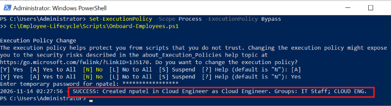

3.  Verify the account and its attributes:

```powershell
Get-ADUser npatel -Properties Department, Title, Enabled |

Select-Object Name, SamAccountName, Department, Title, Enabled, DistinguishedName
```

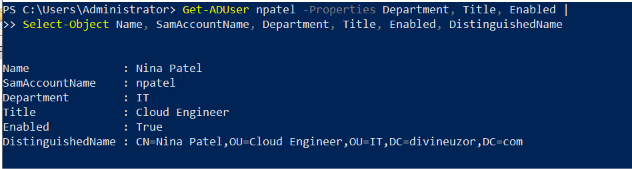

4.  Verify the group membership:

```powershell
Get-ADGroupMember "IT Staff" | Select-Object Name, SamAccountName

Get-ADGroupMember "CLOUD ENG" | Select-Object Name, SamAccountName
```

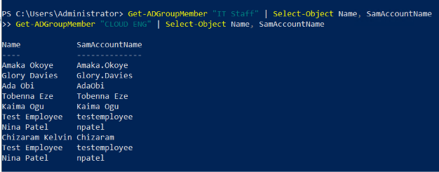

5.  Verify the forced password change (True means a change is required at first sign-in):

```powershell
Get-ADUser npatel -Properties pwdLastSet |

Select-Object Name, @{Name="MustChangePassword"; Expression={ $\_.pwdLastSet -eq 0 }}
```

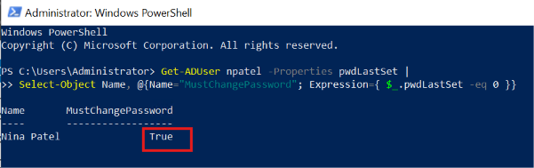

6.  Read the audit log:

```powershell
Get-Content "C:\Employee-Lifecycle\Logs\Onboarding.log"
```

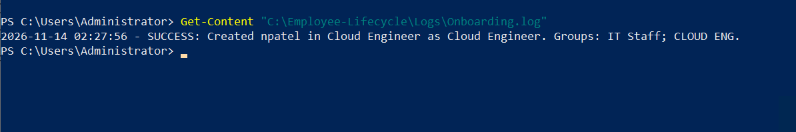

### Task 15: Test Validation and Duplicate Detection

A good automation refuses bad requests. This test sends three: an account that already exists, a request for the wrong OU, and one with a missing field.

1.  Replace the onboarding request with the test requests:

```powershell
@"

FirstName,LastName,SamAccountName,UserPrincipalName,Department,JobTitle,TargetOU

Nina,Patel,npatel,npatel@divineuzor.com,IT,Cloud Engineer,Cloud Engineer

Ola,Wrong,owrong,owrong@divineuzor.com,IT,Cloud Engineer,Sales

,Blank,bblank,bblank@divineuzor.com,IT,IT Support,IT

"@ | Set-Content "C:\Employee-Lifecycle\Input\Onboarding.csv"
```

2.  Run the script again:

```powershell
C:\Employee-Lifecycle\Scripts\Onboard-Employees.ps1
```

3.  All three should fail, and none will ask for a password.

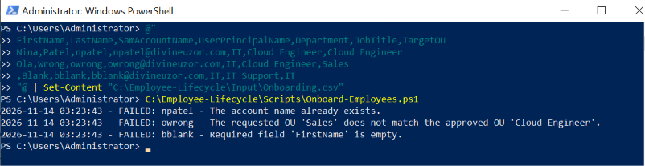

4.  Review the log:

```powershell
Get-Content "C:\Employee-Lifecycle\Logs\Onboarding.log"
```

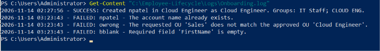

4.  Confirm that only one npatel account exists and that owrong and bblank were not created:

```powershell
Get-ADUser -Filter "SamAccountName -like 'npatel' -or SamAccountName -like 'owrong' -or SamAccountName -like 'bblank'" |

Select-Object Name, SamAccountName
```

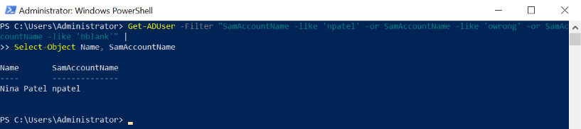

5.  Restore the original request:

```powershell
@"

FirstName,LastName,SamAccountName,UserPrincipalName,Department,JobTitle,TargetOU

Nina,Patel,npatel,npatel@divineuzor.com,IT,Cloud Engineer,Cloud Engineer

"@ | Set-Content "C:\Employee-Lifecycle\Input\Onboarding.csv"
```

## PART 4: EMPLOYEE ROLE CHANGE

### Task 16: Review the Employee Before the Change

Chisom is transferring from Sales to Software Engineering. Record her current state first.

```powershell
$Chisom = Get-ADUser -Filter "Name -like 'Chisom*'" -Properties Department, Title, MemberOf

$Chisom | Select-Object Name, SamAccountName, Department, Title, DistinguishedName, MemberOf
```

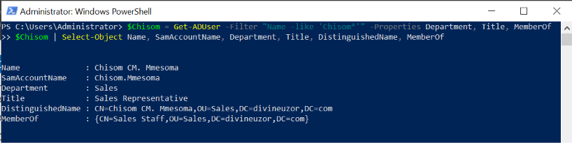

### Task 17: Create the Role-Change Script

The script grants the new access first, updates the attributes, moves the account, and only then removes the access that no longer applies. It removes only the groups the automation manages, so unrelated memberships such as GPO-Pilot-Users are untouched.

1.  Create a file named Change-EmployeeRole.ps1 in C:\Employee-Lifecycle\Scripts.

2.  Enter:

```powershell
. "$PSScriptRoot\Lifecycle-Common.ps1"

$ErrorActionPreference = "Stop"

$InputFile = "$LifecycleRoot\Input\RoleChanges.csv"

$LogFile = "$LifecycleRoot\Logs\RoleChanges.log"

if (-not (Test-Path $InputFile)) {

throw "The role-change CSV file was not found."

}

$ManagedGroups = Get-ManagedGroups

foreach ($Change in (Import-Csv $InputFile)) {

try {

$Sam = "$($Change.SamAccountName)".Trim()

$NewDepartment = "$($Change.NewDepartment)".Trim()

$NewJobTitle = "$($Change.NewJobTitle)".Trim()

$NewOU = "$($Change.NewOU)".Trim()

if ([string]::IsNullOrWhiteSpace($Sam) -or

[string]::IsNullOrWhiteSpace($NewDepartment) -or

[string]::IsNullOrWhiteSpace($NewJobTitle) -or

[string]::IsNullOrWhiteSpace($NewOU)) {

throw "A required employee field is empty."

}

$Rule = Get-RoleRule -Department $NewDepartment -JobTitle $NewJobTitle

if ($null -eq $Rule) {

throw "No approved role matches '$NewDepartment / $NewJobTitle'."

}

if ($Rule.TargetOU -ne $NewOU) {

throw "The requested OU '$NewOU' does not match the approved OU '$($Rule.TargetOU)'."

}

$NewOUPath = Resolve-TargetOU -Name $Rule.TargetOU

$User = Get-ADUser -Identity $Sam -Properties Department, Title, MemberOf

if (-not $User.Enabled) {

throw "The employee account is disabled."

}

$OldDepartment = $User.Department

$OldTitle = $User.Title

$CurrentOU = ($User.DistinguishedName -split ',', 2)[1]

$CurrentGroups = @($User.MemberOf | ForEach-Object { (Get-ADGroup -Identity $\_).Name })

$NewGroups = Get-GroupList $Rule.Groups

$GroupsToAdd = @($NewGroups | Where-Object { $\_ -notin $CurrentGroups })

$GroupsToRemove = @($CurrentGroups | Where-Object {

$\_ -in $ManagedGroups -and $\_ -notin $NewGroups

})

# Add the new access first, so the employee is never left without it


foreach ($Group in $GroupsToAdd) {

Add-ADGroupMember -Identity $Group -Members $Sam

}

Set-ADUser -Identity $Sam -Department $NewDepartment -Title $NewJobTitle

if ($CurrentOU -ne $NewOUPath) {

Move-ADObject -Identity $User.DistinguishedName -TargetPath $NewOUPath

}

foreach ($Group in $GroupsToRemove) {

Remove-ADGroupMember -Identity $Group -Members $Sam -Confirm:$false

}

Write-Log "SUCCESS: Updated $Sam from $OldDepartment / $OldTitle to $NewDepartment / $NewJobTitle. Added: $(Format-ItemList $GroupsToAdd). Removed: $(Format-ItemList $GroupsToRemove)."

}

catch {

Write-Log "FAILED: $($Change.SamAccountName) - $($\_.Exception.Message)"

}

}
```

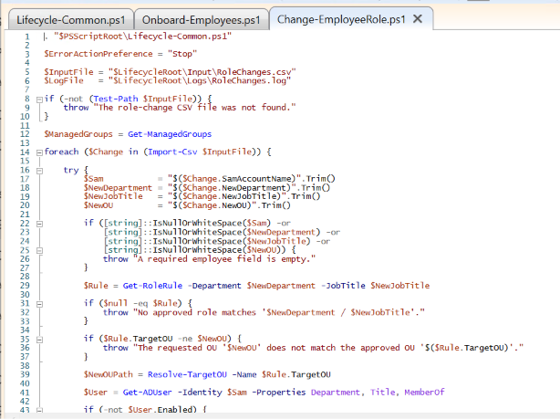

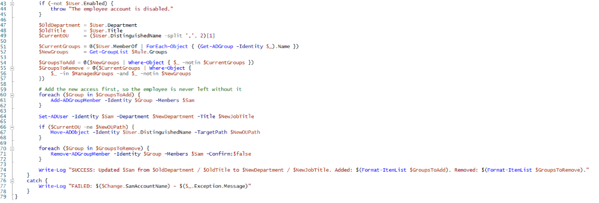

| **Command**          | **Purpose**                                                    |
|----------------------|----------------------------------------------------------------|
| Get-ADUser           | Reads the account's current attributes and groups              |
| Add-ADGroupMember    | Grants the new role's groups                                   |
| Set-ADUser           | Updates department and job title                               |
| Move-ADObject        | Moves the account to the new OU, skipped if it's already there |
| Remove-ADGroupMember | Removes managed groups that the new role doesn't include       |

### Task 18: Run the Role Change and Verify

1.  Run:

```powershell
C:\Employee-Lifecycle\Scripts\Change-EmployeeRole.ps1
```

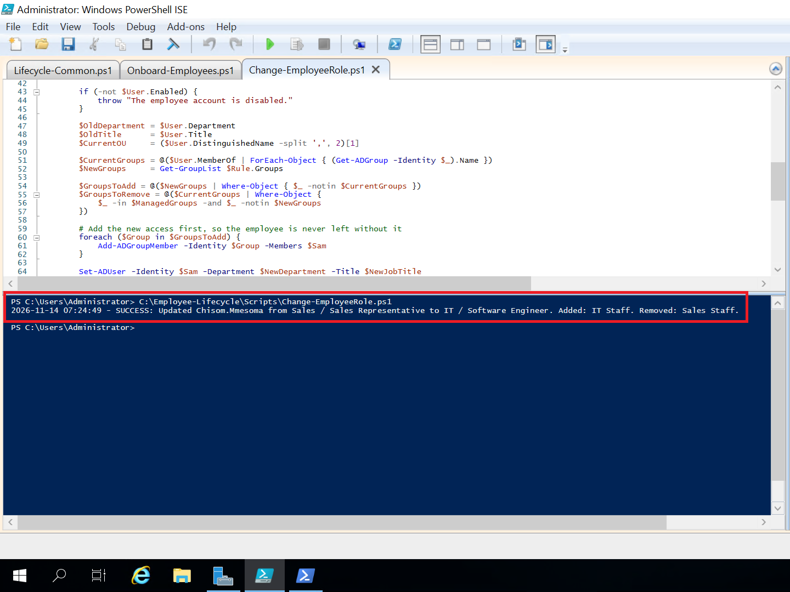

2.  Verify the attributes and location:

```powershell
Get-ADUser -Filter "Name -like 'Chisom*'" -Properties Department, Title |

Select-Object Name, Department, Title, DistinguishedName
```

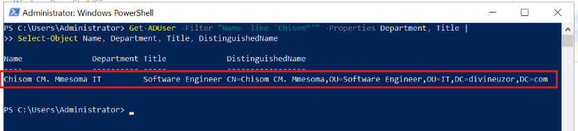

3.  Verify the groups:

```powershell
Get-ADGroupMember "IT Staff" | Select-Object Name

Get-ADGroupMember "Sales Staff" | Select-Object Name

Get-ADGroupMember "GPO-Pilot-Users" | Select-Object Name
```

Chisom should now be in IT Staff and no longer in Sales Staff. Any membership in GPO-Pilot-Users is unchanged.

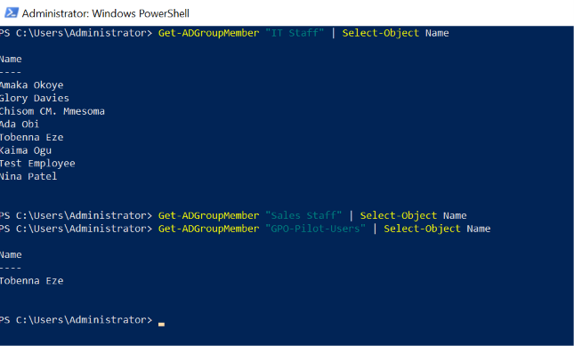

4.  Read the log:

```powershell
Get-Content "C:\Employee-Lifecycle\Logs\RoleChanges.log"
```

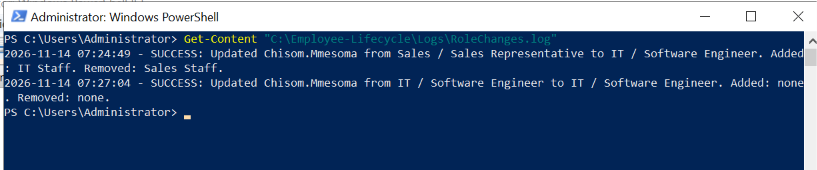

## PART 5: EMPLOYEE OFFBOARDING

### Task 19: Create the Disabled Users OU

Departing employees' accounts are kept for review instead of being deleted.

```powershell
New-ADOrganizationalUnit -Name "Disabled Users" -Path "DC=divineuzor,DC=com"

Get-ADOrganizationalUnit -Identity "OU=Disabled Users,DC=divineuzor,DC=com" |

Select-Object Name, DistinguishedName, ProtectedFromAccidentalDeletion
```

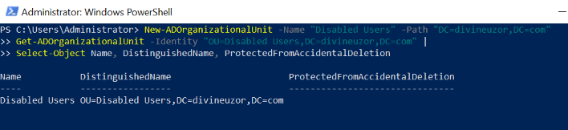

Open **Active Directory Users and Computers** and refresh to see the new OU at the root.

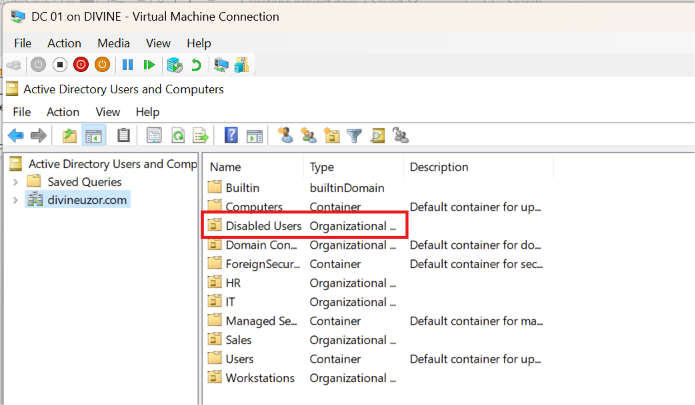

### Task 20: Create the Offboarding Script

The script only processes accounts inside the HR, IT, and Sales OUs. It disables the account, removes managed groups, records the reason on the account, and moves it to Disabled Users.

1.  Create a file named Offboard-Employees.ps1 in C:\Employee-Lifecycle\Scripts.

2.  Enter:

```powershell
. "$PSScriptRoot\Lifecycle-Common.ps1"

$ErrorActionPreference = "Stop"

$InputFile = "$LifecycleRoot\Input\Offboarding.csv"

$LogFile = "$LifecycleRoot\Logs\Offboarding.log"

$DisabledOU = "OU=Disabled Users,$DomainDN"

$EmployeeOUs = @("OU=HR,$DomainDN", "OU=IT,$DomainDN", "OU=Sales,$DomainDN")

if (-not (Test-Path $InputFile)) {

throw "The offboarding CSV file was not found."

}

if (-not (Get-ADOrganizationalUnit -Filter "DistinguishedName -eq '$DisabledOU'")) {

throw "The Disabled Users OU was not found."

}

$ManagedGroups = Get-ManagedGroups

foreach ($Departure in (Import-Csv $InputFile)) {

try {

$Sam = "$($Departure.SamAccountName)".Trim()

if ([string]::IsNullOrWhiteSpace($Sam)) {

throw "The employee account name is missing."

}

$Reason = "$($Departure.Reason)".Trim()

if ([string]::IsNullOrWhiteSpace($Reason)) { $Reason = "Not recorded" }

$User = Get-ADUser -Identity $Sam -Properties Department, Title, MemberOf

if (-not $User.Enabled) {

throw "The employee account is already disabled."

}

$InEmployeeOU = $false

foreach ($OU in $EmployeeOUs) {

if ($User.DistinguishedName.EndsWith(",$OU", [System.StringComparison]::OrdinalIgnoreCase)) {

$InEmployeeOU = $true

}

}

if (-not $InEmployeeOU) {

throw "The account is not located in an approved employee OU."

}

$GroupsToRemove = @($User.MemberOf |

ForEach-Object { (Get-ADGroup -Identity $\_).Name } |

Where-Object { $\_ -in $ManagedGroups })

Disable-ADAccount -Identity $Sam

foreach ($Group in $GroupsToRemove) {

Remove-ADGroupMember -Identity $Group -Members $Sam -Confirm:$false

}

Set-ADUser -Identity $Sam -Description "Offboarded $(Get-Date -Format 'yyyy-MM-dd'): $Reason"

Move-ADObject -Identity $User.DistinguishedName -TargetPath $DisabledOU

Write-Log "SUCCESS: Disabled $Sam. Department: $($User.Department). Job title: $($User.Title). Removed groups: $(Format-ItemList $GroupsToRemove). Reason: $Reason."

}

catch {

Write-Log "FAILED: $($Departure.SamAccountName) - $($\_.Exception.Message)"

}

}
```


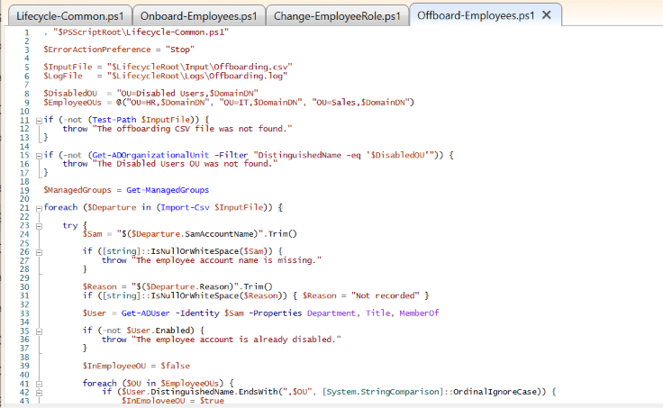

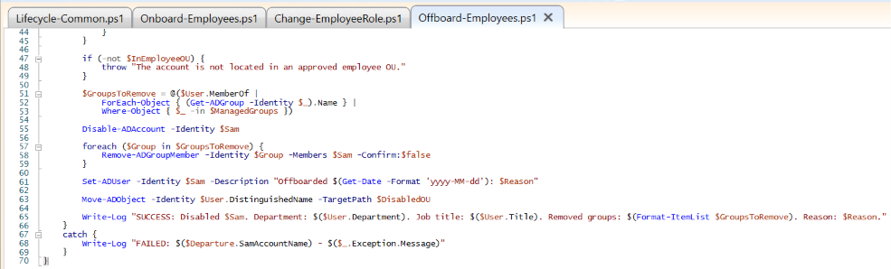


| **Command**             | **Purpose**                                |
|-------------------------|--------------------------------------------|
| Disable-ADAccount       | Stops the employee signing in              |
| Remove-ADGroupMember    | Revokes managed group access               |
| Set-ADUser -Description | Records the date and reason on the account |
| Move-ADObject           | Moves the account to Disabled Users        |

### Task 21: Run the Offboarding and Verify

1.  Record the account before the change:

```powershell
Get-ADUser -Identity "testemployee" -Properties Enabled, MemberOf |

Select-Object Name, Enabled, DistinguishedName, MemberOf
```


2.  Run the script:

```powershell
C:\Employee-Lifecycle\Scripts\Offboard-Employees.ps1
```


3.  Verify the status, location, and description:

```powershell
Get-ADUser -Identity "testemployee" -Properties Enabled, Description |

Select-Object Name, Enabled, Description, DistinguishedName
```


4.  Verify the group removal:

```powershell
Get-ADGroupMember "IT Staff" | Select-Object Name

Get-ADGroupMember "CLOUD ENG" | Select-Object Name
```


5.  Read the log:

```powershell
Get-Content "C:\Employee-Lifecycle\Logs\Offboarding.log"
```


## PART 6: AUDIT LOGS AND REPORTING

### Task 22: Review the Audit Logs

1.  Open C:\Employee-Lifecycle\Logs and confirm the three logs exist.


2.  Display them:

```powershell
Get-Content "C:\Employee-Lifecycle\Logs\Onboarding.log"

Get-Content "C:\Employee-Lifecycle\Logs\RoleChanges.log"

Get-Content "C:\Employee-Lifecycle\Logs\Offboarding.log"
```


No password appears in any log.

### Task 23: Create the Final Inventory Report

Run the same report as the baseline, with a new file name:

```powershell
$ReportPath = "C:\Employee-Lifecycle\Reports\Employee-Inventory-After.csv"

Get-ADUser -Filter * -Properties Department, Title, Enabled, MemberOf |

Where-Object {

$\_.SamAccountName -notin @("Administrator","Guest","DefaultAccount") -and

$\_.SamAccountName -notlike "krbtgt*"

} |

Select-Object Name, SamAccountName, Department, Title, Enabled,

@{Name="OU"; Expression={ ($\_.DistinguishedName -split ',', 2)[1] }},

@{Name="Groups"; Expression={

($\_.MemberOf | ForEach-Object { ($\_ -split ',')[0] -replace '^CN=','' }) -join '; '

}} |

Export-Csv -Path $ReportPath -NoTypeInformation
```

Run the following script to display both reports formatted neatly as tables:

```powershell
Write-Host "=== EMPLOYEE INVENTORY BEFORE ===" -ForegroundColor Cyan

Import-Csv "C:\Employee-Lifecycle\Reports\Employee-Inventory-Before.csv" | Format-Table -AutoSize

Write-Host "=== EMPLOYEE INVENTORY AFTER ===" -ForegroundColor Green

Import-Csv "C:\Employee-Lifecycle\Reports\Employee-Inventory-After.csv" | Format-Table -AutoSize
```


## PART 7: REPLICATION AND CLIENT VALIDATION

### Task 24: Verify Replication on DC02

DC02 receives changes from DC01 through replication. Changes made on DC01 should appear there.

1.  On DC01, ask DC02 to pull the changes and then check the result:

```powershell
repadmin /replicate DIVINE-DC02 DIVINE-DCO1 "DC=divineuzor,DC=com"

repadmin /showrepl DIVINE-DC02repadmin /replsummary
```

2.  On DC02, open PowerShell as administrator and run:

```powershell
Import-Module ActiveDirectory

Get-ADUser -Filter * -Properties Department, Title, Enabled |

Where-Object {

$\_.SamAccountName -notin @("Administrator","Guest","DefaultAccount") -and

$\_.SamAccountName -notlike "krbtgt*"

} |

Select-Object Name, SamAccountName, Department, Title, Enabled, DistinguishedName |

Format-Table -AutoSize
```


Confirm that Nina Patel, Chisom's new details, and the disabled Test Employee in Disabled Users all appear.

DC02 is a standard domain controller, so the client can be signed in by either DC01 or DC02. That is why replication is forced and checked before the client tests. If DC02 had not yet received the changes, a sign-in served by DC02 could give a result that does not match DC01.

### Task 25: Test the Employees from the Windows Client

#### Check the client

On the Windows 10 client, sign in as a domain administrator and run:

```powershell
ipconfig /all
```


```powershell
ping 192.168.6.1

nslookup divineuzor.com
```


#### The new employee:

1.  Sign out. At the sign-in screen, select Other user and enter DIVINEUZOR\npatel with the temporary password.

2.  Set a new password when Windows requires it.

3.  Open Command Prompt and run:

```powershell
Whoami
```


```powershell
whoami /groups
```


#### The employee whose role changed

1.  Sign out, and sign in again as Chisom. A new sign-in is needed, because an existing session keeps its old group information.

2.  Run whoami /groups.


3.  Open File Explorer and go to \\DIVINE-DCO1\IT Projects. It now opens, because she is in IT Staff. She can read it, but creating a file fails, because the share permission is Read only (Lab 9).


4.  Go to \\DIVINE-DCO1\Sales-Docs. Windows now refuses access.


In Task 10, the results were the other way round.

#### The employee who left:

1.  Sign out, and try to sign in as DIVINEUZOR\testemployee with the password you set in Task 8.

2.  Windows rejects the sign-in because the account is disabled.


3.  On DC01, confirm it:

```powershell
Get-ADUser -Identity "testemployee" | Select-Object Name, Enabled
```


Keep the client connected to the domain for this test. Cached credentials and offline sign-in can give misleading results.

## PART 8: FINAL VALIDATION AND TROUBLESHOOTING

### Task 26: Validate the Final State

1.  List the active employees:

```powershell
Get-ADUser -Filter 'Enabled -eq $true' -Properties Department, Title |

Where-Object {

$\_.DistinguishedName -like "*OU=HR,*" -or

$\_.DistinguishedName -like "*OU=IT,*" -or

$\_.DistinguishedName -like "*OU=Sales,*"

} |

Select-Object Name, SamAccountName, Department, Title, DistinguishedName
```


2.  List the disabled employees:

```powershell
Get-ADUser -Filter 'Enabled -eq $false' -SearchBase "OU=Disabled Users,DC=divineuzor,DC=com" |

Select-Object Name, SamAccountName, Enabled, DistinguishedName
```


3.  Review the managed groups:

```powershell
Get-ADGroupMember "IT Staff" | Select-Object Name

Get-ADGroupMember "CLOUD ENG" | Select-Object Name

Get-ADGroupMember "Sales Staff" | Select-Object Name
```


4.  In Active Directory Users and Computers, expand the OUs and confirm Nina is in Cloud Engineer, Chisom is in Software Engineer, the leaver is in Disabled Users, and the original structure is intact.


### Task 27: Troubleshooting

| **Problem**                                                 | **Possible cause**                                     | **Resolution**                                                     |
|-------------------------------------------------------------|--------------------------------------------------------|--------------------------------------------------------------------|
| Active Directory commands are not recognized                | The module is not available or not imported            | Run Import-Module ActiveDirectory, and work on a domain controller |
| "The role matrix file was not found"                        | Wrong path or file name                                | Check C:\Employee-Lifecycle\Config\RoleMatrix.csv                  |
| A request fails with "does not match the approved OU"       | The TargetOU in the CSV differs from the matrix        | Correct the CSV so it matches the matrix                           |
| "The OU does not exist"                                     | A misspelled OU name, or the OU is missing             | Compare with Get-ADOrganizationalUnit -Filter *                   |
| The seed script says it found more or fewer than one Chisom | No account, or several accounts, match                 | Check with Get-ADUser -Filter "Name -like 'Chisom*'"              |
| "The account name already exists"                           | A duplicate SamAccountName or UPN                      | Review the existing account before retrying                        |
| Account creation fails with a password error                | The temporary password doesn't meet the domain policy  | Use a longer, more complex password                                |
| A PARTIAL entry in the log                                  | The account was created but a group could not be added | Check the group names, then add the groups manually                |
| Offboarding says "not in an approved employee OU"           | The account is outside HR, IT, and Sales               | Check its location and the request                                 |
| Offboarding says the Disabled Users OU was not found        | Task 19 was skipped                                    | Create the OU first                                                |
| Share access doesn't change after the role change           | The old sign-in session is still active                | Sign out and sign in again                                         |
| Replication shows errors                                    | DNS, network, or replication problems                  | Review repadmin /showrepl and /replsummary, and run dcdiag         |
| The client can't sign in                                    | DNS, connectivity, or account status                   | Check DNS, connectivity, and the account's Enabled status          |

To review failures, read the three logs with Get-Content. For domain controller health, run:

```powershell
dcdiag

repadmin /replsummary
```


## 9. Security and Administrative Considerations

This lab uses test accounts in a training domain. A production version would add:

- **Least privilege:** assign only the groups a role approves.

- **Approval:** process only authorized HR requests, and keep the request as evidence.

- **Password protection:** never store passwords in CSV files, scripts, or logs. Deliver temporary passwords through an approved channel.

- **Preview mode:** add a dry run with -WhatIf so changes can be reviewed before they are made.

- **Offboarding scope:** revoke access in other systems too, such as email, VPN, and cloud services.

- **Retention:** follow the organization's policy before deleting disabled accounts.

- **Testing:** try scripts on designated test accounts before real records.

- **Logging:** keep centralized, tamper-resistant logs in addition to local files.

This solution does not replace a full HR provisioning system. It shows the logic such a system must follow.

## 10. Skills Demonstrated

- Windows Server and Active Directory administration (OUs, users, groups, attributes)

- PowerShell automation, CSV-driven processing, validation, and error handling

- Security group, NTFS, and share permission design, tested end to end

- Environment assessment and findings documentation

- Audit logging and reporting

- Read-only domain controller replication verification

- Hyper-V based lab design and documentation

- Testing from a domain-joined client

## 11. Conclusion

In this lab, you automated employee onboarding, role changes, and offboarding in the divineuzor.com domain. A role matrix defined the approved rules, and PowerShell scripts applied them to HR requests, validated the input, rejected duplicates and invalid requests, and logged every operation.

You onboarded a new employee, moved a Sales employee into Software Engineering and revoked her old access, and offboarded a leaver by disabling the account, removing group access, and moving it to a Disabled Users OU. I confirmed the changes on the read-only domain controller, and proved from a Windows client that the new employee could sign in, that the transferred employee lost access to the Sales share and gained access to the IT share, and that the departed employee could not sign in.

## 12. Project Outcome

The project turns routine HR requests into a repeatable, auditable Active Directory process. It shows the full path from assessing an existing environment, through design, automation, and testing, to verification and documentation, which is how I approach a client engagement from start to finish.

This capstone completes the Windows Server series.
